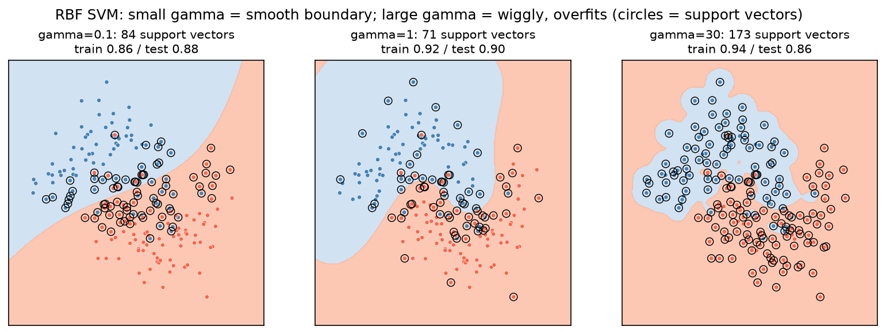

[Machine Learning](../../README.md) › [監督式學習](../README.md) › [分類](README.md) › SVM

# 支持向量機 (Support Vector Machine, SVM)

SVM 找一條不只分開兩類、還**離兩邊最近的點越遠越好**的邊界。這段「留白」叫間隔 (margin)；決定邊界位置的少數點叫支持向量 (support vectors)。搭配 kernel 可以畫出非線性邊界。

| 概念 | 說明 |
| --- | --- |
| 最大間隔 | 間隔越大，對新資料越穩健 |
| 軟間隔 (soft margin) | 容許部分點越界或分錯，`C` 控制容忍度 |
| 支持向量 | 在間隔上或越界的點；其他點移動不影響邊界 |
| Kernel trick | 不必真的把資料映射到高維，就能在高維空間找線性邊界（= 原空間的非線性邊界） |
| 損失 | Hinge loss，見 [損失函數](../../foundations/loss-functions.md) |

## C 與 gamma

| 參數 | 小 | 大 |
| --- | --- | --- |
| `C`（誤分懲罰） | 間隔寬、容許錯誤 → 較平滑（強正則化） | 間隔窄、盡量全分對 → 易過擬合 |
| `gamma`（RBF 每個點的影響範圍） | 影響範圍大 → 邊界平滑 | 影響範圍小 → 邊界圍著個別點打轉 |



`gamma=30` 時邊界圍著藍色點形成一個個小島，需要 173 個支持向量（幾乎一半的訓練點），訓練 accuracy 最高、測試最低。`C` 與 `gamma` 要一起用 CV 調（對數尺度）。

| `kernel` | 邊界 | 何時用 |
| --- | --- | --- |
| `"linear"`（或 `LinearSVC`） | 線性 | 特徵很多（文字、基因表現）；p ≫ n 時常已足夠 |
| `"rbf"`（預設） | 平滑非線性 | 一般首選 |
| `"poly"` | 多項式 | 較少用 |

## 用法

```python
from sklearn.pipeline import make_pipeline
from sklearn.preprocessing import StandardScaler
from sklearn.svm import SVC, LinearSVC
from sklearn.calibration import CalibratedClassifierCV
from sklearn.model_selection import GridSearchCV, StratifiedKFold

# 承乳癌範例；一定要縮放
cv = StratifiedKFold(5, shuffle=True, random_state=0)
search = GridSearchCV(make_pipeline(StandardScaler(), SVC()),
                      {"svc__C": [0.1, 1, 10, 100], "svc__gamma": ["scale", 0.001, 0.01, 0.1]},
                      cv=cv, scoring="roc_auc")          # AUC 用 decision_function，不需要機率
search.fit(X_train, y_train)
search.best_params_                                       # C=10, gamma=0.01；CV AUC 0.994
search.best_estimator_[-1].n_support_                     # [27, 25]：398 筆中只有 52 個支持向量

# 高維 / 大資料：線性 SVM
make_pipeline(StandardScaler(), LinearSVC(C=0.1))         # CV AUC 0.993

# 需要機率時：用 CalibratedClassifierCV 包起來
svm_proba = make_pipeline(StandardScaler(),
                          CalibratedClassifierCV(SVC(C=10, gamma=0.01), ensemble=False, cv=5))
svm_proba.fit(X_train, y_train).predict_proba(X_test)
```

> sklearn 1.9 起 `SVC(probability=True)` 已 deprecated（預計 1.11 移除），官方建議改用 `CalibratedClassifierCV(SVC(), ensemble=False)`。舊做法內部也是 Platt scaling + 5-fold CV，既慢、機率又不一定準。

## 優缺點

| 優點 | 缺點 |
| --- | --- |
| 中小型、高維資料上表現強 | 訓練時間隨樣本數**超過平方成長**（官方文件），**超過數萬筆就很慢** → `LinearSVC`、`SGDClassifier(loss="hinge")` |
| 只依賴支持向量，對遠處的點穩健 | **必須縮放** |
| Kernel 提供彈性的非線性邊界 | `C`、`gamma` 敏感，必須調參 |
| 線性 SVM 適合 p ≫ n | 不直接輸出機率；RBF 模型難解釋 |

| 適合 | 不適合 |
| --- | --- |
| 樣本數百到數萬、特徵多的分類 | 百萬筆以上的資料 |
| 文字、基因表現、光譜等高維資料 | 需要可解釋係數或可信機率的情境 |
| 想要和邏輯斯迴歸、樹模型對照的強 baseline | — |
