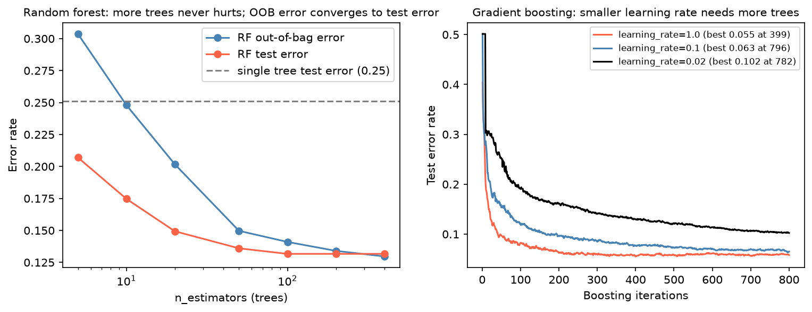

[Machine Learning](../../README.md) › [監督式學習](../README.md) › 集成方法

# 集成方法 (Ensemble Methods)

組合多個模型，讓預測更準或更穩。三大類的差別在**組合的方式**與**主要降低的誤差**（見 [Bias-Variance](../../foundations/bias-variance-tradeoff.md)）。

| 類型 | 做法 | 主要降低 | 基本模型 | 筆記 |
| --- | --- | --- | --- | --- |
| Bagging | 在 bootstrap 樣本上**平行**訓練多個模型，平均 / 投票 | 變異 | 深樹（高變異、低偏誤） | [Bagging](bagging.md)、[隨機森林](random-forest.md) |
| Boosting | **依序**訓練，每個新模型修正前面的錯誤 | 偏誤（也降變異） | 淺樹（弱學習器） | [AdaBoost](adaboost.md)、[Gradient Boosting](gradient-boosting.md)、[XGBoost](xgboost.md) |
| 異質組合 | 不同類型的模型投票或由第二層模型組合 | 視情況 | 任意 | [Voting](voting.md)、[Stacking](stacking.md) |

左：隨機森林的樹越多，誤差單調下降後持平（單棵樹 0.25 → 森林 0.13），**樹多不會過擬合**，只是變慢。右：Boosting 的學習率越小，需要越多輪才收斂；輪數是要調的參數（early stopping）。

## 乳癌資料的實際比較

5-fold CV AUC（訓練集 398 筆、30 個特徵）：

| 模型 | CV AUC |
| --- | --- |
| SVM (RBF) | 0.993 |
| Stacking（RF + SVM + KNN → 邏輯斯） | 0.993 |
| **邏輯斯迴歸** | **0.992** |
| Soft voting | 0.992 |
| AdaBoost、XGBoost、LightGBM | 0.991–0.992 |
| Extra Trees、隨機森林、Gradient Boosting、HistGB | 0.983–0.991 |
| Bagging（決策樹） | 0.981 |
| 單棵決策樹 | 0.912 |

> 集成方法對**單棵樹**是巨大改進（0.91 → 0.98+），但在這份近乎線性可分的小資料上，沒有一個集成方法明顯勝過邏輯斯迴歸。集成的價值在大型、非線性、有交互作用的表格資料上才明顯。

## 怎麼選

| 情境 | 首選 |
| --- | --- |
| 表格資料、想少調參、要穩健預設 | [隨機森林](random-forest.md) |
| 表格資料、要最高分、願意調參 | [HistGradientBoosting / XGBoost / LightGBM](gradient-boosting.md) |
| 已有幾個表現相近但不同類型的模型 | [Soft voting](voting.md) → 再試 [Stacking](stacking.md) |
| 單一不穩定的非樹模型 | [Bagging](bagging.md) |

## 提醒

| 提醒 | 原因 |
| --- | --- |
| 先和單一強 baseline 比 | 增加的複雜度不一定值得 |
| 流程若有洩漏或不穩，集成只會**掩蓋**問題 | 先把 [工作流程](../../workflow/README.md) 弄對 |
| 部署與解釋成本變高 | 模型大、推論慢、難解釋 |
| 搭配錯誤分析與診斷 | 見 [錯誤分析](../../evaluation/baselines-and-error-analysis.md)、[模型診斷](../../interpretability-and-diagnostics/model-diagnostics.md) |
