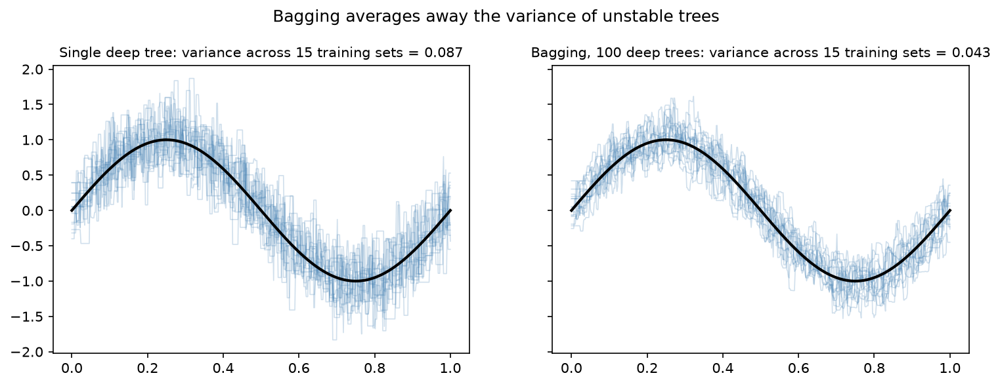

[Machine Learning](../../README.md) › [監督式學習](../README.md) › [集成方法](README.md) › Bagging

# Bagging (Bootstrap Aggregating)

對訓練資料做多次 [bootstrap](../../../statistics/probability-and-distributions/monte-carlo-simulation.md#拔靴法-bootstrap)（有放回抽樣），每份樣本訓練一個模型，最後平均（迴歸）或投票（分類）。平均能抵銷各模型的隨機誤差，**主要降低變異**，對高變異的模型（深決策樹）最有效。

```
訓練資料 ──bootstrap──► 樣本 1 → 模型 1 ┐
         ──bootstrap──► 樣本 2 → 模型 2 ├─► 平均 / 投票 → 預測
         ──bootstrap──► 樣本 B → 模型 B ┘
```



在 15 份不同的訓練資料上重新配適：單棵深樹的預測曲線彼此差很多（變異 0.087）；100 棵樹的 bagging 曲線集中得多（變異 0.043）。

## Out-of-Bag (OOB) 評估

每份 bootstrap 樣本約有 $1 - (1 - 1/n)^n \approx 63.2\%$ 的不重複原始資料，剩下約 36.8% 沒被抽到（out-of-bag）。每筆資料用「沒看過它的那些模型」預測，就得到免費的驗證分數。

```python
from sklearn.ensemble import BaggingClassifier, BaggingRegressor
from sklearn.tree import DecisionTreeClassifier

# 承乳癌範例
bag = BaggingClassifier(estimator=DecisionTreeClassifier(),   # sklearn ≥ 1.2 用 estimator（舊名 base_estimator 已在 1.4 移除）
                        n_estimators=200,
                        max_samples=1.0,       # 每份 bootstrap 樣本的大小（比例）
                        max_features=1.0,      # 每個模型使用的特徵比例（< 1 = random subspace）
                        bootstrap=True,        # False = pasting（不放回）
                        oob_score=True,        # 需要 bootstrap=True
                        n_jobs=-1, random_state=0)
bag.fit(X_train, y_train)
bag.oob_score_                  # 0.952（OOB accuracy）
bag.score(X_test, y_test)       # 0.965
```

| 參數 | 說明 |
| --- | --- |
| `estimator` | 基本模型；預設決策樹 |
| `n_estimators` | 模型數；越多越穩定，不會過擬合，只是更慢 |
| `max_samples` / `max_features` | 每個模型用多少樣本 / 特徵；越小越多樣、相關越低 |
| `bootstrap` | `False` 時為 pasting；**不能和 `oob_score=True` 一起用** |

> OOB 分數是方便的內部估計，但在模型數少時偏悲觀（每筆只被少數模型預測），且不能取代保留的測試集或用於比較不同的前處理流程。

## 特性

| 特性 | 說明 |
| --- | --- |
| 降變異、不降偏誤 | 基本模型太簡單（欠擬合）時，bagging 幫不上忙 |
| 對穩定模型效果小 | 線性迴歸、KNN（大 k）本身變異低，bagging 幾乎沒差 |
| 可平行化 | 各模型獨立訓練（`n_jobs=-1`） |
| 樹之間仍相關 | 每棵樹都會優先用最強的特徵切 → [隨機森林](random-forest.md) 再加上特徵隨機性降低相關 |

乳癌資料：單棵樹 CV AUC 0.912 → Bagging 0.981 → 隨機森林 0.986。
