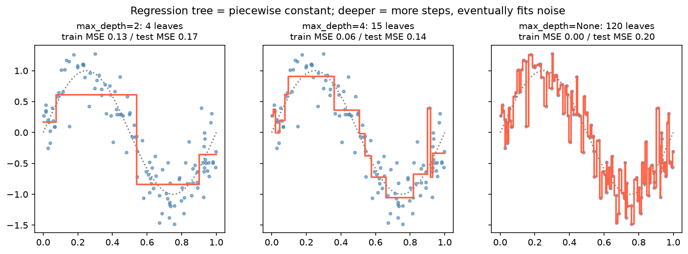

[Machine Learning](../../README.md) › [監督式學習](../README.md) › [迴歸](README.md) › 迴歸樹

# 迴歸樹 (Decision Tree Regression)

迴歸樹把特徵空間切成很多矩形區塊，每個區塊預測一個常數（該區塊訓練資料 y 的平均）。切分規則、剪枝與可解釋性和 [分類樹](../classification/decision-tree.md) 相同，差別在分裂準則與輸出。

| | 分類樹 | 迴歸樹 |
| --- | --- | --- |
| 葉節點輸出 | 類別比例 / 多數類別 | y 的平均（或中位數） |
| 分裂準則 `criterion` | `gini`、`entropy`、`log_loss` | `squared_error`、`absolute_error`、`friedman_mse`、`poisson` |
| sklearn | `DecisionTreeClassifier` | `DecisionTreeRegressor` |



預測是**階梯狀**：深度 2 只有 4 階，抓到大致形狀；深度 4 較貼近真實曲線，測試 MSE 最低；不限深度時每個訓練點自成一葉，訓練 MSE = 0、測試 MSE 反而最高。

## 用法

```python
from sklearn.tree import DecisionTreeRegressor
from sklearn.model_selection import GridSearchCV, KFold

# 承 diabetes 切分
search = GridSearchCV(DecisionTreeRegressor(random_state=0),
                      {"max_depth": [1, 2, 3, 4, 6, 10, None], "min_samples_leaf": [1, 5, 10, 20]},
                      cv=KFold(5, shuffle=True, random_state=0), scoring="neg_root_mean_squared_error")
search.fit(X_train, y_train)
```

diabetes 上不同深度的 CV RMSE：

| `max_depth` | 1 | 2 | 3 | 4 | 6 | 10 | 不限 |
| --- | --- | --- | --- | --- | --- | --- | --- |
| CV RMSE | 69.2 | **64.1** | 66.5 | 68.5 | 72.7 | 80.4 | 78.7 |

最佳的單棵樹 (64.1) 仍明顯輸給線性迴歸 (54.9)：資料以線性關係為主、樣本又少時，單棵樹的階梯近似很吃虧。

## 特性

| 優點 | 缺點 |
| --- | --- |
| 自動抓非線性與交互作用 | 預測不連續（階梯狀），無法外推到訓練範圍之外 |
| 不需縮放、可處理 NaN（新版 sklearn） | 單棵樹變異很大，資料稍變結構就改變 |
| 淺樹可直接讀成規則 | 深樹極易 [過擬合](../../foundations/overfitting-underfitting.md) |
| `criterion="poisson"` 可處理計數目標 | 通常輸給 [隨機森林](../ensemble/random-forest.md)、[Gradient Boosting](../ensemble/gradient-boosting.md) |

> 實務上很少單獨使用迴歸樹，它主要是集成方法的基本單元。要可解釋的非線性模型，可考慮淺樹、廣義加法模型 (GAM)，或樹模型 + [SHAP](../../interpretability-and-diagnostics/model-interpretability.md)。
