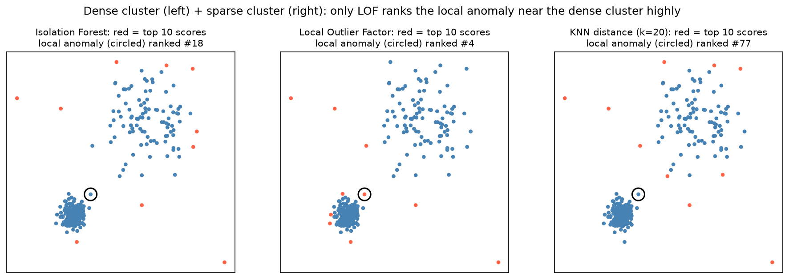

[Machine Learning](../../README.md) › [非監督式學習](../README.md) › [異常偵測](README.md) › Isolation Forest

# 隔離森林 (Isolation Forest)

核心想法：**異常點比正常點容易被隔離**。反覆隨機挑一個特徵、在其範圍內隨機選切點，直到每個點都被單獨分開。遠離主體的點只需要很少次切分就會被隔離，所以平均路徑長度越短，異常分數越高。

| 觀測類型 | 平均路徑長度 |
| --- | --- |
| 在密集區域的正常點 | 長（要切很多次才能孤立） |
| 孤立的異常點 | 短 |

它不計算點與點之間的距離，所以比 KNN / LOF 快得多，也適合高維資料。

## 用法

```python
from sklearn.ensemble import IsolationForest

iso = IsolationForest(n_estimators=200,       # 樹數；越多分數越穩定
                      max_samples="auto",     # 每棵樹抽樣 min(256, n) 筆
                      max_features=1.0,       # 寬表格可降低
                      contamination="auto",   # 或指定比例，如 0.01
                      random_state=42, n_jobs=-1)
iso.fit(X_train)
scores = -iso.score_samples(X_new)            # 越大越異常（原始分數越負越異常）
labels = iso.predict(X_new)                   # 1 = 正常、-1 = 異常
```

| 參數 | 作用 |
| --- | --- |
| `n_estimators` | 樹數，100–300 通常足夠 |
| `max_samples` | 每棵樹的樣本數；小樣本反而容易隔離異常（原論文建議 256） |
| `max_features` | 每棵樹用的特徵比例 |
| `contamination` | 只決定 `predict` 的閾值：`score_samples` 與排序完全不變，`decision_function` 只是整體平移 |

> pyod 套件（`pyod.models.iforest.IForest`）提供相同的演算法與統一介面（`decision_scores_`、`labels_`），方便比較多種偵測器；sklearn 版本已足夠日常使用。

## 優缺點

| 優點 | 缺點 |
| --- | --- |
| 快、可擴展到大資料 | 對**局部異常**（緊鄰密集群的點）不敏感 |
| 高維表格資料表現好 | 閾值仍是獨立的問題 |
| 自然處理多變量異常 | 特徵品質仍然重要；對縮放不像距離法那麼敏感，但不是完全不受影響 |
| 不需距離矩陣 | 資料組成改變時分數會跟著變 |
| — | 不適合本質上是時間序列的異常（需先處理趨勢、季節） |



緊鄰密集群的局部異常（圈起來的點）：Isolation Forest 排第 18 名，LOF 排第 4 名。全域孤立的點兩者都抓得到。比較見 [距離與密度方法](distance-density.md)。
