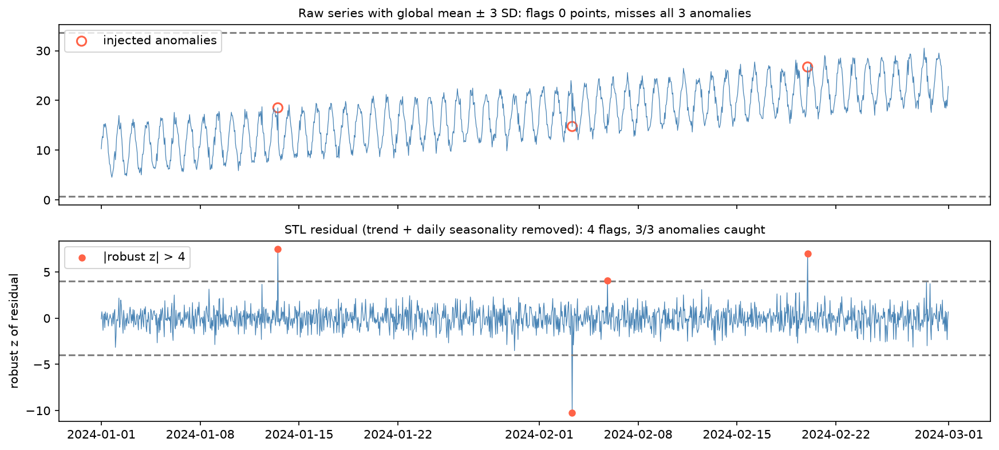

[Machine Learning](../../README.md) › [非監督式學習](../README.md) › [異常偵測](README.md) › 時間序列異常

# 時間序列異常 (Time-Series Anomalies)

時間序列的問題不是「這個值大不大」，而是「**這個值在這個時間點**是否不尋常」。週一的高流量、節慶期間的高銷售、成長期的高數值都可能完全正常；忽略時間結構，季節性本身就會被誤判成異常。

## 為什麼全域門檻會失敗



模擬：60 天的每小時資料，有趨勢 + 每日週期 + 雜訊，注入 3 個異常。

| 方法 | 結果 |
| --- | --- |
| 全域平均 ± 3 SD | 0 個標記，**3 個異常全漏掉**：每日週期與趨勢讓 SD 很大，異常值仍在範圍內 |
| STL 分解後，對殘差做穩健 z-score（\|z\| > 4） | 4 個標記，3 個異常全抓到，1 個偽陽性 |

| 全域門檻的問題 | 說明 |
| --- | --- |
| 基準會漂移 | 趨勢讓早期與晚期的「正常」不同 |
| 變異隨時間改變 | 不同季節、不同時段的波動不同 |
| 自相關 | 連續觀測不獨立，簡單統計門檻的假設不成立 |

> 全域 z-score 適合當初步篩檢，不適合當最終的異常邏輯。

## 殘差法：先建「預期值」，再看偏離

$$
\text{觀測值} = \text{趨勢} + \text{季節性} + \text{殘差}
$$

趨勢吸收緩慢變化、季節性吸收重複結構，殘差留下真正意外的部分。

```python
import numpy as np
import pandas as pd
from statsmodels.tsa.seasonal import STL

# 1. 時間索引
df["Date"] = pd.to_datetime(df["Date"])
s = df.set_index("Date")["value"].asfreq("h")

# 2. STL 分解：period = 一個季節週期的長度（每小時資料、每日週期 → 24）
res = STL(s, period=24, seasonal=25, robust=True).fit().resid
# seasonal 是季節平滑的視窗（奇數）；robust=True 降低異常值對分解本身的影響

# 3. 殘差的穩健 z-score（中位數與 MAD，不被異常值拉走）
mad = 1.4826 * (res - res.median()).abs().median()
robust_z = (res - res.median()) / mad
anomalies = robust_z.abs() > 4

# 簡化版：滾動中位數當基準
baseline = s.rolling(24 * 7, center=True, min_periods=24).median()
```

> 參數會影響結果：同一份資料用 `robust=True` 搭配預設 `seasonal=7` 時，殘差的 MAD 被壓得太小，|z| > 4 會標出 29 個點；改用 `seasonal=25` 只有 4 個。上線前要用已知事件校正閾值。分解方法的細節見 [時間序列分解](../../../statistics/time-series-analysis/decomposition.md#classical-vs-stl)。

| 建立預期值的方法 | 適合 |
| --- | --- |
| 滾動平均 / 中位數 | 簡單、無明顯季節性 |
| STL 分解 | 有穩定季節週期 |
| 預測模型（ARIMA、Prophet、ML） | 有多重季節、節日效應；殘差 = 實際 − 預測，見 [ARIMA](../../../statistics/time-series-analysis/arima.md) |
| 日曆特徵 + 一般模型 | 星期、月份、節日等情境 |

```python
# 日曆特徵：讓模型知道「什麼時候」
df["day_of_week"] = df.index.dayofweek
df["hour"] = df.index.hour
df["month"] = df.index.month
```

## 感測器 / IoT 資料：統計異常 ≠ 營運事件

不尋常的值可能來自：感測器故障、封包遺失或延遲、裝置重啟，或是真實的環境 / 製程改變。要同時問兩個問題：**統計上不尋常嗎？**和**營運上有意義嗎？**許多遙測「異常」其實是資料品質事件。

## 有標籤之後：變成監督式告警

| 沒有標籤 | 有標籤（如每個時間窗標記正常 / 異常） |
| --- | --- |
| 從結構偵測不尋常行為 | 訓練分類器預測已知的告警狀態 |
| 評估靠專家審查 | 標準的 [不平衡分類](../../evaluation/class-imbalance.md) 問題 |

監督式時要注意：標籤品質、類別不平衡、**依時間切分**避免洩漏（見 [交叉驗證](../../workflow/cross-validation.md)）、標籤標的是根因、症狀還是下游告警。

## 多方法並用

困難的序列常同時比較：鄰域型偵測器、隔離型偵測器、殘差門檻。多個方法同意的點，通常比單一分數更值得優先審查。
