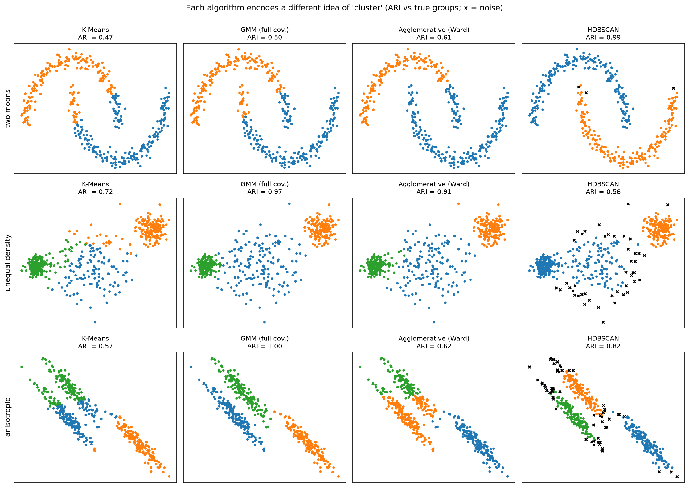

[Machine Learning](../../README.md) › [非監督式學習](../README.md) › 分群

# 分群 (Clustering)

沒有標籤時，依相似度把觀測分組。不同演算法對「群」的定義完全不同，所以**沒有一個方法到處都最好**。統計觀點的完整說明（評估指標、連結方法、群的描述）見 [統計：分群](../../../statistics/multivariate-analysis/clustering.md)；這裡著重 ML 實作與方法選擇。



| 資料形狀 | 最佳 | 失敗的 | 原因 |
| --- | --- | --- | --- |
| 兩彎月（非凸） | HDBSCAN (ARI 0.99) | K-Means、GMM（約 0.5） | 以中心 / 高斯為基礎的方法只能畫凸形邊界 |
| 密度不均 | GMM (0.97)、Ward (0.91) | HDBSCAN (0.56) | 稀疏的群被密度法判成雜訊 |
| 拉長（非等向） | GMM 完整共變異 (1.00) | K-Means (0.57) | K-Means 假設各群是等大小的球 |

## 筆記

| 筆記 | 群的定義 | 要指定 k？ | 適合 |
| --- | --- | --- | --- |
| [K-Means](kmeans.md) | 離中心最近 | 是 | 大資料、球形且大小相近的群 |
| [階層式](hierarchical.md) | 依連結方法逐步合併 | 否（切樹時決定） | 小到中型資料、想看階層結構（基因 / 樣本熱圖） |
| [DBSCAN / HDBSCAN](dbscan.md) | 高密度的連通區域 | 否 | 任意形狀、有雜訊；空間資料 |
| [高斯混合模型](gaussian-mixture.md) | 機率模型的成分 | 是（可用 BIC 選） | 群重疊、橢圓形、需要軟分配 |

## 評估分群

| 有沒有標籤 | 指標 | sklearn |
| --- | --- | --- |
| 沒有（內部指標） | Silhouette（−1 到 1，越高越好） | `silhouette_score` |
| 沒有 | Davies-Bouldin（越低越好）、Calinski-Harabasz（越高越好） | `davies_bouldin_score`、`calinski_harabasz_score` |
| 有已知分組（只用來驗證） | ARI（調整後 Rand 指數，0 = 隨機、1 = 完全一致） | `adjusted_rand_score` |
| 有已知分組 | NMI（標準化互資訊） | `normalized_mutual_info_score` |
| — | **穩定性**：bootstrap 或子樣本重跑，看分群是否一致 | 自行計算 ARI |

> 內部指標偏好特定形狀：silhouette 偏好凸、分離良好的群，對兩彎月這類形狀會給 DBSCAN 低分，即使它分對了。指標只是參考，最終要看群在領域上是否有意義。

## 工作流程

```
選特徵 → 處理偏態（log）→ 縮放 → (PCA 降維) → 試幾種方法與參數 → 評估 + 穩定性 → 描述各群 → 領域驗證
```

| 資料類型 | 前處理 |
| --- | --- |
| 數值表格 | 標準化；右偏先 log |
| 文字 | TF-IDF 或 embedding，常用 cosine 距離 |
| 混合型（數值 + 類別） | Gower 距離 + 階層式 / PAM，或 K-Prototypes |
| 基因表現 / 單細胞 | 正規化 + log → 選高變異基因 → PCA → KNN 圖 + Leiden / Louvain |

> 單細胞 RNA-seq 的標準分群（Scanpy / Seurat）不是 K-Means，而是在 PCA 空間建 KNN 圖，再用 Leiden 等社群偵測 (community detection) 演算法切圖，見 [網路分析](../../../network-analysis/README.md)。
