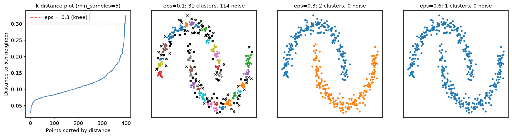

[Machine Learning](../../README.md) › [非監督式學習](../README.md) › [分群](README.md) › DBSCAN / HDBSCAN

# DBSCAN 與 HDBSCAN

DBSCAN (Density-Based Spatial Clustering of Applications with Noise) 把「夠擁擠」的區域連成群，太孤立的點標為**雜訊 (−1)**。不需指定群數，能找任意形狀的群。

| 點的類型 | 定義 |
| --- | --- |
| 核心點 (core) | `eps` 半徑內至少有 `min_samples` 個點（含自己） |
| 邊界點 (border) | 不是核心點，但在某核心點的 `eps` 範圍內 |
| 雜訊點 (noise) | 兩者都不是 → 標籤 −1 |

相連的核心點及其邊界點構成一群。

## 選 eps



| 步驟 | 說明 |
| --- | --- |
| 1. 先標準化 | 距離才有意義 |
| 2. 固定 `min_samples` | 常用 2 × 維度，或 5–10 |
| 3. 畫 k-distance 圖 | 每點到第 k 個鄰居的距離，排序後找急遽上升的「膝點」 |
| 4. `eps` 設在膝點附近 | 圖中約 0.3 |

`eps` 太小（0.1）：碎成 31 群、114 個雜訊點；適中（0.3）：正確的 2 群；太大（0.6）：全部併成 1 群。

## 用法

```python
import numpy as np
from sklearn.cluster import DBSCAN, HDBSCAN
from sklearn.neighbors import NearestNeighbors
from sklearn.preprocessing import StandardScaler

X_scaled = StandardScaler().fit_transform(X)

# 1. k-distance 圖選 eps
d = NearestNeighbors(n_neighbors=5).fit(X_scaled).kneighbors(X_scaled)[0][:, -1]
np.sort(d)              # 畫出來找膝點

# 2. DBSCAN
labels = DBSCAN(eps=0.3, min_samples=5).fit_predict(X_scaled)
n_clusters = len(set(labels) - {-1}); n_noise = (labels == -1).sum()

# 3. HDBSCAN（sklearn ≥ 1.3）：不用選 eps，能處理密度不同的群
labels = HDBSCAN(min_cluster_size=15, copy=True).fit_predict(X_scaled)   # 兩彎月：2 群、5 個雜訊點
```

> sklearn 1.9 會提醒 `HDBSCAN` 的 `copy` 預設值將在 1.10 改變；明確寫 `copy=True` 可避免警告。

## DBSCAN vs HDBSCAN

| | DBSCAN | HDBSCAN |
| --- | --- | --- |
| 主要參數 | `eps`、`min_samples` | `min_cluster_size`（較直覺） |
| 密度不同的群 | **困難**：單一 `eps` 無法同時適合密與疏 | 較好：在多個密度尺度上找穩定的群 |
| 輸出 | 標籤 | 標籤 + 每點的成員機率（`probabilities_`） |
| 速度 | 快 | 稍慢 |

> HDBSCAN 也不是萬能：[分群方法比較圖](README.md) 的「密度不均」資料中，HDBSCAN 把稀疏的那群大量標成雜訊（ARI 0.56），反而是 GMM 最好。

## 優缺點

| 優點 | 缺點 |
| --- | --- |
| 不需指定群數 | 對 `eps` 很敏感 |
| 任意形狀的群 | 密度差異大時表現差 |
| 內建雜訊判定 | 高維時距離失去意義 → 先 PCA |
| 對離群值穩健 | 對縮放敏感 |

## 常見錯誤

| 錯誤 | 說明 |
| --- | --- |
| 把 −1 全當成錯誤資料刪掉 | 可能是真實的少數型態，見 [異常偵測](../anomaly-detection/README.md) |
| 沒標準化 | 距離被單一特徵主導 |
| 群太少就一直調大 `eps` | 最後把不同的群硬併在一起 |
