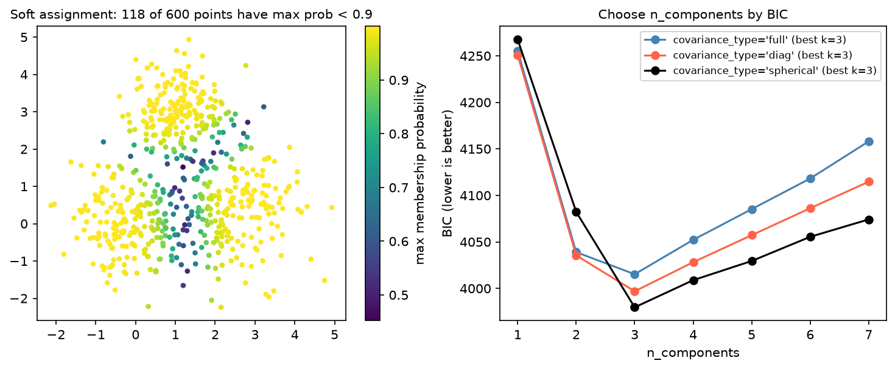

[Machine Learning](../../README.md) › [非監督式學習](../README.md) › [分群](README.md) › 高斯混合模型

# 高斯混合模型 (Gaussian Mixture Model, GMM)

假設資料來自 k 個高斯分配的混合，用 EM 演算法 (Expectation-Maximization) 估計每個成分的平均、共變異與權重。和 [K-Means](kmeans.md) 的關鍵差別是**軟分配**：每個點得到屬於各群的機率。

| | K-Means | GMM |
| --- | --- | --- |
| 分配 | 硬分配（只屬一群） | 軟分配（各群機率） |
| 群形狀 | 球形、大小相近 | 橢圓形，可不同大小與方向（`covariance_type="full"`） |
| 選 k | 手肘 / silhouette | **BIC / AIC**（有概似函數） |
| 關係 | 等於所有成分共用球形共變異、硬分配的 GMM 特例 | — |

## 用法

```python
import numpy as np
from sklearn.mixture import GaussianMixture
from sklearn.preprocessing import StandardScaler

X_scaled = StandardScaler().fit_transform(X)

# 1. 用 BIC 選成分數與共變異型態
bic = {(k, ct): GaussianMixture(k, covariance_type=ct, random_state=0).fit(X_scaled).bic(X_scaled)
       for k in range(1, 8) for ct in ["full", "diag", "spherical"]}
best_k, best_ct = min(bic, key=bic.get)

# 2. 配適與軟分配
gmm = GaussianMixture(n_components=best_k, covariance_type=best_ct, n_init=5, random_state=0).fit(X_scaled)
labels = gmm.predict(X_scaled)
proba = gmm.predict_proba(X_scaled)        # 每列加總 = 1
uncertain = proba.max(axis=1) < 0.9        # 歸屬不確定的點
```



三個重疊的群：600 個點中有 118 個的最大歸屬機率 < 0.9，集中在群的交界。K-Means 會把它們硬分進某一群，GMM 則明確告訴你「這些點不確定」。右圖 BIC 在三種共變異型態下都選出 k = 3。

| `covariance_type` | 群形狀 | 參數量 |
| --- | --- | --- |
| `"full"`（預設） | 任意橢圓 | 最多 |
| `"tied"` | 所有群共用同一個橢圓 | 中 |
| `"diag"` | 軸平行的橢圓 | 少 |
| `"spherical"` | 球形 | 最少 |

## 注意事項

| 注意 | 原因 |
| --- | --- |
| 不要用訓練 log-likelihood 選 k | k 越多一定越高；用 BIC（懲罰參數量） |
| 機率不是「真實」的群別 | 只是在高斯混合假設下的後驗機率 |
| 群明顯非高斯（彎月形）時效果差 | 改用 [DBSCAN / HDBSCAN](dbscan.md) |
| 高維、full 共變異時參數量爆炸 | 先 PCA，或用 `diag` |
| EM 可能收斂到局部最佳 | `n_init` > 1 |

> 其他用途：GMM 也是密度估計器，`score_samples` 給出 log 密度，可用來做 [異常偵測](../anomaly-detection/README.md)（密度很低的點 = 異常）。生資例子：流式細胞術 (flow cytometry) 的自動 gating、拷貝數狀態的分群。
