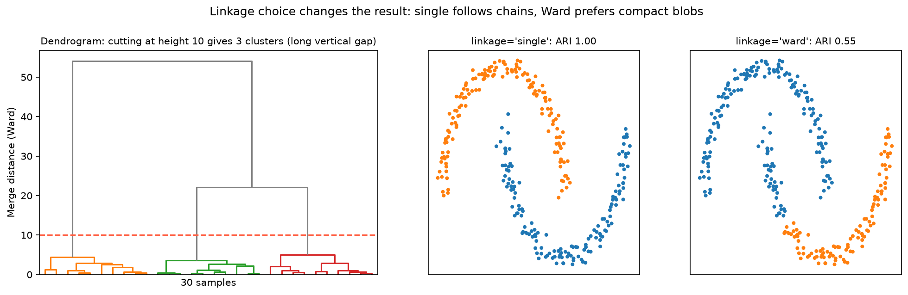

[Machine Learning](../../README.md) › [非監督式學習](../README.md) › [分群](README.md) › 階層式分群

# 階層式分群 (Hierarchical Clustering)

不直接切成 k 群，而是建立一棵合併樹（樹狀圖 dendrogram），再決定在哪個高度切。生資最常見的用法是基因 × 樣本表現量熱圖兩側的樹。

| 方向 | 做法 | 常用度 |
| --- | --- | --- |
| 聚合式 (agglomerative，由下而上) | 每點各自一群 → 反覆合併最近的兩群 | **最常用** |
| 分裂式 (divisive，由上而下) | 全部一群 → 反覆分裂 | 較少 |

## 連結方法 (Linkage)

群與群之間的距離怎麼算：

| Linkage | 定義 | 傾向 |
| --- | --- | --- |
| Single | 兩群最近兩點的距離 | 能沿著細長結構連起來；易產生**鏈結效應 (chaining)** |
| Complete | 最遠兩點的距離 | 緊密、直徑相近的群 |
| Average (UPGMA) | 所有點對的平均距離 | 折衷；系統發生樹常用 |
| Ward | 合併後群內變異增加最少 | 緊密、大小相近的群；**歐氏距離下的好預設** |



左：在高度 10 切樹得到 3 群；切線上方有一段很長的垂直空白，代表這 3 群分得很開。右：同一份兩彎月資料，single linkage 沿著彎月連起來 (ARI 1.00)，Ward 則切成兩個緊密的團塊 (0.55)。資料有雜訊時情況可能相反（single 會把群串在一起），所以 linkage 要依資料試。

## 用法

```python
from scipy.cluster.hierarchy import linkage, dendrogram, fcluster
from sklearn.cluster import AgglomerativeClustering
from sklearn.preprocessing import StandardScaler

X_scaled = StandardScaler().fit_transform(X)

# 1. SciPy：完整的樹，可畫 dendrogram、用兩種方式切
Z = linkage(X_scaled, method="ward")                 # 也可傳入距離矩陣（pdist 結果）
dendrogram(Z, no_labels=True)
labels_h = fcluster(Z, t=10, criterion="distance")   # 依高度切
labels_k = fcluster(Z, t=3, criterion="maxclust")    # 依群數切

# 2. sklearn：只要標籤時
AgglomerativeClustering(n_clusters=3, linkage="ward").fit_predict(X_scaled)
AgglomerativeClustering(n_clusters=None, distance_threshold=10).fit_predict(X_scaled)

# 3. 相關係數距離（基因表現常用：看「形狀」相似而不是絕對量）
Z_corr = linkage(X_scaled, method="average", metric="correlation")
```

標準化 iris 用 Ward 切成 3 群，和真實品種的 ARI 為 0.615（single 0.558、complete 0.573、average 0.562）。

## 讀樹狀圖

| 看什麼 | 意義 |
| --- | --- |
| 合併高度 | 兩群合併時的距離；越高越不相似 |
| 長的垂直空白 | 在這段高度切，群會很穩定 |
| 葉子的左右順序 | **沒有意義**，每個分支都可以翻轉 |
| 依高度切 vs 依群數切 | 兩種切法可能得到不同分組，要明確寫出用哪一種 |

## 優缺點

| 優點 | 缺點 |
| --- | --- |
| 不需事先指定 k | 記憶體 O(n²)（要存距離矩陣），樣本上萬就很吃力 |
| 給出完整的階層結構 | 合併是貪婪的，早期合併錯了無法修正 |
| 可用任意距離（相關、Gower、Jaccard） | 對雜訊與離群值敏感 |
| 結果固定（無隨機初始化） | Linkage 選擇大幅影響結果 |

> Ward 只適用歐氏距離；用相關係數或其他距離時改用 average 或 complete。熱圖分群（`seaborn.clustermap`、R `pheatmap`）預設常是歐氏距離 + complete，記得確認並說明。
