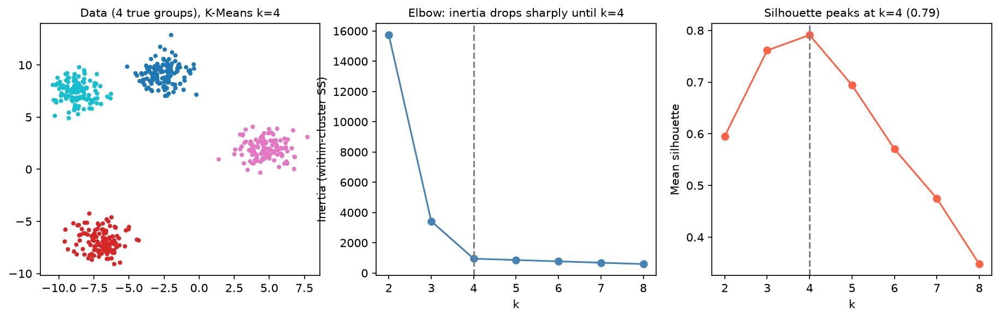

[Machine Learning](../../README.md) › [非監督式學習](../README.md) › [分群](README.md) › K-Means

# K-Means 分群 (K-Means Clustering)

把資料分成 k 群，每個點屬於離它最近的群中心 (centroid)。演算法在「分配點到最近中心」與「中心移到群平均」之間交替，直到不再變動，目標是最小化群內平方和 (inertia)。

$$
\text{inertia} = \sum_{i} \lVert x_i - \mu_{c(i)} \rVert^2
$$

| 概念 | 說明 |
| --- | --- |
| Centroid | 群內所有點的平均位置 |
| Inertia | 群內平方和；越小越緊密，但 **k 越大必然越小**，不能直接拿來選 k |
| Silhouette | 每個點與自己群的距離 vs 與最近他群的距離，−1 到 1 |
| k-means++ | 預設的初始化方式：中心盡量分散，收斂較穩 |

## 用法

```python
import numpy as np
from sklearn.cluster import KMeans
from sklearn.datasets import make_blobs
from sklearn.metrics import silhouette_score
from sklearn.pipeline import make_pipeline
from sklearn.preprocessing import StandardScaler

X, y = make_blobs(n_samples=500, centers=4, cluster_std=1.0, random_state=42)

# 比較不同 k
for k in range(2, 9):
    km = KMeans(n_clusters=k, random_state=0).fit(X)
    km.inertia_, silhouette_score(X, km.labels_)
# k:          2       3      4     5     6
# inertia: 15737   3426    949   862   770   ← 4 之後下降趨緩（手肘）
# silhouette: 0.60  0.76  0.79  0.69  0.57   ← k=4 最高

# 實務：縮放放在 pipeline 內
model = make_pipeline(StandardScaler(), KMeans(n_clusters=4, n_init=10, random_state=0))
labels = model.fit_predict(X)
model[-1].cluster_centers_          # 標準化空間中的中心
model.predict(np.array([[5, 3]]))   # 新資料指派到最近中心
```

> sklearn 1.4 起 `n_init` 預設為 `"auto"`（k-means++ 初始化時只跑 1 次）。結果對初始化敏感時，明確設 `n_init=10` 跑多次取最好的。大資料可用 `MiniBatchKMeans`。

## 選 k



| 方法 | 做法 | 注意 |
| --- | --- | --- |
| 手肘法 (elbow) | inertia vs k，找轉折 | 啟發式；曲線平滑時看不出手肘 |
| Silhouette | 平均 silhouette 最高的 k | 偏好分離明顯的少數群 |
| Gap statistic | 和均勻隨機資料的 inertia 比較 | 計算較多 |
| BIC | 改用 [GMM](gaussian-mixture.md) 時可用 | — |
| 領域知識 | 生物 / 業務上有意義的群數 | 最終仍要看群是否可解釋 |

> 指標會和「真實」分組不一致：標準化 iris 的 silhouette 在 k=2（0.58）比 k=3（0.46）高，因為兩個相近的品種在特徵空間本來就不太分得開。k=3 時和真實品種的 ARI 只有 0.62。

## 假設與限制

| 假設 / 限制 | 後果 | 替代 |
| --- | --- | --- |
| 群是球形、大小相近 | 拉長或大小懸殊的群會被切錯 | [GMM](gaussian-mixture.md)（full 共變異） |
| 必須先指定 k | — | [DBSCAN / HDBSCAN](dbscan.md)、[階層式](hierarchical.md) |
| 對離群值敏感 | 中心被拉走 | K-Medoids、先處理離群值 |
| 只適用歐氏距離與數值特徵 | 類別特徵無意義 | K-Prototypes、Gower + 階層式 |
| 對縮放敏感 | 數值範圍大的特徵主導 | **先標準化** |
| 每個點都會被分進某一群 | 雜訊也被硬分 | DBSCAN（可標為雜訊） |

## 應用：RFM 顧客分群

把交易紀錄壓縮成每位顧客一列的 **RFM** 特徵，再分群：

| 特徵 | 意義 |
| --- | --- |
| Recency | 距最近一次購買幾天 |
| Frequency | 購買次數 |
| Monetary | 消費總額 |

```python
import numpy as np
import pandas as pd
from sklearn.cluster import KMeans
from sklearn.preprocessing import StandardScaler

# 1. 交易 → 每位顧客一列
snapshot_date = orders["InvoiceDate"].max() + pd.Timedelta(days=1)    # 讓 Recency ≥ 1
rfm = orders.groupby("CustomerID").agg(
    Recency=("InvoiceDate", lambda x: (snapshot_date - x.max()).days),
    Frequency=("InvoiceNo", "nunique"),
    Monetary=("Sales", "sum"),
)

# 2. 右偏 → 先 log，再標準化（順序不能反：標準化後會有負值，無法取 log）
rfm = rfm[rfm["Monetary"] > 0]                      # 退貨可能讓總額 ≤ 0，需先處理
X = StandardScaler().fit_transform(np.log(rfm))
rfm["Cluster"] = KMeans(n_clusters=4, n_init=10, random_state=42).fit_predict(X)

# 3. 描述各群：群編號本身沒有意義，profile 才有
profile = rfm.groupby("Cluster").agg(["mean", "size"])
relative = rfm.groupby("Cluster").mean() / rfm.drop(columns="Cluster").mean() - 1   # 相對整體平均
```

| 描述方式 | 用途 |
| --- | --- |
| 各群平均 + 群大小 | 基本 profile |
| Relative importance（群平均 / 整體平均 − 1） | 接近 0 = 與整體相似；大正負值 = 該群的特色 |
| Snake plot（各群標準化特徵的折線） | 視覺比較各群 |

> RFM 不一定要用分群：用分位數打分（每個指標分 1–5 級）常更好解釋、更好操作。K-Means 的優勢是從三個指標的**聯合**分布學出分組。
