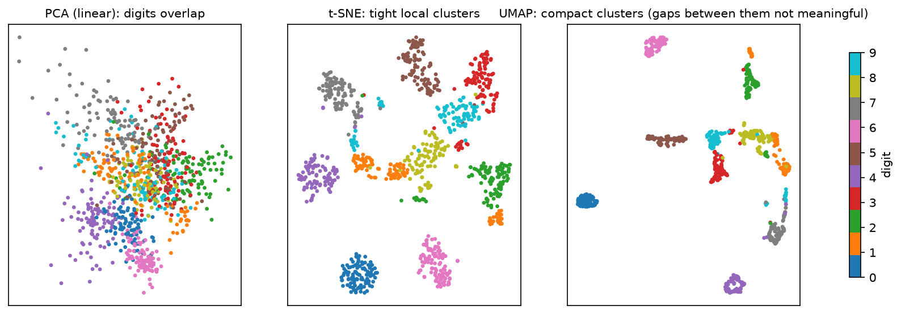

[Machine Learning](../../README.md) › [非監督式學習](../README.md) › 降維

# 降維 (Dimensionality Reduction)

把高維資料壓到少數幾維，同時保留重要結構。用途不同，方法就不同：**建模前的特徵壓縮**用 PCA；**視覺化**用 t-SNE / UMAP；**要可解釋的非負成分**用 NMF。

## 筆記

| 筆記 | 類型 | 保留什麼 | 主要用途 |
| --- | --- | --- | --- |
| [PCA](pca.md) | 線性 | 最大變異方向（全域結構） | 特徵壓縮、降噪、建模前處理、QC 與批次檢查 |
| [t-SNE](tsne.md) | 非線性 | 局部鄰居關係 | 視覺化 |
| [UMAP](umap.md) | 非線性 | 局部鄰居關係（較快） | 視覺化；單細胞分析的標準嵌入 |
| [NMF](nmf.md) | 線性、非負 | 「部分相加」的成分 | 主題模型、基因表現程式、突變特徵 (mutational signatures) |

## 怎麼選

| 目的 | 方法 |
| --- | --- |
| 下游模型的輸入、可 `transform` 新資料、可解釋變異比例 | PCA |
| 只為了畫圖看群 | t-SNE 或 UMAP（通常先 PCA 到 30–50 維） |
| 資料非負（計數、表現量、像素）且要可解釋成分 | NMF |
| 要保留原始特徵的可解釋性 | 不要降維，改做 [特徵選擇](../../preprocessing/feature-selection.md) |

## 特徵選擇 vs 特徵萃取

| | 特徵選擇 (selection) | 特徵萃取 (extraction) |
| --- | --- | --- |
| 做法 | 保留原始欄位的子集合 | 組合原始欄位產生新欄位 |
| 例子 | 變異數過濾、Lasso、RFE | PCA、NMF、autoencoder |
| 可解釋性 | 高（仍是原始變數） | 較低（成分是組合） |
| 用途 | 減少資料依賴、解釋 | 壓縮、降噪、視覺化 |

不使用標籤的過濾（缺失率、低變異、高相關）屬於非監督式選擇；使用標籤的選擇要放在 CV 內，見 [資料洩漏](../../foundations/data-leakage.md)。

## 維度詛咒

維度升高時距離失去鑑別力、資料變稀疏、需要更多樣本才能維持相同密度。這是 KNN、分群、距離型異常偵測前要先降維或選特徵的原因，見 [高維小樣本](../../foundations/high-dimensional-data.md)。
