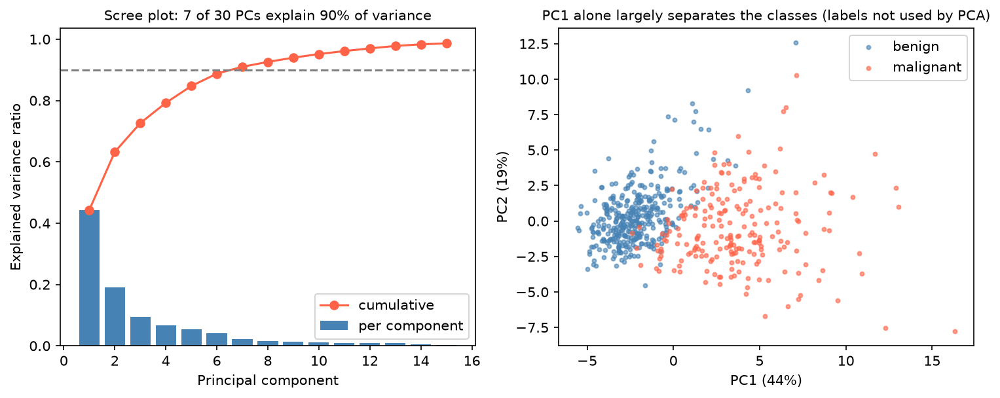

[Machine Learning](../../README.md) › [非監督式學習](../README.md) › [降維](README.md) › PCA

# 主成分分析 (PCA)

PCA 找出資料變異最大的正交方向（主成分），把資料投影上去。每個主成分 (PC) 是原始特徵的線性組合：PC1 是變異最大的方向，PC2 是與 PC1 正交、變異次大的方向，以此類推。轉換後的成分彼此不相關。

這篇是 **ML 用法**（pipeline 中的特徵萃取、選成分數）。負荷量 (loadings)、biplot 解讀與基因表現 PCA 見 [統計：主成分分析](../../../statistics/multivariate-analysis/pca.md)。

## 標準化與否差很多

PCA 追求變異最大，所以單位大的特徵會主導結果：

| iris | PC1 | PC2 |
| --- | --- | --- |
| 未標準化 | 92.5% | 5.3% |
| 標準化 | 73.0% | 22.9% |

未標準化時 petal length（變異最大）幾乎獨佔 PC1。特徵單位不同時**一定要標準化**；同單位且變異大小本身有意義時（例如 log 表現量）才考慮不標準化。

## 用法

```python
import numpy as np
import pandas as pd
from sklearn.datasets import load_breast_cancer
from sklearn.decomposition import PCA
from sklearn.preprocessing import StandardScaler
from sklearn.pipeline import make_pipeline
from sklearn.linear_model import LogisticRegression
from sklearn.model_selection import cross_val_score, StratifiedKFold

X, y = load_breast_cancer(return_X_y=True, as_frame=True)

# 1. 探索：解釋變異比例與負荷量
X_scaled = StandardScaler().fit_transform(X)
pca = PCA().fit(X_scaled)
pca.explained_variance_ratio_[:3]          # [0.443, 0.190, 0.094]
np.cumsum(pca.explained_variance_ratio_)   # 7 個 PC 達 90%、10 個達 95%
loadings = pd.DataFrame(pca.components_[:2].T, index=X.columns, columns=["PC1", "PC2"])
scores = pca.transform(X_scaled)[:, :2]    # 每個樣本在 PC1、PC2 的座標

# 2. 指定保留的變異比例
PCA(n_components=0.9).fit(X_scaled).n_components_      # 7

# 3. 建模：縮放與 PCA 都放在 pipeline 內，只在訓練 fold 上 fit
pipe = make_pipeline(StandardScaler(), PCA(n_components=5), LogisticRegression(max_iter=1000))
cross_val_score(pipe, X, 1 - y, cv=StratifiedKFold(5, shuffle=True, random_state=0), scoring="roc_auc").mean()
```



30 個特徵中，7 個主成分就解釋 90% 的變異；PC1 單獨就把良性與惡性大致分開（PCA 沒有用到標籤）。

| PCA 後的邏輯斯迴歸 | CV AUC |
| --- | --- |
| 2 個 PC | 0.991 |
| 5 個 PC | 0.994 |
| 10 個 PC | 0.995 |
| 不做 PCA（30 個特徵） | 0.996 |

> 降維不一定讓預測變好：這裡 PCA 只帶來壓縮，沒有提升。高解釋變異 ≠ 高預測力，因為 PCA 不看標籤，變異最大的方向不一定和目標有關。PCA 對預測的幫助主要在 p ≫ n、特徵高度共線或需要降噪時。

## 選成分數

| 目的 | 做法 |
| --- | --- |
| 視覺化 | 2 或 3 |
| 保留大部分資訊 | `n_components=0.9`（累積解釋變異 90%） |
| 找轉折 | Scree plot 的手肘 |
| 作為模型輸入 | 把 `n_components` 當超參數用 CV 調 |
| 單細胞 / 基因表現 | 常取 30–50 個 PC 給下游分群與 UMAP |

## 注意事項

| 注意 | 說明 |
| --- | --- |
| 只在訓練資料上 fit | 縮放與 PCA 都要在 pipeline 內 |
| PCA 是特徵萃取，不是特徵選擇 | 成分是所有特徵的組合 |
| 只抓線性結構 | 非線性結構用 t-SNE / UMAP 視覺化，或 Kernel PCA |
| 對離群值敏感 | 一個極端樣本可能獨佔一個 PC |
| PC 的正負號是任意的 | 不同版本或資料可能翻轉 |
| 高相關的兩個特徵 | 有時直接刪掉一個比 PCA 好解釋 |

> **生資常用的 PCA 檢查**：把樣本的 PC1 / PC2 依批次、定序日期、樣本品質上色。若主要變異來自批次而非生物分組，要先處理 [批次效應](../../../statistics/experimental-design/confounding-bias.md#生資最常見的干擾批次效應-batch-effect)。見 [生資應用：基因表現 PCA](../../../statistics/multivariate-analysis/pca.md#生資應用基因表現-pca)。

變體：`IncrementalPCA`（資料放不進記憶體）、`TruncatedSVD`（稀疏矩陣，不置中）、`KernelPCA`（非線性）、`SparsePCA`（稀疏負荷量）。
