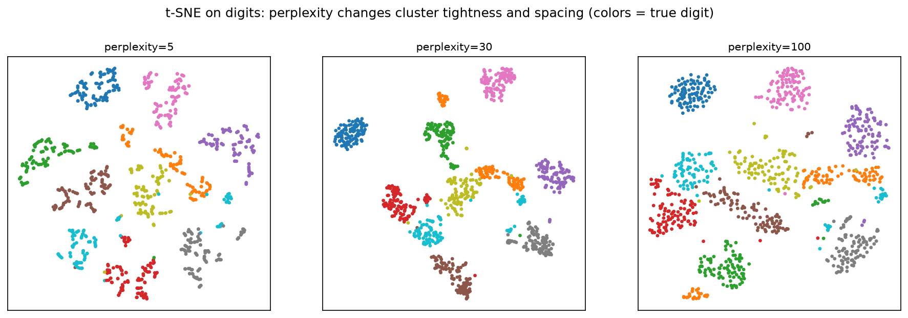

[Machine Learning](../../README.md) › [非監督式學習](../README.md) › [降維](README.md) › t-SNE

# t-SNE (t-Distributed Stochastic Neighbor Embedding)

把高維資料嵌入 2 或 3 維，盡量讓**原本相近的點在圖上仍然相近**。擅長呈現群結構，是單細胞、影像 embedding 的經典視覺化工具。它是**視覺化工具**，不是一般的特徵轉換方法。

| 原理 | 說明 |
| --- | --- |
| 高維相似度 | 每個點周圍用高斯分配定義鄰居機率；`perplexity` 決定有效鄰居數 |
| 低維相似度 | 用自由度 1 的 t 分配（重尾），讓不相似的點能被推遠 |
| 最佳化 | 最小化兩組機率的 KL divergence |

## perplexity 的影響



| perplexity | 效果 |
| --- | --- |
| 小（5） | 只看很近的鄰居 → 群被切碎成小團 |
| 中（30，預設） | 通常較平衡 |
| 大（100） | 看更大範圍 → 群較完整，但細節可能被抹平 |

常用範圍 5–50，必須小於樣本數。換一組參數，圖可能看起來完全不同，**不要只看一張圖就下結論**。

## 用法

```python
from sklearn.datasets import load_digits
from sklearn.decomposition import PCA
from sklearn.manifold import TSNE
from sklearn.preprocessing import StandardScaler

X, y = load_digits(return_X_y=True)
X_scaled = StandardScaler().fit_transform(X)

# 高維資料常先 PCA 到 30–50 維：降噪 + 加速
X_pca = PCA(n_components=30).fit_transform(X_scaled)
emb = TSNE(n_components=2, perplexity=30, init="pca", learning_rate="auto",
           max_iter=1000, random_state=0).fit_transform(X_pca)
# 依 y 上色畫散佈圖
```

> sklearn 版本差異：1.2 起 `init` 預設 `"pca"`、`learning_rate` 預設 `"auto"`；1.5 起 `n_iter` 改名為 `max_iter`。舊教學的 `n_iter=` 在新版會報錯或警告。

## 怎麼讀 t-SNE 圖

| 可以讀 | 不能讀 |
| --- | --- |
| 哪些點是鄰居、有沒有群 | **群的大小**：t-SNE 會擴張密集的群、壓縮稀疏的群 |
| 某個標籤是否混在其他群裡 | **群之間的距離**：兩群相距遠不代表比較不相似 |
| — | 軸的意義：座標沒有單位與方向 |
| — | 群的形狀：隨機的形狀也可能看起來有結構 |

## 限制

| 限制 | 說明 |
| --- | --- |
| 沒有 `transform` | 新資料不能投影到既有的 t-SNE 圖上，只能整批重跑 |
| 慢 | O(n log n)（Barnes-Hut），數十萬點要很久 → 用 openTSNE 或 [UMAP](umap.md) |
| 隨機性 | 不同 `random_state` 結果不同 |
| 不適合當模型特徵 | 不保留全域結構，且無法套用到新資料 |
| 可能「看出」不存在的群 | 搭配 [分群](../clustering/README.md) 與穩定性檢查，不要只靠眼睛 |

和 PCA、UMAP 的比較見 [降維](README.md)。
