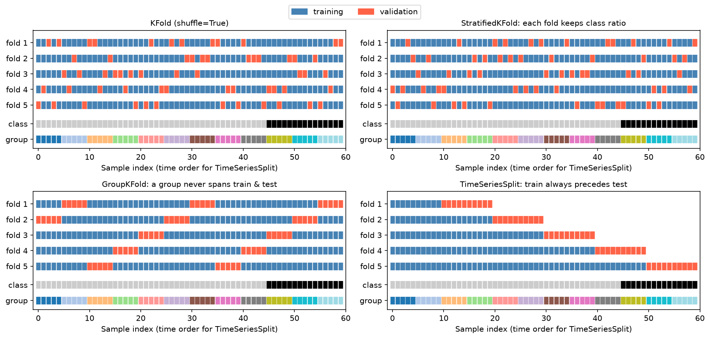

[Machine Learning](../README.md) › [工作流程](README.md) › 交叉驗證

# 交叉驗證 (Cross-Validation)

交叉驗證把資料輪流切成訓練與驗證部分，重複配適後取平均，比單次切分更穩定地估計 [泛化](../foundations/generalization.md) 能力。它是**模型評估與選擇**的工具，不是最終測試集的替代品。

## 切分策略

| 方法 | 做法 | 何時用 |
| --- | --- | --- |
| `KFold` | 切成 k 份，輪流用 1 份驗證、k−1 份訓練 | 迴歸、一般 i.i.d. 表格資料 |
| `StratifiedKFold` | 每個 fold 保持與全體相同的類別比例 | **分類的預設**，尤其 [類別不平衡](../evaluation/class-imbalance.md)、小樣本 |
| `GroupKFold` | 同一組（病人、使用者、批次）只會出現在同一個 fold | 同一實體有多筆資料 |
| `StratifiedGroupKFold` | 分組 + 盡量維持類別比例 | 分組且不平衡 |
| `TimeSeriesSplit` | 訓練永遠在驗證之前，訓練窗逐步擴大 | 時間序列、有時間順序的資料 |
| `RepeatedStratifiedKFold` | 用不同隨機切法重複 k-fold | 小樣本，降低估計的變異 |
| `LeaveOneOut` | k = n | 極小樣本；估計變異大、計算量大，通常不如重複 5 / 10-fold |
| Nested CV | 內層調參、外層評估 | 要調參又要報告誠實的效能（小樣本必備） |



藍色 = 訓練、紅色 = 驗證；下方兩列是類別與分組。`StratifiedKFold` 的每個驗證 fold 都含有黑色少數類；`GroupKFold` 的紅色區塊永遠對齊完整的分組；`TimeSeriesSplit` 的驗證永遠在訓練之後。

## 基本用法

```python
from sklearn.datasets import load_iris
from sklearn.linear_model import LogisticRegression
from sklearn.pipeline import make_pipeline
from sklearn.preprocessing import StandardScaler
from sklearn.model_selection import (KFold, StratifiedKFold, GroupKFold, TimeSeriesSplit,
                                     cross_val_score, cross_validate, cross_val_predict)

X, y = load_iris(return_X_y=True)
model = make_pipeline(StandardScaler(), LogisticRegression(max_iter=1000))   # 前處理放在 pipeline 內

# 1. K-Fold：分數 + 平均 ± 標準差
kf = KFold(n_splits=5, shuffle=True, random_state=42)
scores = cross_val_score(model, X, y, cv=kf, scoring="accuracy")
scores                        # [1.0, 0.967, 0.933, 0.9, 0.967]
scores.mean(), scores.std()   # 0.953, 0.034

# 2. 分類用 StratifiedKFold；cross_validate 可一次算多個指標、也回傳訓練分數
skf = StratifiedKFold(n_splits=5, shuffle=True, random_state=42)
res = cross_validate(model, X, y, cv=skf, scoring=["accuracy", "f1_macro"],
                     return_train_score=True)
res["test_accuracy"].mean(), res["train_accuracy"].mean()   # 0.953, 0.973

# 3. Out-of-fold 預測：每筆資料都由「沒看過它」的模型預測（畫 ROC、stacking 用）
oof_proba = cross_val_predict(model, X, y, cv=skf, method="predict_proba")

# 4. 分組：groups 是每列所屬的病人 / 使用者 ID
cross_val_score(model, X_all, y_all, groups=patient_id, cv=GroupKFold(n_splits=5))

# 5. 時間序列：資料先依時間排序，不可 shuffle；gap 在訓練與驗證之間留空檔
cross_val_score(reg_model, X_sorted, y_sorted, cv=TimeSeriesSplit(n_splits=5, gap=7),
                scoring="neg_root_mean_squared_error")
```

> `cv=5` 這種整數寫法：分類器預設用 `StratifiedKFold`、迴歸用 `KFold`，**都不會 shuffle**。資料若依類別或時間排序過，請明確傳入 `KFold(..., shuffle=True)`。

時間序列的滾動驗證 (walk-forward) 與預測評估見 [預測評估](../../statistics/time-series-analysis/forecast-evaluation.md#時間序列交叉驗證-walk-forward-validation)。

## 選 k 與重複次數

| k | 偏誤 | 變異 | 計算量 |
| --- | --- | --- | --- |
| 小（如 3） | 每次訓練資料少 → 效能估計偏悲觀 | 低 | 低 |
| 5 或 10 | 常用折衷 | 中 | 中 |
| n（LOOCV） | 最低 | 高（各 fold 模型幾乎相同） | 最高 |

小樣本時，與其加大 k，不如用 `RepeatedStratifiedKFold(n_splits=5, n_repeats=10)`，並報告平均 ± 標準差。

## Nested CV

調參時看到的「最佳 CV 分數」本身是挑選出來的，會偏樂觀。要同時調參又要報告效能時，把 `GridSearchCV` 整個包進外層 CV：

```python
from sklearn.model_selection import GridSearchCV

inner = StratifiedKFold(5, shuffle=True, random_state=0)
outer = StratifiedKFold(5, shuffle=True, random_state=1)
search = GridSearchCV(pipe, param_grid, cv=inner)
nested_scores = cross_val_score(search, X, y, cv=outer)   # 外層分數 = 整個流程（含調參）的效能
```

外層每個 fold 選出的參數可能不同，這是正常的；外層分數評估的是「調參程序」而不是某組參數。最終模型用全部資料再跑一次 `search.fit(X, y)`。實例與數字見 [高維小樣本](../foundations/high-dimensional-data.md#nested-cv-與置換檢定)。

## 有獨立 hold-out 的做法（Kaggle 式）

測試集沒有標籤（競賽）或想多一道防線時：先切出 hold-out，在其餘資料上做 CV 選模型，最後再看 hold-out。

```python
from sklearn.model_selection import train_test_split

X_tr, X_val, y_tr, y_val = train_test_split(X, y, test_size=0.2, stratify=y, random_state=42)
cross_val_score(model, X_tr, y_tr, cv=skf).mean()     # 0.958  ← 用來比較、調參
model.fit(X_tr, y_tr).score(X_val, y_val)             # 0.933  ← 只看一次
```

CV 分數與 hold-out 分數差距大時，先懷疑切分方式與資料分布，而不是模型。競賽流程見 [Kaggle 競賽流程](kaggle-competition-workflow.md)。

## CV vs Bootstrap

| | 交叉驗證 | Bootstrap |
| --- | --- | --- |
| 抽樣 | 不放回、切成 k 份 | 有放回抽 n 筆 |
| 主要用途 | 估計預測效能、選模型 | 估計統計量的不確定性（CI）、[Bagging](../supervised-learning/ensemble/bagging.md) |
| 驗證資料 | 該 fold | 沒被抽到的約 36.8%（out-of-bag） |

見 [Bootstrap](../../statistics/probability-and-distributions/monte-carlo-simulation.md#拔靴法-bootstrap)。

## 常見錯誤

| 錯誤 | 後果 | 改正 |
| --- | --- | --- |
| 先做 scaling / 補值 / 特徵選擇，再把處理後資料送進 CV | 洩漏 | 全部放進 [Pipeline](pipeline-basic.md) |
| 把 CV 分數當最終測試效能 | 偏樂觀（尤其調過參） | 保留測試集或用 nested CV |
| 不平衡分類用普通 `KFold` | 某些 fold 幾乎沒有少數類 | `StratifiedKFold` |
| 時間序列 shuffle | 用未來預測過去 | `TimeSeriesSplit` |
| 同一病人的多筆樣本隨機切 | 模型認得病人 → 分數虛高 | `GroupKFold` |
| 只報平均不報變異 | 無法判斷差異是否只是雜訊 | 報告 mean ± SD；比較模型時用同一組 folds |
