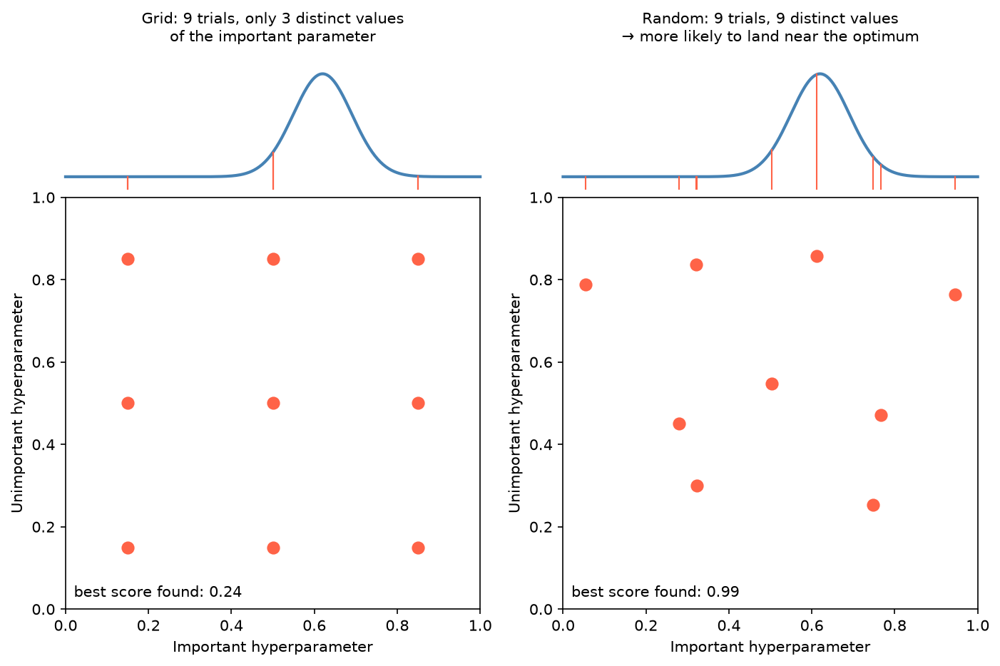

[Machine Learning](../README.md) › [工作流程](README.md) › 超參數調整

# 超參數調整 (Hyperparameter Tuning)

超參數是訓練前就要決定的設定（[正則化](../foundations/regularization.md) 強度、樹深度、學習率），不像模型參數是從資料學來的。調參就是在驗證資料上找表現最好的組合。

> 調參只能用訓練資料（搭配 [交叉驗證](cross-validation.md)），最終評估要在獨立的測試集上做一次。調參時看到的最佳 CV 分數會偏樂觀，要誠實報告效能請用 [nested CV](cross-validation.md#nested-cv)。

## 方法比較

| 方法 | 做法 | 優點 | 缺點 | 工具 |
| --- | --- | --- | --- | --- |
| Grid search | 窮舉所有組合 | 簡單、可重現 | 組合數指數成長 | `GridSearchCV` |
| Random search | 從分布隨機抽 n 組 | 大搜尋空間下效率高；**實務預設** | 不保證找到最佳 | `RandomizedSearchCV` |
| Successive halving | 先用少量資源試很多組，逐輪淘汰 | 快 | 早期表現差的設定可能後勁強 | `HalvingGridSearchCV`、`HalvingRandomSearchCV`（實驗性 API） |
| Bayesian optimization | 用過去結果建代理模型，選下一組最有希望的 | 評估次數少 | 較難平行、需額外套件 | Optuna、Hyperopt、scikit-optimize |
| 演化 / 族群式 (population-based) | 一群設定互相競爭、突變 | 適合很大或不平滑的空間 | 需要大量運算 | Ray Tune (PBT)、DEAP |

深度學習的學習率排程 (learning rate schedule) 屬於訓練過程的一部分，見 [Deep Learning](../../deep-learning/README.md)。



為什麼 random search 常勝過 grid：通常只有少數幾個超參數真正重要。9 次試驗的 3×3 grid 在重要參數上只試了 3 個值；random search 試了 9 個不同的值，更容易碰到最佳區域（上方曲線為分數對重要參數的關係）。

## 範例

```python
import optuna
from scipy.stats import loguniform
from sklearn.datasets import load_diabetes
from sklearn.linear_model import Lasso
from sklearn.pipeline import make_pipeline
from sklearn.preprocessing import StandardScaler
from sklearn.model_selection import train_test_split, GridSearchCV, RandomizedSearchCV, cross_val_score

X, y = load_diabetes(return_X_y=True)
X_train, X_test, y_train, y_test = train_test_split(X, y, test_size=0.2, random_state=42)
pipe = make_pipeline(StandardScaler(), Lasso(max_iter=10_000))
scoring = "neg_root_mean_squared_error"     # sklearn 的 scorer 一律「越大越好」，誤差類取負號

# 1. Grid search
grid = GridSearchCV(pipe, {"lasso__alpha": [0.01, 0.1, 1, 10, 100]}, cv=5, scoring=scoring, n_jobs=-1)
grid.fit(X_train, y_train)
grid.best_params_                # {'lasso__alpha': 1}
-grid.best_score_                # 55.9  CV RMSE
-grid.score(X_test, y_test)      # 53.1  測試 RMSE（只看一次）

# 2. Random search：尺度型參數用 log-uniform
rand = RandomizedSearchCV(pipe, {"lasso__alpha": loguniform(1e-3, 1e2)}, n_iter=30,
                          cv=5, scoring=scoring, random_state=42, n_jobs=-1)
rand.fit(X_train, y_train)       # best alpha ≈ 1.15, CV RMSE 55.9

# 3. Bayesian (Optuna)
def objective(trial):
    alpha = trial.suggest_float("alpha", 1e-3, 1e2, log=True)
    model = make_pipeline(StandardScaler(), Lasso(alpha=alpha, max_iter=10_000))
    return -cross_val_score(model, X_train, y_train, cv=5, scoring=scoring).mean()

study = optuna.create_study(direction="minimize", sampler=optuna.samplers.TPESampler(seed=42))
study.optimize(objective, n_trials=30)
study.best_params                # {'alpha': ≈ 1.36}, CV RMSE 55.9
```

> Optuna 舊寫法 `trial.suggest_loguniform` / `suggest_uniform` 自 v3.0 deprecated（預計 v6.0 移除），改用 `suggest_float(..., log=True)`。

三種方法在這個一維問題上找到幾乎相同的答案；差異在搜尋空間變大（多個參數、連續範圍）時才明顯。

## 設計搜尋空間

| 原則 | 例子 |
| --- | --- |
| 尺度型參數用 log 尺度 | `alpha`、`C`、learning rate：`loguniform(1e-4, 1e2)` |
| 只調會影響結果的參數 | 調 `max_iter`、`tol` 通常沒有意義（只影響收斂） |
| 先粗後細 | 先大範圍 random search，再在最佳區域縮小範圍 |
| 最佳值落在邊界 → 擴大範圍 | `alpha` 最佳 = 搜尋上限，代表真正最佳可能更大 |
| 前處理參數也可以調 | 透過 [Pipeline](pipeline-basic.md) 的 `步驟名__參數名` |

常見模型的重要超參數：

| 模型 | 先調 |
| --- | --- |
| Ridge / Lasso / Logistic | `alpha` 或 `C` |
| 隨機森林 | `max_features`、`min_samples_leaf`（`n_estimators` 夠大即可，不必調） |
| Gradient Boosting / XGBoost | `learning_rate` + `n_estimators`（搭配 early stopping）、`max_depth`、`subsample` |
| SVM (RBF) | `C`、`gamma` |
| KNN | `n_neighbors`、`weights` |

## 注意事項

| 注意 | 說明 |
| --- | --- |
| 先把流程弄對再調參 | 在錯誤的驗證設計上調參，只是把錯的流程調到最好看 |
| 先建 [baseline](../evaluation/baselines-and-error-analysis.md) | 調參的提升常小於特徵或資料品質的提升 |
| 小心對 CV 過擬合 | 搜尋空間很大、樣本很小時，最佳分數有很大成分是運氣 |
| 差距小於 CV 標準差 | 選較簡單的那組參數 |
| 固定 `random_state` | 讓比較可重現 |

> 實務順序：先 random search，再用 Optuna 精修；搜尋前先確認資料切分與 pipeline 正確。
