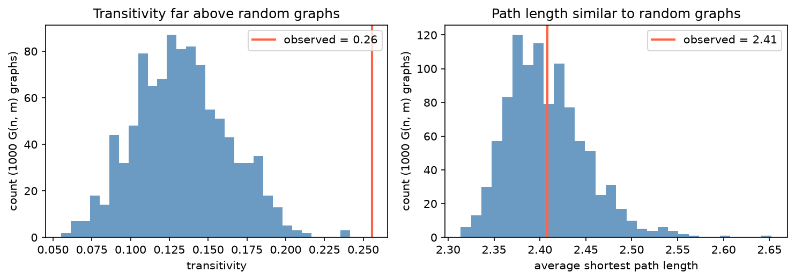

[Data Science](../README.md) › [Network Analysis](README.md) › 有向網路與結構指標

# 有向網路與結構指標 (Directed Networks and Structural Metrics)

有方向時，很多熟悉的指標會換一個意思；而網路層級的結構指標回答「這張網路整體是鬆散還是緊密、是否互惠、是否同質相連、有沒有清楚的社群」。所有結構指標都要和隨機基準比較才有意義。

## 兩種表示法

| 表示法 | 適合 | 注意 |
| --- | --- | --- |
| Edge list（source, target, 屬性） | 從表格建圖、加 edge metadata、與 pandas 串接 | 實務最常用 |
| Adjacency matrix（n × n） | 看對稱性、稀疏度、矩陣運算 | 大網路用稀疏矩陣（`nx.to_scipy_sparse_array`） |

有向圖的 adjacency matrix 不對稱：`A[i, j] = 1` 表示 i → j。

## 有向網路

在有向圖中 `A → B` 與 `B → A` 是不同事件，這會改變問題：誰主動指向很多人？誰被很多人指向？哪些路徑其實走不通？

| 指標 | 意義 | 社交 / 引用網路 | 基因調控網路 |
| --- | --- | --- | --- |
| In-degree | 多少邊指向這個節點 | 受關注、被引用、被依賴 | 受多少 TF 調控 |
| Out-degree | 這個節點指向多少節點 | 活躍、主動接觸、擴散 | 調控多少 target（master regulator） |

```python
D = nx.DiGraph()
D.add_edges_from([("A", "B"), ("A", "E"), ("B", "A"), ("C", "A")])

dict(D.in_degree()), dict(D.out_degree())    # A: in 2, out 2
D.has_edge("A", "E"), D.has_edge("E", "A")   # (True, False)
list(D.successors("A")), list(D.predecessors("A"))
nx.pagerank(D)                               # 有向圖的重要性
```

只報一個總 degree 會把兩種角色混在一起。後續的 centrality 與路徑結論都建立在方向沒建錯的前提上，先抽查幾條邊。

## 網路層級指標

| 指標 | 意義 | NetworkX | 解讀 |
| --- | --- | --- | --- |
| Density | 實際邊數 / 可能邊數 | `nx.density(G)` | 稀疏或稠密；真實網路通常非常稀疏 |
| 平均最短路徑長 | 任兩點平均要走幾步 | `nx.average_shortest_path_length(G)` | 短 → 容易穿越（只對連通圖定義） |
| Global transitivity | 封閉三角形比例（朋友的朋友也是朋友） | `nx.transitivity(G)` | 局部是否形成團塊 |
| Local clustering | 單一節點的鄰居彼此相連的比例 | `nx.clustering(G)`、`nx.average_clustering(G)` | 節點所在的圈子是否緊密 |
| Assortativity | 節點是否傾向連到相似的節點 | `nx.degree_assortativity_coefficient(G)`、`nx.attribute_assortativity_coefficient(G, "type")` | > 0 同質相連；< 0 異質相連（生物網路的 hub 常連到低 degree 節點） |
| Reciprocity | 有 A → B 時 B → A 也存在的比例 | `nx.reciprocity(D)` | 單向關注 vs 雙向互動 |

density 單獨看不夠：高 density 不代表有群聚，也不代表資訊傳播快；兩張密度相近的網路，平均路徑長可能差很多。

## 和隨機圖比較

單一指標幾乎不該脫離基準解讀。做法：產生許多與原圖節點數、邊數相同的隨機圖，計算同一指標，把原圖的值放進這個分布。

```python
import numpy as np

n, m = G.number_of_nodes(), G.number_of_edges()
obs = nx.transitivity(G)
rng = np.random.default_rng(42)
null = [nx.transitivity(nx.gnm_random_graph(n, m, seed=int(rng.integers(1e9)))) for _ in range(1000)]
p = (np.sum(np.array(null) >= obs) + 1) / (len(null) + 1)     # 經驗 p 值

# 保留每個節點 degree 的隨機化（更嚴格的基準）
R = nx.double_edge_swap(G.copy(), nswap=10 * m, max_tries=100 * m, seed=0)
```



Zachary 空手道俱樂部網路（34 人、78 條邊）的 transitivity 0.26，1000 張相同大小的 G(n, m) 隨機圖平均約 0.13，沒有一張達到觀察值：這個網路確實比隨機更聚集。平均路徑長 2.41 則落在隨機分布中央：「路徑短」本身不特別，隨機圖也一樣短。

| 基準 | 保留 | 適合 |
| --- | --- | --- |
| G(n, m)（Erdős–Rényi） | 節點數、邊數 | 第一個基準 |
| Configuration model / degree-preserving swap | 每個節點的 degree | 問「這個結構是否只是 degree 分布造成的」；生物網路的 hub 結構很強時必用 |

## 社群偵測 (Community Detection)

網路出現多個緊密區塊時，社群偵測把結構切成可解讀的群組。

| 方法 | 原理 | NetworkX / 其他 | 特性 |
| --- | --- | --- | --- |
| Girvan–Newman（edge betweenness） | 反覆移除 betweenness 最高的邊（跨群的橋），網路逐步分裂 | `nx.community.girvan_newman` | 直觀、能看出撐住社群間連接的邊；慢，只適合小圖 |
| Louvain | 貪婪最大化 modularity | `nx.community.louvain_communities(G, seed=0)` | 快、常用；可能產生內部不連通的社群 |
| Leiden | 改良 Louvain，保證社群內部連通 | `leidenalg`、igraph、scanpy | 單細胞分群的標準 |
| Label propagation | 節點採用鄰居中最多的標籤 | `nx.community.label_propagation_communities` | 非常快、結果不穩定 |
| Leading eigenvector | modularity 矩陣的特徵向量切分 | igraph | 確定性 |

```python
comms = nx.community.louvain_communities(G, weight="weight", resolution=1.0, seed=0)
nx.community.modularity(G, comms)              # 0.3–0.7 通常表示明顯社群結構
```

| 注意 | 說明 |
| --- | --- |
| resolution 參數決定群的大小與數量 | 沒有唯一正確值；在單細胞分析中同樣如此 |
| 不同方法、不同 seed 結果不同 | 比較多種方法，看哪些群穩定存在（例如以 ARI 比較） |
| 社群是結構假說，不是最終答案 | 用外部資訊（功能註解、metadata）驗證 |

## 結構分析的閱讀順序

1. 確認有向或無向
2. 有向圖分開看 in-degree 與 out-degree
3. 用 density 與平均路徑長看整體連通程度
4. 用 global / local transitivity 看局部閉合
5. 和隨機基準比較，避免過度解讀
6. 懷疑同質相連時看 assortativity；關係可能互惠時看 reciprocity
7. 呈現多團塊時做社群偵測，並比較多種方法

| 常見錯誤 | |
| --- | --- |
| 把有向圖當無向圖解讀 | 忽略方向，誤把單向連結當雙向互動 |
| 只報 degree，不分 in / out | 角色混淆 |
| 看到高 transitivity 就說有穩定社群 | 要和其他指標、隨機基準一起看 |
| 用 density 或路徑長單獨講故事 | 沒有基準 |
| 把社群偵測的輸出當成絕對邊界 | 方法與參數依賴 |
