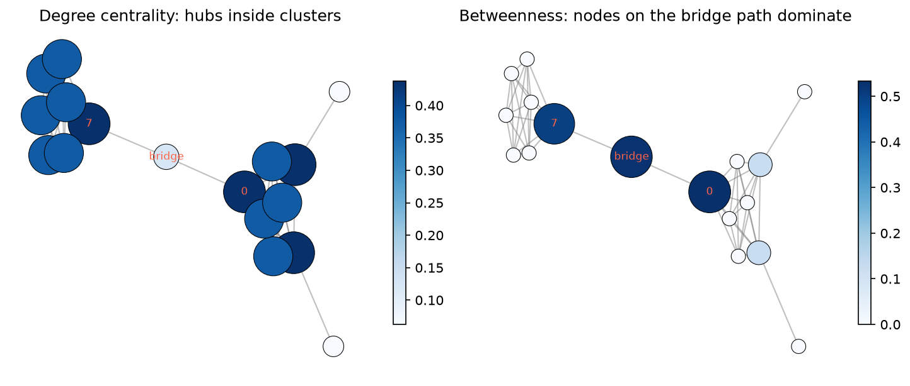

[Data Science](../README.md) › [Network Analysis](README.md) › 網路分析入門

# 網路分析入門 (Introduction to Network Analysis)

網路分析處理的是關係結構本身：誰和誰有連結、資訊或流量怎麼穿越網路、哪些節點扮演橋樑。網路的資訊不只在 node 與 edge 的清單，而在它們組成的結構；分析目標是把結構轉成可解讀的問題，例如重要性、路徑、群聚與推薦。

## 先做建模選擇

算任何指標之前，先定義：

| 決定 | 問題 | 例子 |
| --- | --- | --- |
| Node | 代表什麼實體？ | 人、站點、蛋白質、基因、細胞 |
| Edge | 代表什麼關係？ | 互動、可通行路線、物理結合、共表現、相似度 |
| 方向 | 關係有方向嗎？ | 追蹤、引用、轉錄調控（TF → target）有方向；PPI、好友無方向 |
| 權重 | 關係有強度、距離或成本嗎？ | 互動次數、相關係數、信心分數、運輸成本 |

node 與 edge 的語意沒先釐清，後面所有指標都可能失去意義。

| 網路類型 | Node | Edge | 典型問題 |
| --- | --- | --- | --- |
| 社交網路 | 人 | 互動或關係 | 誰有影響力？ |
| 交通網路 | 站點 | 可通行路線 | 最有效率的路徑？ |
| 合作網路 | 使用者 | 共同參與同一個 repo / 專案 | 誰跨越多個合作圈？該推薦誰合作？ |
| PPI 網路 | 蛋白質 | 物理或功能交互作用 | 哪些蛋白是 hub？哪些模組對應 complex？ |
| 基因調控網路 | 轉錄因子、基因 | 調控關係（有向） | 哪些 TF 是 master regulator？ |

## Graph 類型

| 類型 | 意義 | NetworkX | 影響 |
| --- | --- | --- | --- |
| 無向 (undirected) | 關係雙向 | `nx.Graph()` | degree 只有一種 |
| 有向 (directed) | 關係有方向 | `nx.DiGraph()` | in-degree 與 out-degree 回答不同問題；路徑要順著方向走 |
| 多重圖 (multigraph) | 同一對節點可有多條邊 | `nx.MultiGraph()` / `MultiDiGraph()` | 多次互動不該被壓成單一連結 |
| 加權 (weighted) | 邊帶強度或成本 | edge attribute `weight` | 最短路徑可能不是邊數最少，而是成本最低 |

```python
import networkx as nx

G = nx.Graph()
G.add_node("TP53", type="TF")
G.add_edges_from([("TP53", "MDM2"), ("TP53", "CDKN1A"), ("MDM2", "MDM4")])
G.add_edge("TP53", "ATM", weight=0.9, source="STRING")      # edge attribute

G.number_of_nodes(), G.number_of_edges()     # (5, 4)
G.nodes(data=True); G.edges(data=True)        # 連同屬性
list(G.neighbors("TP53"))                    # ['MDM2', 'CDKN1A', 'ATM']

# 從 edge list DataFrame 建圖（最常見）
G = nx.from_pandas_edgelist(edges, source="protein1", target="protein2",
                            edge_attr="combined_score")
```

建好圖後先檢查 node / edge 數量、屬性與連通分量是否合理，再算指標。

## 中心性 (Centrality)

| 指標 | 直覺 | 回答 | 注意 |
| --- | --- | --- | --- |
| Degree | 直接連了多少邊 | 誰最活躍 / 最多直接連結？ | 只看鄰居，會高估「熱鬧但不關鍵」的節點 |
| Betweenness | 多常出現在其他節點對的最短路徑上 | 誰是橋樑、瓶頸？ | 計算量大（大圖用 `k=` 抽樣近似） |
| Closeness | 到其他所有節點的平均距離倒數 | 誰能最快觸及全網？ | 不連通圖要小心定義 |
| Eigenvector / PageRank | 連到重要節點的節點也重要 | 誰在核心圈？ | 有向圖用 PageRank |

```python
deg = nx.degree_centrality(G)                  # degree / (n - 1)
btw = nx.betweenness_centrality(G)             # 大圖：nx.betweenness_centrality(G, k=500, seed=0)
clo = nx.closeness_centrality(G)
pr = nx.pagerank(G)

top = sorted(btw, key=btw.get, reverse=True)[:10]
```



兩個緊密群體以一條路徑相連：群內節點 degree 高，但橋樑節點（以及兩端的 0、7）betweenness 最高。degree 低不代表不重要；移除橋樑節點，網路就斷成兩半。

> 生資網路中 hub（高 degree）常是研究較多的基因：文獻研究偏差 (study bias) 會讓熱門基因累積更多已知交互作用。比較 degree 前，考慮用資料驅動的網路或校正研究次數。

## 路徑

| 問題 | NetworkX |
| --- | --- |
| 兩點最短路徑 | `nx.shortest_path(G, a, b)`、加權：`weight="cost"` |
| 所有最短路徑 | `nx.all_shortest_paths(G, a, b)` |
| 最短路徑長度 | `nx.shortest_path_length(G, a, b)` |
| 是否連通、連通分量 | `nx.is_connected(G)`、`nx.connected_components(G)` |

最短路徑的定義要和 edge 意義一致：權重代表距離或成本時，不能只看 hop 數；權重代表**相似度或信心**時（相關係數、STRING score），要先轉成距離（例如 `1 - score` 或 `-log(score)`）再算最短路徑，否則會找到「最不相似」的路徑。

## Clique 與 Subgraph

clique 是一組兩兩完全相連的節點，最小的非平凡 clique 是三角形。maximal clique 是無法再加入任何節點而仍是 clique 的 clique，常用來找緊密群體（如蛋白質複合體）的起點。

```python
cliques = list(nx.find_cliques(G))                    # 所有 maximal cliques
largest = max(cliques, key=len)

# 大圖先聚焦局部：某節點及其鄰居的子圖
nodes = [hub] + list(G.neighbors(hub))
sub = G.subgraph(nodes).copy()                        # subgraph 預設是 view，要修改時 copy
ego = nx.ego_graph(G, hub, radius=2)                  # 兩步內的鄰域
```

真實網路太大時，直接看全圖只是一團毛球。常見節奏：全圖找重要節點 → 取鄰居建子圖 → 在局部檢查社群、橋接或推薦機會。

## 視覺化是推理工具，不是裝飾

視覺化可以快速看出團塊、橋樑、緊密區域與局部鄰域是否合理，但 layout 不是數學事實：換一個 layout 或 seed，圖看起來可能完全不同，相近的位置也不代表相近的關係。判斷要回到指標。

```python
import matplotlib.pyplot as plt
pos = nx.spring_layout(G, seed=0)                     # 固定 seed 才能重現
nx.draw(G, pos, node_size=[300 * btw[n] + 20 for n in G], with_labels=False)
```

大型或需要註解的生物網路用 Cytoscape 或 Gephi 畫較方便。

## 工作流程

1. 定義 node、edge、方向與權重
2. 建圖，檢查節點、邊、屬性、連通分量
3. 判斷是有向、無向、加權還是多重圖問題
4. 先算 degree，再看 betweenness 與最短路徑
5. 圖太大時切子圖做局部檢查
6. 懷疑有緊密群體時看 clique 或[社群偵測](directed-networks-and-structural-metrics.md#社群偵測-community-detection)
7. 回到原本的任務：影響力、路徑、社群或推薦

推薦不一定要從 user-item 矩陣出發，也可以從 graph 結構出發：例如推薦「朋友的朋友」中共同鄰居最多的人（`nx.common_neighbors`、`nx.jaccard_coefficient`）。

## 常見錯誤

| 錯誤 | 後果 |
| --- | --- |
| 把任何關聯資料都硬畫成 graph，沒有清楚的 edge 意義 | 指標無法解讀 |
| 忽略有向 vs 無向 | in / out 角色混在一起、走不通的路徑被算進去 |
| 把高 degree 當成所有形式的重要性 | 漏掉橋樑節點 |
| 只看視覺化不看指標 | 被 layout 誤導 |
| 不切子圖，硬讀全圖 | 看不出結構 |
| 把 clique 或社群當成絕對真實的群體 | 它們取決於建模定義與演算法 |
