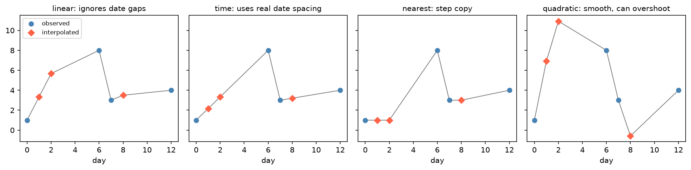

[Python Foundations](../README.md) › [pandas](README.md) › 缺值

# 缺值 (Missing Data)

這篇是 pandas 的缺值工具：統一缺值標記、量化與視覺化缺失型態、刪除、填補與插值。缺失機制 (MCAR / MAR / MNAR) 與「該刪還是該補」的判斷見 [Missing Data](../../data-manipulation-and-eda/missing-data.md)；建模用的插補 (imputation) 見 [Imputation](../../machine-learning/preprocessing/imputation.md)。

```text
統一缺值標記 → 量化（每欄、每列多少）→ 看型態（missingno）→ 判斷機制 → 刪除 / 填補 / 插值 → 檢查分布是否被扭曲
```

## pandas 的缺值表示

| 表示 | 出現在 | 注意 |
| --- | --- | --- |
| `np.nan` | `float64`、`str` 欄 | 浮點值；`np.nan == np.nan` 為 False |
| `pd.NA` | nullable dtype（`Int64`、`boolean`、`string`） | 運算結果傳遞為 `<NA>` |
| `NaT` | `datetime64` | 日期的缺值 |
| `None` | `object` 欄 | 讀入後通常被轉成上面其中一種 |

不論哪種，一律用 `isna()` / `notna()` 判斷，不要用 `== np.nan`。

## 1. 統一缺值標記

```python
import numpy as np
import pandas as pd

# 讀檔時：哪些字串代表缺值（預設已含 "", "NA", "NaN", "null" 等）
df = pd.read_csv("data.csv", na_values=[".", "-", "missing", -999])

# 讀檔後：只有在領域知識確定 0 是「未測量」時才換
df["glucose"] = df["glucose"].replace(0, np.nan)
df = df.replace(r"^\s*$", np.nan, regex=True)        # 只有空白的字串
```

> 小心預設的 `na_values`：基因名 `NA`、鈉 `NA` 或國家代碼 `NA`（納米比亞）會被讀成缺值。遇到時用 `keep_default_na=False` 再自己指定 `na_values`。

## 2. 量化缺值

```python
df.isna().sum()                                  # 每欄缺幾個
df.isna().mean().sort_values(ascending=False)    # 每欄缺值比例，先處理最多的
df.isna().sum(axis=1).value_counts()             # 每列缺幾欄的分布
df[df.isna().any(axis=1)]                        # 至少有一個缺值的列
df.columns[df.isna().all()]                      # 完全空白的欄
df.notna().sum()                                 # 每欄的有效值數

# 依組別看缺值率：缺值率在組間差很多 → 不是 MCAR
df.groupby("batch")["glucose"].apply(lambda s: s.isna().mean())
```

## 3. missingno 視覺化

數字看不出缺值之間的關係時，用 `missingno`。

```python
import missingno as msno

msno.bar(df)          # 每欄完整度
msno.matrix(df)       # 每列的缺值位置：看是否成塊出現（例如某批次、某時段）
msno.heatmap(df)      # 欄與欄之間「是否一起缺」的相關
msno.dendrogram(df)   # 依缺值型態把欄位分群
```

| 圖 | 看什麼 | 型態暗示 |
| --- | --- | --- |
| `matrix` 中缺值集中在某段列 | 依排序欄（時間、批次）成塊 | 流程或儀器問題，可能是 MAR |
| `heatmap` 兩欄相關接近 1 | 兩欄總是一起缺 | 同一量測步驟失敗 |
| `heatmap` 相關接近 -1 | 一欄有值另一欄就缺 | 互斥欄位（例如不同版本問卷） |
| 散佈各處、無結構 | | 較可能 MCAR |

## 4. 刪除

```python
df.dropna()                          # 任何欄有缺值就刪列（listwise deletion）
df.dropna(subset=["petal_length"])   # 只看下游必要的欄
df.dropna(thresh=3)                  # 至少要有 3 個非缺值才保留
df.dropna(axis=1, how="all")         # 刪掉全空的欄
df.loc[:, df.isna().mean() < 0.5]    # 刪掉缺值比例 ≥ 50% 的欄
```

| 策略 | 做法 | 代價 |
| --- | --- | --- |
| Listwise deletion | 整列刪除 | 簡單、各分析用同一批列；但可能丟掉很多資料 |
| Pairwise deletion | 每個統計量用該組欄位可用的列（`df.corr()` 預設如此） | 保留較多資料，但不同統計量的樣本不同 |

刪除只有在缺失接近 MCAR 時才不引入偏差；刪除後記得比較刪除前後的樣本組成。

## 5. 填補

```python
df["x"] = df["x"].fillna(0)                                     # 常數（確定缺值 = 0 時）
df["x"] = df["x"].fillna(df["x"].median())                      # 中位數：比平均對離群值穩健
df = df.fillna({"sl": df["sl"].mean(), "sw": df["sw"].median(), "grp": "unknown"})
df["x"] = df.groupby("species")["x"].transform(lambda s: s.fillna(s.median()))   # 組內中位數

df["x"] = df["x"].ffill()            # 前值延續（有順序的資料）
df["x"] = df["x"].bfill()            # 後值回填
df["x"] = df.groupby("patient")["x"].ffill(limit=2)              # 每位病人內最多往後延 2 筆

df["x_missing"] = df["x"].isna()     # 填補前先保留「是否缺值」的指標欄
```

> 用整份資料的平均 / 中位數填補，再切 train / test，是資料洩漏。建模時把插補放進 pipeline，只在訓練集 fit，見 [Imputation](../../machine-learning/preprocessing/imputation.md)。

## 6. 插值 (Interpolation)

插值用前後相鄰的值估計缺值，只適合**有順序**的資料（時間序列、沿基因體位置、劑量）；一般表格欄位不適用。

```python
days = pd.to_datetime(["2024-01-01", "2024-01-02", "2024-01-03", "2024-01-07",
                       "2024-01-08", "2024-01-09", "2024-01-13"])          # 不等距
ts = pd.Series([1.0, np.nan, np.nan, 8.0, 3.0, np.nan, 4.0], index=days)

ts.interpolate()                        # linear：把列當等距 → 3.33, 5.67, 3.5
ts.interpolate(method="time")           # 依實際日期間隔   → 2.17, 3.33, 3.2
ts.interpolate(method="nearest")        # 最近的觀測值     → 1, 1, 3（需要 scipy）
ts.interpolate(method="quadratic")      # 二次曲線         → 6.91, 10.92, -0.58：超出觀測範圍
ts.interpolate(limit=1)                 # 最多連續補 1 個
ts.interpolate(limit_area="inside")     # 只補兩端都有值的空洞，不外插
```



index 不等距時，預設的 linear 會忽略日期間隔，時間序列要用 `method="time"`；nearest 呈階梯狀；quadratic 在轉折處過衝，補出比所有觀測值都大（10.92）或為負（-0.58）的值，對濃度、計數等不能為負的量尤其危險。缺口越長，任何插值都越不可信，用 `limit=` 限制最大連續補值數。

## 檢查表

| 檢查 | 寫法 |
| --- | --- |
| 隱藏的缺值標記（`-999`、`"."`、空字串）都轉成 NaN 了嗎？ | `df[col].value_counts().head()` |
| 缺值比例最高的欄是哪些？ | `df.isna().mean().sort_values()` |
| 缺值是否集中在某組？ | `df.groupby(g)[col].apply(lambda s: s.isna().mean())` |
| 處理後分布有沒有被扭曲？ | 比較處理前後的 `describe()`、直方圖 |
| 填補是否只用訓練資料的統計量？ | pipeline |

R 的對應工具見 [Missing Data in R](../../r-foundations/missing-data.md)。
