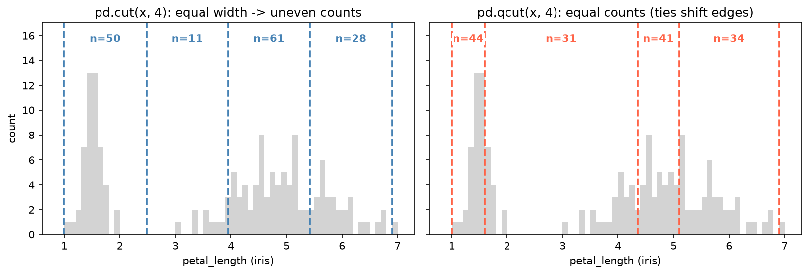

[Python Foundations](../README.md) › [pandas](README.md) › 排序、分箱、抽樣與去重

# 排序、分箱、抽樣與去重 (Sorting, Binning, Sampling & Duplicates)

清理與探索時常用的四組操作：排序決定閱讀與報表順序，分箱把連續值變成區間，抽樣用於探索大檔與 bootstrap，去重確保每個實體只算一次。

## 排序 (Sorting)

```python
import pandas as pd

df = pd.DataFrame({"name": ["Bella", "Charlie", "Lucy"], "age": [5, 3, 7], "weight_kg": [24, 22, 28]})

df.sort_values("age")                                      # 升冪
df.sort_values("age", ascending=False)                     # 降冪
df.sort_values(["age", "weight_kg"], ascending=[True, False])  # 第二欄只在第一欄相同時當 tie-breaker
df.sort_values("age", na_position="first")                 # 缺值預設排最後
df.sort_values("name", key=lambda s: s.str.lower())        # 依轉換後的值排序（不分大小寫）
df.sort_index()                                            # 依 index
df.nlargest(2, "age"), df.nsmallest(2, "age")              # 前 k 名，比排序後 head 快

# MultiIndex：各層可分別指定方向
m = pd.DataFrame({"col1": ["B", "A", "A", "B"], "col2": [1, 2, 1, 2], "value": [10, 20, 30, 40]})
m.set_index(["col1", "col2"]).sort_index(level=["col1", "col2"], ascending=[True, False])
#            value
# col1 col2
# A    2        20
#      1        30
# B    2        40
#      1        10
```

| 需求 | 寫法 |
| --- | --- |
| 自訂順序（低 / 中 / 高、chr1…chr22） | 轉成有序 `category`，見 [dtype、類別與字串](dtypes-categorical-strings.md#類別-categorical) |
| 自然排序（`S2` < `S10`） | `key=lambda s: s.str.extract(r"(\d+)")[0].astype(int)` |
| 排序結果穩定（相同值保留原順序） | `kind="stable"`（多欄排序時預設即穩定） |

## 分箱 (Binning)

```python
import seaborn as sns
iris = sns.load_dataset("iris")

# 1. cut：自訂邊界（固定意義的門檻）
iris["pl_bin"] = pd.cut(iris["petal_length"], bins=[0, 2, 5, 7], labels=["short", "medium", "long"])
iris["pl_bin"].value_counts(sort=False)      # short 50, medium 58, long 42

pd.cut(x, bins=[0, 18, 65, 120], right=False)   # 區間 [0, 18)；預設 right=True 為 (0, 18]
pd.cut(x, bins=4)                               # 等寬 4 箱（依最小 / 最大值）

# 2. qcut：依分位數，每箱筆數接近相同
iris["pl_q"] = pd.qcut(iris["petal_length"], q=3, labels=["low", "mid", "high"])
iris["pl_q"].value_counts(sort=False)        # low 50, mid 54, high 46（同值不能拆開，所以不完全相等）
pd.qcut(x, q=[0, 0.1, 0.5, 0.9, 1])          # 自訂分位點
pd.qcut(x, q=10, duplicates="drop")          # 很多重複值（如大量 0）導致邊界重複時

bins = pd.cut(x, 4, retbins=True)[1]         # 取回邊界，套用到 test set：pd.cut(x_test, bins)
```

| | `pd.cut` | `pd.qcut` |
| --- | --- | --- |
| 邊界 | 自訂或等寬 | 依分位數 |
| 每箱筆數 | 可能非常不平均 | 大致相等 |
| 適合 | 有意義的門檻（年齡層、臨床參考值、BMI 分級） | 分組比較、等量分層 |
| 偏態資料 | 大多數值擠在少數箱 | 每箱都有資料，但邊界較難解讀 |



iris 的 petal length 是雙峰：等寬 4 箱時落在兩峰之間的第二箱只有 11 筆。qcut 的目標是每箱 37–38 筆，但 1.5 之類的值大量重複、同值不能拆到兩箱，實際是 44 / 31 / 41 / 34；第一個邊界 1.6 還把 setosa 的叢集切成兩半。

> 分箱會丟掉箱內資訊，且邊界的選擇會影響結果。建模時通常保留連續值；需要分箱時，邊界只能從訓練資料決定。

## 抽樣 (Sampling)

```python
iris.sample(n=5, random_state=42)                    # 固定筆數
iris.sample(frac=0.3, random_state=42)               # 比例
iris.sample(frac=1, random_state=42)                 # 打亂全部列
iris.sample(n=150, replace=True, random_state=42)    # 放回抽樣 → bootstrap

# 分層抽樣
iris.groupby("species").sample(frac=0.4, random_state=42)   # 各組同比例：保持原組成
iris.groupby("species").sample(n=5, random_state=42)        # 各組同筆數：平衡組別，但改變組成

# 加權抽樣：權重越大越容易被抽到（Series 或欄名）
w = iris["species"].map({"setosa": 2, "versicolor": 1, "virginica": 1})
iris.sample(frac=0.3, weights=w, random_state=42)

# 系統抽樣：每隔 k 列；資料依時間 / 類別排序時先打亂，以免抽到週期性
iris.sample(frac=1, random_state=42).iloc[::10]
```

| 方法 | 用途 | 注意 |
| --- | --- | --- |
| 簡單隨機 | 大檔探索、快速原型 | `random_state` 固定才可重現 |
| 分層 (`groupby().sample`) | 稀有組別不被抽漏 | 建模切分改用 `train_test_split(stratify=y)`，見 [Train-Test Split](../../machine-learning/preprocessing/train-test-split.md) |
| 放回 | bootstrap 信賴區間 | 見 [抽樣與估計](../../statistics/inferential-statistics/sampling-estimation.md) |
| 加權 | 刻意過抽某些族群 | 估計母體量時要用權重校正回來 |

## 唯一值與重複 (Unique & Duplicates)

```python
iris["species"].unique()                    # 唯一值
iris["species"].nunique()                   # 3
iris["species"].value_counts()              # 各值次數
iris.nunique()                              # 每欄唯一值數：快速找出 ID 欄、常數欄

iris.duplicated().sum()                     # 完全重複的列數（iris 有 1 列）
iris.duplicated(subset=["sepal_length", "species"], keep=False)   # 所有重複者都標 True
iris.drop_duplicates()                      # 保留第一次出現
iris.drop_duplicates(subset="species", keep="last")

# 同一 key 保留「最新」或「最好」的那筆：先排序再去重
df.sort_values("date").drop_duplicates(subset="sample_id", keep="last")
```

| `keep=` | 標記 / 刪除 |
| --- | --- |
| `"first"`（預設） | 除了第一筆以外的重複 |
| `"last"` | 除了最後一筆以外的重複 |
| `False` | 全部重複者（用於檢視衝突） |

> 去重前先看重複的列內容（`keep=False`）：完全相同的列多半是重複匯入；同一 key 但其他欄不同的列，代表資料有衝突，要決定保留規則而不是隨便刪。merge 前檢查 key 唯一性見 [Reshape 與 Merge](reshape-merge.md#合併前檢查-key)。
