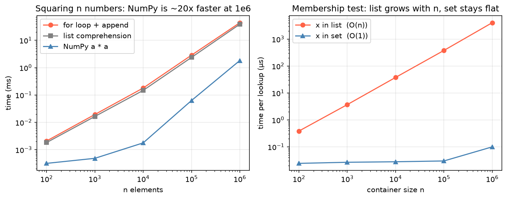

[Python Foundations](../README.md) › [效能與擴展](README.md) › Efficient Python

# 寫出有效率的 Python (Efficient Python)

最大的效能提升通常不是語法微調，而是**改變解法的形狀**：選對資料結構、把 Python 層級的迴圈交給 NumPy / pandas 的底層實作。順序永遠是：先量測 → 找到瓶頸 → 換解法 → 才考慮平行化（見 [平行運算](parallel.md)）。

```
量測（timeit / profiler）
  → 演算法與資料結構對嗎？（set 查找、Counter、避免重複計算）
    → 能向量化嗎？（NumPy / pandas 整欄運算）
      → 還不夠：Numba / Polars / 平行化 / 分散式
```

## 量測 (Measure)

| 工具 | 回答 | 用法 |
| --- | --- | --- |
| `%timeit` / `timeit` | 一小段程式多快 | `%timeit expr`、`%%timeit`（整個 cell） |
| `time.perf_counter()` | 腳本某段花多久 | 前後相減 |
| `cProfile` | 時間花在哪些**函式** | `python -m cProfile -s cumtime script.py` |
| `line_profiler` | 時間花在哪一**行** | `%lprun -f func func(data)` |
| `memory_profiler` | 每行配置多少記憶體 | `%mprun -f func func(data)` |
| `py-spy` / `scalene` | 不改程式碼，取樣正在跑的程式 | `py-spy top --pid 1234`、`scalene script.py` |

```python
%timeit np.random.default_rng(0).random(1000)
%timeit -n 100 -r 5 sum(range(1000))      # 指定 loops / runs
res = %timeit -o sorted(data)             # 保留結果：res.best、res.timings

import timeit
timeit.timeit("sum(range(1000))", number=10_000)   # 腳本中使用

%load_ext line_profiler
%lprun -f normalize normalize(df)
```

| 原則 | 說明 |
| --- | --- |
| 用相同、具代表性的資料比較 | 小資料看不出 O(n²) 的問題 |
| 先看數量級 | 10 倍以上的差異才值得改寫可讀的程式 |
| 只優化熱點 | 只佔總時間 2% 的函式，快 10 倍也沒差 |

## 選對資料結構



左：同樣是把 n 個數平方，comprehension 只比 `append` 迴圈快一點，NumPy 在 10⁶ 個元素時快約 20 倍。右：`x in list` 的時間隨 n 線性成長，`x in set` 幾乎不變。

| 需求 | 慢 | 快 |
| --- | --- | --- |
| 反覆的 membership test | `x in list`（O(n)） | `x in set` / `dict`（平均 O(1)） |
| 計數 | 手寫 `d[k] = d.get(k, 0) + 1` | `collections.Counter` |
| 分組收集 | 先檢查 key 是否存在 | `collections.defaultdict(list)` |
| 兩端增刪 | `list.insert(0, x)`、`list.pop(0)`（O(n)） | `collections.deque` |
| 排列 / 組合 | 手寫多層巢狀迴圈 | `itertools.product` / `combinations` |
| 大量同型別數值 | Python `list` of float | NumPy array（連續記憶體、向量化） |
| 前 k 大 | 整個排序後取前 k | `heapq.nlargest(k, x)`；NumPy `np.argpartition` |

```python
keep = set(gene_whitelist)                        # 建一次 set，之後查找 O(1)
filtered = [g for g in all_genes if g in keep]    # 若 keep 是 list：|all_genes| × |keep| 次比較

from collections import Counter
Counter(variant_types).most_common(3)
```

容器的完整介紹見 [核心資料型別](../core-data-types.md)。

## 內建函式與 comprehension

```python
totals = []                                       # 慢且囉嗦
for row in rows:
    totals.append(sum(row))

totals = [sum(row) for row in rows]               # comprehension
totals = list(map(sum, rows))                     # 套用既有函式時，map 也很直接

for i, v in enumerate(values): ...                # 取代 for i in range(len(values))
for name, score in zip(names, scores): ...        # 取代依 index 拼接
"".join(parts)                                    # 取代迴圈裡 s += part（每次都複製整個字串）
any(p < 0.05 for p in pvals)                      # 找到第一個就停
```

comprehension 主要的好處是意圖集中；複雜邏輯硬塞進一行反而難讀，此時寫回一般迴圈。

## 把不變的計算移出迴圈

```python
for name, attack in zip(names, attacks):          # 錯：每圈都重算一次平均
    if attack > np.mean(attacks):
        ...

threshold = np.mean(attacks)                      # 對：只算一次
for name, attack in zip(names, attacks):
    if attack > threshold:
        ...
```

同理：迴圈內不要重複轉型、重複編譯 regex（先 `re.compile`）、重複開檔或連資料庫。

## 向量化 (Vectorization)

整批數值運算交給 NumPy，運算在 C 層級的連續記憶體上執行，不經過 Python 物件。

```python
import numpy as np

values = np.array([1, 2, 3, 4])
values * 2                                        # array([2, 4, 6, 8])：逐元素
[1, 2, 3, 4] * 2                                  # [1, 2, 3, 4, 1, 2, 3, 4]：list 是重複串接！

X = np.array(rows, dtype=float)
X.mean(axis=1)                                    # 每列平均，取代 Python 迴圈
np.where(X > 0, np.log2(X), 0)                    # 條件運算取代 if/else 迴圈
(X - X.mean(axis=0)) / X.std(axis=0)              # broadcasting：每欄標準化

np.log2(counts + 1)                               # 取代 [math.log2(c + 1) for c in counts]
```

broadcasting 與 reshape 規則見 [NumPy 向量化與 reshape](../numpy/vectorization-and-reshape.md)。

### pandas：避免逐列處理

| 由快到慢 | 寫法 |
| --- | --- |
| 1. 整欄向量化 | `df["cpm"] = df["count"] / df["count"].sum() * 1e6` |
| 2. 內建方法 | `.str`、`.dt`、`groupby().agg()`、`np.where`、`np.select`、`.map(dict)` |
| 3. `.apply(func, axis=1)` | 本質仍是 Python 迴圈，只是寫起來短 |
| 4. `itertuples()` | 真的必須逐列時 |
| 5. `iterrows()` / `for i in range(len(df))` | 最慢，且每列轉成 Series 會改變 dtype |

詳見 [pandas 效能](../pandas/performance.md)。

## 迴圈無法避免時：Numba

逐元素依賴前一步（遞迴、動態規劃、模擬）無法向量化時，用 Numba 把數值迴圈編譯成機器碼。

```python
from numba import njit
import numpy as np

@njit                                             # 第一次呼叫時編譯，之後接近 C 的速度
def running_max_drawdown(x):
    peak, worst = x[0], 0.0
    for v in x:
        peak = max(peak, v)
        worst = min(worst, v - peak)
    return worst

running_max_drawdown(np.random.default_rng(0).normal(size=1_000_000).cumsum())
```

| 適合 Numba | 不適合 |
| --- | --- |
| NumPy array + 數值迴圈 | pandas DataFrame、dict、字串處理 |
| 無法向量化的遞迴關係 | 已經能用 NumPy 一行寫完的運算 |

## 記憶體

| 做法 | 原因 |
| --- | --- |
| generator 取代建好的大 list | 一次只放一筆，見 [迭代器與生成器](../iterator.md#生成器-generators惰性求值) |
| 指定較小的 dtype | `float32` 是 `float64` 的一半；重複字串用 `category` |
| 只讀需要的欄位 | `pd.read_csv(usecols=...)`、`pd.read_parquet(columns=...)` |
| 稀疏矩陣 | 單細胞計數矩陣 90% 以上是 0，用 `scipy.sparse` |
| 分塊處理 | `chunksize`、Dask、Polars streaming，見 [平行運算](parallel.md)、[Polars](polars.md) |

```python
import sys
sys.getsizeof([0.0] * 1_000_000)                  # 約 8 MB（只是指標，還不含 float 物件）
np.zeros(1_000_000).nbytes                        # 8,000,000 bytes
df.memory_usage(deep=True).sum()                  # DataFrame 實際記憶體
```

## 檢查表

| 問題 | 方向 |
| --- | --- |
| 量過了嗎？知道最慢的是哪一行嗎？ | `%timeit`、`line_profiler` |
| 迴圈內有重複的一次性計算嗎？ | 移出迴圈 |
| 一直在做 `in` 查找嗎？ | 改用 `set` / `dict` |
| 是整批數值運算嗎？ | NumPy 向量化 |
| 是 DataFrame 轉換嗎？ | 整欄運算、`groupby`，不要 `iterrows` |
| 迴圈真的無法避免嗎？ | Numba |
| 單核已經最佳化，資料還是太大或太慢？ | [平行運算](parallel.md)、[Polars](polars.md)、[分散式處理](../../data-engineering/scalable-processing-and-out-of-core.md) |
