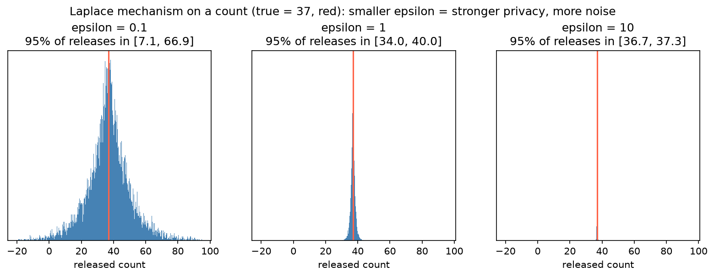

[Data Science](../README.md) › [Responsible AI](README.md) › Python 匿名化

# Python 匿名化 (Anonymization in Python)

匿名化不是單一轉換，而是**隱私保護與資料效用之間的取捨**：抑制、遮罩、概化能降低再識別風險，k-anonymity 給出可檢查的標準，差分隱私 (differential privacy) 給出數學保證。只刪姓名幾乎從來都不夠。法規面的去識別化標準（HIPAA Safe Harbor 等）見 [隱私與法規](privacy-and-regulation.md#hipaa-去識別化)。

## 先分類欄位

| 類型 | 例子 | 處理 |
| --- | --- | --- |
| 直接識別碼 | 姓名、身分證號、病歷號、email | 刪除，或以隨機研究編號取代（對照表另外保存） |
| 準識別碼 | 年齡、性別、郵遞區號、就診日期、職業、罕見診斷 | 概化、抑制，使組合不唯一 |
| 敏感屬性 | 診斷、檢驗值、基因型 | 分析目標；注意屬性揭露（見 l-diversity） |
| 其他 | 與識別無關的欄位 | 保留 |

> 經典案例：只用「郵遞區號 + 出生日期 + 性別」就能唯一識別美國大部分人口（Sweeney, 2000）。準識別碼的**組合**才是主要風險。

## 技術一覽

| 技術 | 做法 | 優點 | 缺點 |
| --- | --- | --- | --- |
| 抑制 (suppression) | 刪除欄位、儲存格或整列 | 隱私效果強 | 資料量與效用下降 |
| 遮罩 (masking) | 以假值或部分遮蔽取代（`****1234`） | 保留格式，適合測試資料 | 不提供正式的匿名保證 |
| 假名化 (pseudonymization) | 識別碼 → 代碼 | 可連結同一人的多筆紀錄 | 法律上仍是個資 |
| 概化 (generalization) | 精確值 → 區間或上層類別（34 → 30–39；鄉鎮 → 縣市） | 保留分析價值 | 損失精度 |
| 頂端 / 底端編碼 | 極端值合併（年齡 > 89 → 90+） | 保護分布尾端的少數人 | — |
| 彙總 (aggregation) | 只發表分組統計 | 適合統計報告 | 小格子仍有風險 → 小於門檻的格子要抑制 |
| 合成資料 (synthetic data) | 產生模仿分布的新紀錄 | 適合分享與開發 | 可能複製稀有個案；變數關聯可能失真 |
| 差分隱私 | 加入校準過的雜訊 | 可量化的隱私保證 | 結果有雜訊；需管理隱私預算 |

```python
import numpy as np
import pandas as pd

rng = np.random.default_rng(0)
df = pd.read_csv("cohort.csv")

# 1. 直接識別碼：刪除，或換成隨機研究編號（對照表另外存放、限制存取）
key = pd.DataFrame({"mrn": df["mrn"], "study_id": rng.permutation(len(df))})
df = df.drop(columns=["name", "national_id"]).assign(study_id=key["study_id"]).drop(columns="mrn")

# 2. 概化：年齡分組 + 頂端編碼；郵遞區號截短；日期只留年份
df["age_group"] = pd.cut(df["age"], bins=[0, 18, 30, 40, 50, 60, 70, 80, 90, 200],
                         right=False, labels=["<18", "18-29", "30-39", "40-49", "50-59",
                                              "60-69", "70-79", "80-89", "90+"])
df["zip3"] = df["zip"].astype(str).str[:3]
df["admit_year"] = pd.to_datetime(df["admit_date"]).dt.year
df = df.drop(columns=["age", "zip", "admit_date"])

# 3. 遮罩：只留後四碼
df["phone"] = "****" + df["phone"].astype(str).str[-4:]
```

> 隨機研究編號不要用識別碼的雜湊值（如 `sha256(身分證號)`）：身分證號空間小，攻擊者可以窮舉後比對。

## k-Anonymity

每一種準識別碼的組合在釋出資料中至少出現 k 次，使任何一人都至少與 k−1 人無法區分。

```python
QI = ["age_group", "sex", "zip3"]

sizes = df.groupby(QI, observed=True).size()
sizes.min()                                  # 目前的 k
(sizes < 5).sum()                            # 有幾個組合不滿 k=5

# 不滿 k 的組合：再概化（如 zip3 → 縣市），仍不足就抑制這些列
risky = sizes[sizes < 5].index
mask = df.set_index(QI).index.isin(risky)
df_k5 = df[~mask]
```

| 弱點 | 例子 | 補強 |
| --- | --- | --- |
| 同質性攻擊 | 某組 5 人的診斷全是 HIV → 知道某人在這組就知道診斷 | l-diversity：每組的敏感屬性至少有 l 種不同值 |
| 背景知識攻擊 | 攻擊者知道鄰居的其他資訊 | t-closeness：每組的敏感屬性分布接近整體分布 |
| 多次釋出 | 同一群人的不同版本互相比對 | 統一管理釋出版本 |
| 高維資料 | 欄位越多，組合越唯一，要達到 k 只能刪掉大部分資訊 | 改用差分隱私或受控存取 |

## 差分隱私 (Differential Privacy)

核心保證：無論某一個人的資料在或不在資料集中，輸出結果的分布幾乎相同，差異由隱私參數 ε (epsilon) 控制。保護的是「某人是否參與」，不依賴攻擊者有什麼背景知識。

| 概念 | 意義 |
| --- | --- |
| ε | 隱私損失；越小越隱私、雜訊越大。常見參考：≤ 1 屬強保護，> 10 保護很弱 |
| 敏感度 (sensitivity) | 一個人的資料最多能改變查詢結果多少；計數查詢 = 1 |
| Laplace 機制 | 輸出 = 真實值 + Laplace(0, 敏感度 / ε) 雜訊 |
| 隱私預算 | 每次查詢都消耗 ε；多次查詢的 ε 會累加，否則平均多次結果就能消掉雜訊 |
| 全域 vs 本地 DP | 全域：可信的管理者持有原始資料，對輸出加雜訊；本地：每個人在送出前自己加雜訊（雜訊更大） |



真實值 37 時，ε = 0.1 的釋出值 95% 落在約 7–67，幾乎沒有用；ε = 1 時約 34–40；ε = 10 時幾乎等於真值，保護也很弱。實務上要依用途在兩者之間取捨。

```python
import numpy as np
rng = np.random.default_rng(0)

def dp_count(true_count: int, epsilon: float) -> float:
    return true_count + rng.laplace(0, 1 / epsilon)          # 計數查詢敏感度 = 1

# diffprivlib：sklearn 風格的 DP 統計與模型
from diffprivlib.tools import mean
from diffprivlib.models import LogisticRegression

mean(ages, epsilon=0.5, bounds=(0, 100))                     # 一定要給 bounds：從資料推算邊界本身會洩漏隱私
clf = LogisticRegression(epsilon=1.0, data_norm=5.0).fit(X, y)   # data_norm 同理，需事先指定
```

美國 2020 人口普查即以差分隱私發布統計，是大規模應用的代表例子；代價是小地區統計的雜訊明顯。

## 合成資料

| 方法 | 工具 | 適合 |
| --- | --- | --- |
| 欄位層級假資料 | `faker` | 測試、示範；不保留真實關聯 |
| 依分布抽樣 | `numpy`、`scipy` 擬合分布後抽樣 | 單變數分布；各欄獨立抽樣會破壞變數間的相關 |
| 統計 / 深度生成模型 | SDV（Gaussian copula、CTGAN）、synthpop（R） | 保留多變數結構 |
| 差分隱私合成 | 結合 DP 的生成方法 | 需要可量化的保證 |

| 釋出前要檢查 | 方法 |
| --- | --- |
| 效用 | 在合成資料上訓練、在真實資料上測試 (train-on-synthetic, test-on-real)；比較邊際分布與相關 |
| 隱私 | 每筆合成紀錄與最近真實紀錄的距離 (distance to closest record)；稀有組合是否被複製 |

> 生成模型可能「記住」訓練資料，把稀有病人幾乎原樣重現。沒有 DP 保證的合成資料不等於匿名資料。

## PCA 不是匿名化

用主成分取代原始特徵可以遮蔽欄位語意並保留距離結構，對模型訓練仍有用；但沒有正式隱私保證，取得部分原始資料或投影矩陣的人可能還原。只能當作輔助遮蔽，不能當作匿名化。

## 自由文字與影像

| 資料 | 風險 | 工具 / 做法 |
| --- | --- | --- |
| 臨床自由文字 | 姓名、日期、地址、病歷號散落各處 | Microsoft Presidio、Philter 等 NER 工具 + 人工抽查；日期可整體位移（保留間隔） |
| DICOM 醫學影像 | 標頭含病人資訊；影像上可能燒印文字 | 依 DICOM 去識別化規範清除標頭；檢查燒印文字 |
| 頭部 MRI / CT | 可重建臉部 | 去臉 (defacing) 工具 |
| 全切片病理影像 | 標籤區域的條碼與文字 | 移除標籤影像 |

## 基因資料的限制

| 問題 | 說明 |
| --- | --- |
| 基因型本身就是識別碼 | 移除所有其他欄位後，基因型仍唯一對應一個人（同卵雙胞胎除外） |
| k-anonymity / 概化幾乎無效 | 數十萬個 SNP 的組合不可能概化到 k ≥ 2 又保留分析價值 |
| 可透過親屬再識別 | 消費型系譜資料庫、Y-STR 姓氏推論（見 [基因資料的特殊性](privacy-and-regulation.md#基因資料的特殊性)） |
| 彙總統計也可能洩漏 | 由等位基因頻率推論個人是否參與研究 |

| 實務做法 | 說明 |
| --- | --- |
| 受控存取 | dbGaP、EGA：申請 + DAC 審查 + DUA（見 [受控存取](privacy-and-regulation.md#受控存取-controlled-access)） |
| 只分享彙總結果 | GWAS summary statistics、變異頻率（如 gnomAD 只提供頻率） |
| 可信研究環境 | 資料不出平台，只匯出彙總結果 |
| 聯邦式分析 | 各站點本地分析，只交換模型參數或統計量 |
| 移除或模糊高風險資訊 | 罕見變異、Y-STR、粒線體單倍群可能需要額外限制 |

## 釋出前檢查

| 問題 | 沒做到的後果 |
| --- | --- |
| 每個欄位是直接識別碼、準識別碼還是敏感屬性？ | 漏掉組合風險 |
| 每個高風險欄位用了什麼技術？ | 只刪姓名就釋出 |
| k 是多少？是否檢查了 l-diversity？ | 同質性攻擊 |
| 資料是否仍能支援預定的分析？ | 過度保護導致無法使用 |
| 使用的是非正式技術、k-anonymity，還是 DP 保證？ | 高估保護程度 |
| 含基因資料嗎？是否應改走受控存取？ | 無法撤回的外洩 |
