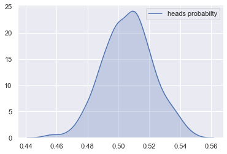

[Statistics](../README.md) › [貝氏統計](README.md) › 貝氏定理

# 貝氏定理與核心概念 (Bayes' Theorem)

頻率學派只能回答「若 H₀ 為真，這筆資料有多極端？」；貝氏可以直接回答「看完資料後，我對參數的信念是什麼？」

| 觀點 | 機率代表 | 例子 |
| --- | --- | --- |
| 頻率學派 (frequentist) | 長期相對次數 | 「公平硬幣多次擲出正面的比例是 50%」 |
| 貝氏 (Bayesian) | 信念 / 不確定性 | 「我有 70% 把握這枚硬幣是公平的」 |

貝氏觀點可以對**一次性事件**與**參數**給機率；頻率學派把參數視為固定的未知常數。

## 貝氏定理

由條件機率 $P(A \cap B) = P(A \mid B)P(B) = P(B \mid A)P(A)$ 移項即得。基礎版（事件、篩檢例子）見 [機率基礎](../probability-and-distributions/probability-basics.md#貝氏定理-bayes-theorem)。

把事件換成**參數 θ** 與**資料 D**：

$$
\underbrace{P(\theta \mid D)}_{\text{後驗}} = \frac{\overbrace{P(D \mid \theta)}^{\text{概似}} \cdot \overbrace{P(\theta)}^{\text{先驗}}}{\underbrace{P(D)}_{\text{證據}}}
\qquad\Longrightarrow\qquad
\text{後驗} \propto \text{概似} \times \text{先驗}
$$

| 項 | 名稱 | 回答 |
| --- | --- | --- |
| P(θ) | 先驗 (prior) | 看資料前相信什麼？ |
| P(D \| θ) | 概似 (likelihood) | 哪些參數值讓觀察到的資料合理？ |
| P(θ \| D) | 後驗 (posterior) | 結合兩者後該相信什麼？ |
| P(D) = ∫P(D \| θ)P(θ)dθ | 證據 / 邊際概似 (marginal likelihood) | 正規化常數，讓後驗積分為 1 |

> P(D) 的積分在複雜模型中通常算不出來，這就是 [MCMC](mcmc.md) 存在的原因：只需要「後驗 ∝ 概似 × 先驗」就能抽樣。

## 更新循環

```
先驗 → [觀察資料] → 後驗 → [更多資料] → 更新後的後驗 → …
```

| 情況 | 結果 |
| --- | --- |
| 強先驗 | 需要更多資料才能推翻 |
| 弱先驗 | 資料很快主導 |
| 資料越多 | 不論先驗為何，後驗都集中到真值附近，趨近 MLE |

## 範例：擲硬幣

先驗 Beta(2, 2)（大概公平，但不確定），擲 10 次得 7 次正面。Beta 先驗 + Binomial 資料 → 後驗仍是 Beta（[共軛](likelihood-conjugate.md)）：Beta(2 + 7, 2 + 3) = Beta(9, 5)。

```python
import numpy as np
import matplotlib.pyplot as plt
from scipy.stats import beta

theta = np.linspace(0, 1, 300)
a0, b0, heads, tails = 2, 2, 7, 3

prior = beta.pdf(theta, a0, b0)
posterior = beta.pdf(theta, a0 + heads, b0 + tails)
likelihood = theta**heads * (1 - theta)**tails
likelihood /= likelihood.max()                     # 只為了畫圖縮放

plt.plot(theta, prior, "--", color="gray", label="Prior Beta(2,2)")
plt.plot(theta, likelihood, ":", label="Likelihood (scaled)")
plt.plot(theta, posterior, lw=2.5, color="tomato", label="Posterior Beta(9,5)")
plt.axvline(0.7, ls="--", alpha=0.4, label="MLE = 0.7")
plt.legend(); plt.show()

# 逐批更新：上一批的後驗 = 下一批的先驗
a, b = 2, 2
for h, t in [(5, 3), (9, 3), (11, 9)]:
    a, b = a + h, b + t
    print(round(beta(a, b).mean(), 3))
```

後驗是先驗與資料的**折衷**：被資料拉向 0.7，但被先驗往 0.5 修正。只擲 10 次時先驗影響明顯；擲 1,000 次時後驗幾乎與概似重合，這也是大樣本下兩學派結論相近的原因。



**讀後驗密度圖**：(1) 機率質量集中在哪；(2) 有多寬（窄 = 較精確的主張）；(3) 是否對稱。

> 逐批更新的特性讓貝氏方法很適合 A/B 測試、線上學習、監控等資料逐步累積的情境。
