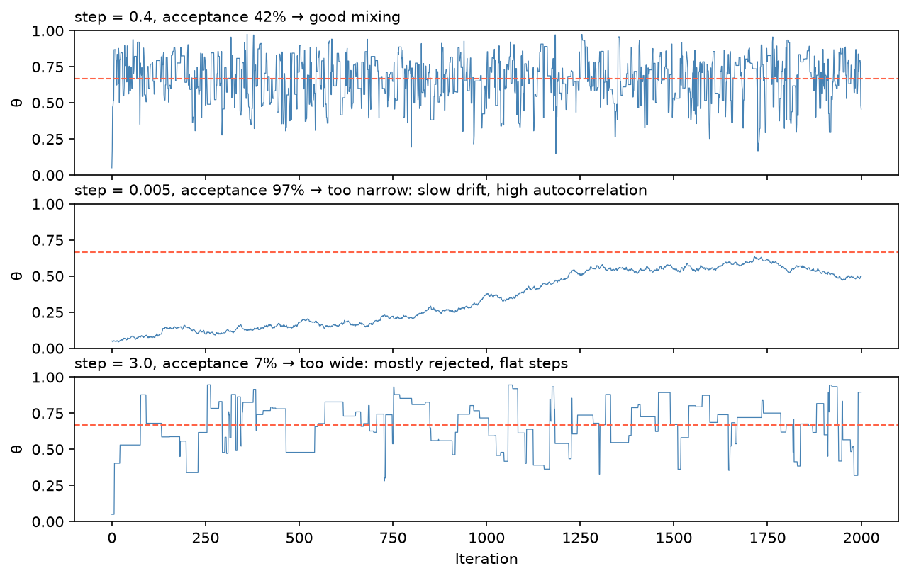

[Statistics](../README.md) › [貝氏統計](README.md) › MCMC

# 馬可夫鏈蒙地卡羅 (Markov Chain Monte Carlo, MCMC)

多數真實模型的後驗沒有公式解：分母 $P(D) = \int P(D \mid \theta)P(\theta)\,d\theta$ 在高維度下無法計算。MCMC 只需要能計算**未正規化的後驗**（概似 × 先驗），就能建構一條馬可夫鏈，使其穩定分配 (stationary distribution) 等於後驗，再從中抽樣。

## 基本流程

1. 從初始值 θ⁰ 開始
2. 依轉移規則提議新值 θ*
3. 依 θ* 的後驗高低決定接受或拒絕
4. 重複數千次 → 接受的序列形成馬可夫鏈
5. 丟掉前段的**暖機 (burn-in / warm-up)**，剩下的樣本近似來自後驗

## Metropolis-Hastings（基礎演算法）

每一步：從 q(θ* | θᵗ)（如以目前值為中心的常態）提議 θ*，計算 $r = P(\theta^* \mid D) / P(\theta^t \mid D)$，以機率 min(1, r) 接受，否則留在原地。比值中 P(D) 抵消，所以不需要算它。

```python
import numpy as np

def log_post(t):                                 # 目標：Beta(6, 3)（未正規化）
    return -np.inf if not 0 < t < 1 else 5 * np.log(t) + 2 * np.log(1 - t)

rng = np.random.default_rng(42)
samples = [0.5]
for _ in range(5000):
    cur = samples[-1]
    prop = cur + rng.normal(0, 0.1)              # 提議寬度 0.1
    accept = np.log(rng.uniform()) < log_post(prop) - log_post(cur)
    samples.append(prop if accept else cur)

post_samples = np.array(samples[500:])           # 丟掉 burn-in
post_samples.mean()                              # ≈ 6/9 = 0.667
```

> 提議寬度太窄 → 探索慢、自相關高；太寬 → 幾乎都被拒絕。MH 的理想接受率約 23–50%。實務上**不要自己寫 MH**，用 PyMC / Stan。



## 現代抽樣器

| 抽樣器 | 機制 | 接受率 | 高維度 |
| --- | --- | --- | --- |
| Metropolis-Hastings | 隨機漫步提議 | 20–50% | 差 |
| HMC (Hamiltonian Monte Carlo) | 利用梯度做有方向的提議 | 65–90% | 好 |
| **NUTS** (No-U-Turn Sampler) | 自動調整路徑長度的 HMC | 65–90% | **很好**，PyMC / Stan 預設 |

> 替代方案：**變分推論 (variational inference, VI)** 用最佳化近似後驗，比 MCMC 快很多但較不精確；常用於大資料與深度學習（如 VAE、scVI）。

## PyMC 範例

```python
import pymc as pm
import arviz as az

with pm.Model() as coin_model:
    theta = pm.Beta("theta", alpha=2, beta=2)                     # 先驗
    pm.Binomial("y", n=25, p=theta, observed=15)                  # 概似
    trace = pm.sample(2000, tune=1000, chains=4, random_seed=42)  # NUTS

az.summary(trace, var_names=["theta"])     # mean ≈ 0.586、HDI、ess_bulk、ess_tail、r_hat
az.plot_trace(trace)                       # 軌跡圖
az.plot_posterior(trace, hdi_prob=0.95)    # 後驗 + HDI
```

公式語法版本（類似 statsmodels）：`bambi.Model("y ~ x + (1|subject)", data).fit()`。

## 收斂診斷

MCMC 不保證收斂，**診斷是結果的一部分**，不是附錄。

| 檢查 | 工具 | 標準 |
| --- | --- | --- |
| 軌跡圖 (trace plot) | `az.plot_trace()` | 像「毛毛蟲」：混合良好、無趨勢、多條鏈重疊 |
| R̂（Gelman-Rubin） | `az.summary()` | 所有參數 **≤ 1.01** |
| ESS_bulk / ESS_tail（有效樣本數） | `az.summary()` | 每個參數 **≥ 400** |
| 發散 (divergences) | `trace.sample_stats.diverging.sum()` | **0**（或極少） |
| PPC | `az.plot_ppc()` | 模擬資料與觀察資料相符 |

| 軌跡圖樣貌 | 診斷 | 對策 |
| --- | --- | --- |
| 隨機、混合良好 | 收斂 | 繼續 |
| 有趨勢或漂移 | 未收斂 | 增加暖機、重新參數化 |
| 卡住的平坦段 | 抽樣困難（如 funnel 幾何） | 重新參數化（non-centered） |
| 多條鏈不重疊 | 多峰或未收斂 | 檢查模型、更好的初始值 |

- **R̂** 比較鏈內與鏈間變異，至少跑 **4 條鏈**才有意義；單一條鏈即使沒探索完整後驗也常看起來正常。
- **ESS** = 扣除自相關後的「等效獨立樣本數」：$\text{ESS} = N / (1 + 2\sum_k \rho_k)$。
- **發散**代表後驗幾何有問題（常見於階層模型），不要忽略。
