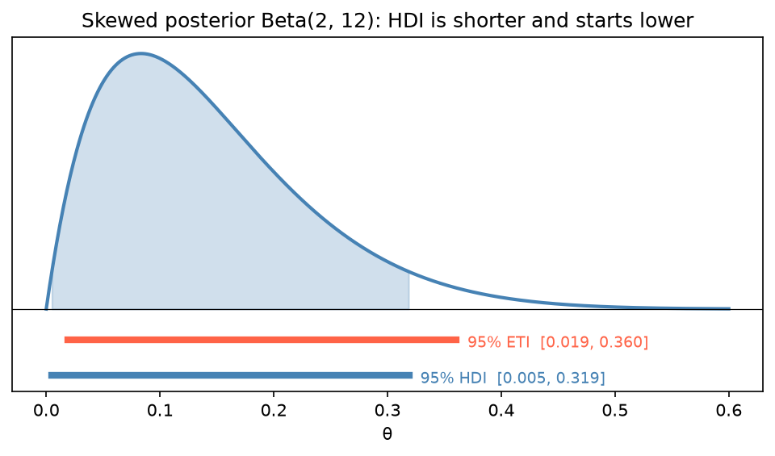

[Statistics](../README.md) › [貝氏統計](README.md) › 後驗推論

# 後驗推論 (Posterior Inference)

後驗分配**本身**就是貝氏推論的完整答案。不要只報後驗平均：形狀、寬度、尾部都有資訊。

## 點估計

| 估計 | 定義 | 最小化的損失 | 適用 |
| --- | --- | --- | --- |
| 後驗平均 (posterior mean) | E[θ \| D] | 平方誤差 | 對稱的後驗 |
| 後驗中位數 (posterior median) | 第 50 百分位 | 絕對誤差 | 偏態後驗，較穩健 |
| MAP (maximum a posteriori) | 後驗的眾數 argmax P(θ \| D) | 0-1 損失 | 需要「最可能的值」；= 正則化後的 MLE |

對稱分配時三者相等；偏態時要注意差異。

## 可信區間 (Credible Interval)

「給定資料，θ 有 95% 機率落在此區間」，就是多數人以為 [信賴區間](../inferential-statistics/confidence-intervals.md) 的意思。

| 區間 | 定義 | 特性 |
| --- | --- | --- |
| 等尾區間 (equal-tailed interval, ETI) | 第 2.5 與 97.5 百分位 | 簡單；偏態時包含低密度區 |
| 最高密度區間 (highest density interval, HDI) | 包含 95% 質量的**最短**區間 | 偏態時較窄、集中在高密度處；**建議預設** |

對稱後驗時 ETI ≈ HDI。



```python
import numpy as np
import arviz as az
from scipy.stats import beta

post = beta(8, 4)
post.mean(), post.median(), (8 - 1) / (8 + 4 - 2)     # 平均、中位數、MAP（Beta 的眾數）
post.ppf([0.025, 0.975])                               # 95% ETI

samples = post.rvs(20_000, random_state=0)
az.hdi(samples, hdi_prob=0.95)                         # 95% HDI（用樣本計算，MCMC 結果同樣適用）

# 決策相關的機率陳述
(samples > 0.5).mean()                                 # P(θ > 0.5 | D)
```

## 後驗預測分配 (Posterior Predictive)

「看過資料後，**未來的觀測**會是什麼樣？」對所有參數值以後驗加權平均：

$$
P(\tilde{y} \mid D) = \int P(\tilde{y} \mid \theta)\, P(\theta \mid D)\, d\theta
$$

同時包含兩種不確定性：**參數的不確定性** + **資料本身的隨機性**，所以比後驗更寬（概念同迴歸的 [預測區間](../regression-analysis/simple-linear-regression.md#信賴區間-vs-預測區間)）。

```python
from scipy.stats import binom

theta_s = beta.rvs(8, 4, size=10_000, random_state=1)    # 1. 從後驗抽 θ
y_pred = binom.rvs(n=10, p=theta_s, random_state=2)      # 2. 每個 θ 模擬未來 10 次
y_pred.mean(), np.percentile(y_pred, [5, 95])
```

## 後驗預測檢查 (Posterior Predictive Check, PPC)

把**觀察資料**與**從後驗預測分配模擬的資料**比較，是偵測模型設定錯誤的主要工具。

| 結果 | 意義 |
| --- | --- |
| 觀察統計量落在模擬分配中間 | 模型合理 |
| 觀察統計量落在極端尾部 | 模型可能設定錯誤（例如忽略了過度離散） |

```python
# PyMC 工作流程
with model:
    pm.sample_posterior_predictive(trace, extend_inferencedata=True)
az.plot_ppc(trace)
```

選擇要比較的統計量時，挑模型**沒有直接配適**的特徵（例如變異數、0 的比例、最大值），比較能揭露問題。

## 報告習慣

1. 中心估計（平均或中位數）
2. 可信區間（HDI）
3. 與決策相關的機率陳述（P(效果 > 0)、P(提升 > 2%)）
4. 若未來結果重要：後驗預測的含義
5. 先驗的選擇與 [敏感度分析](prior-distributions.md#先驗敏感度分析-prior-sensitivity)
