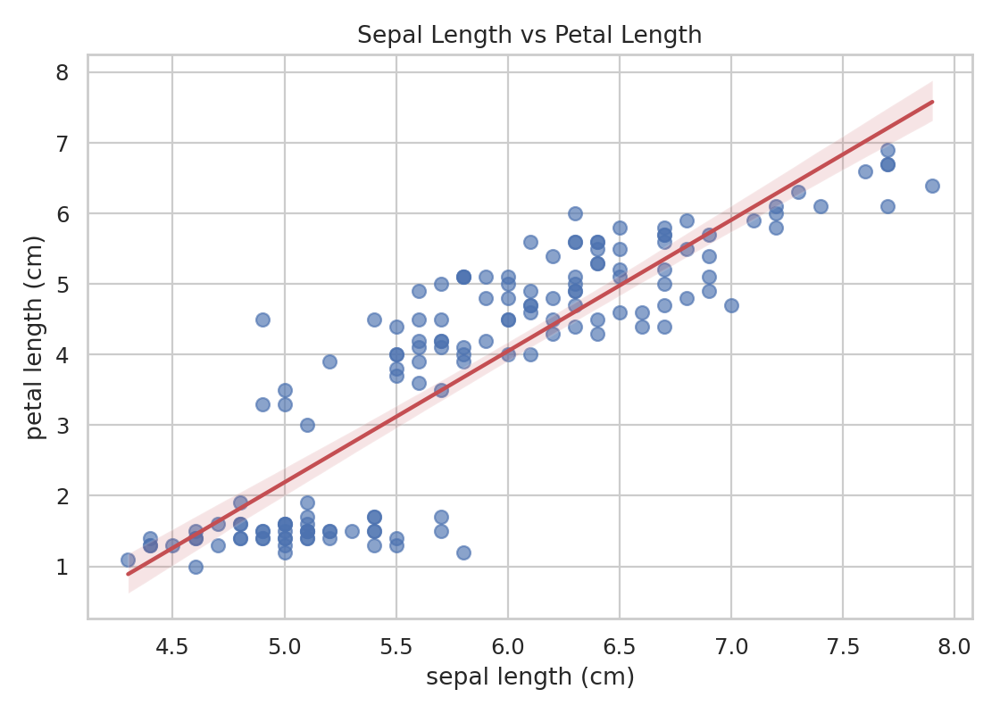
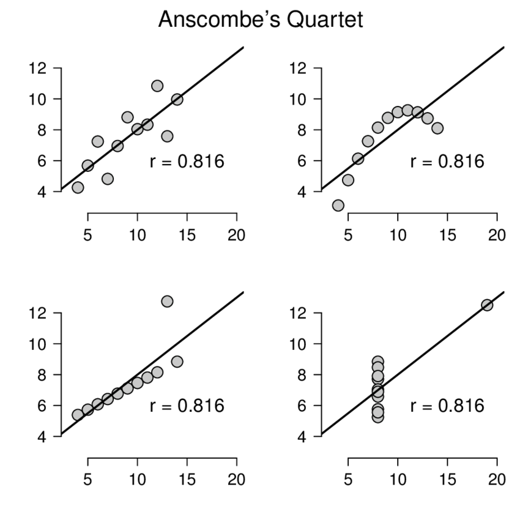
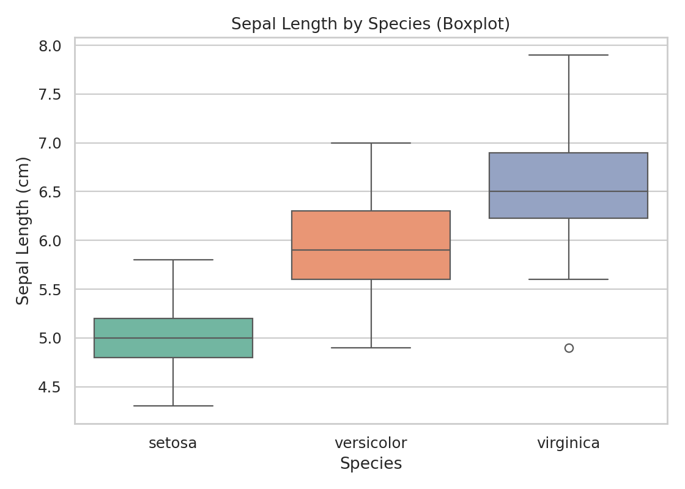
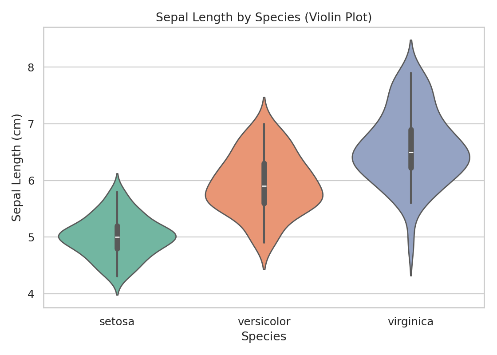
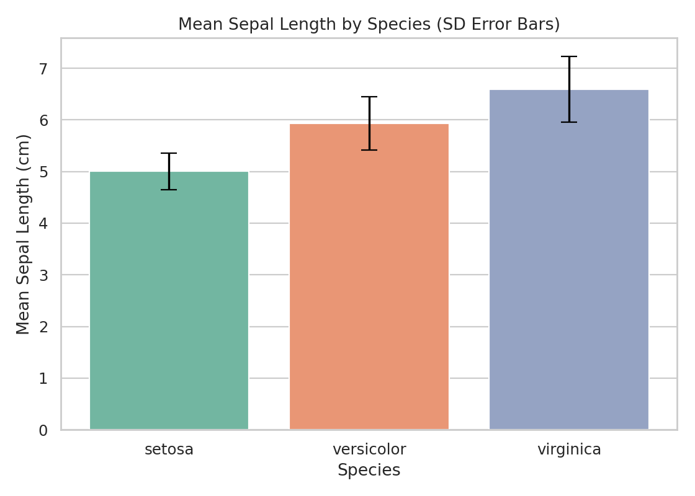
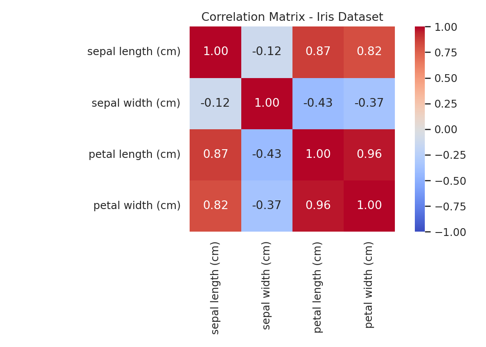
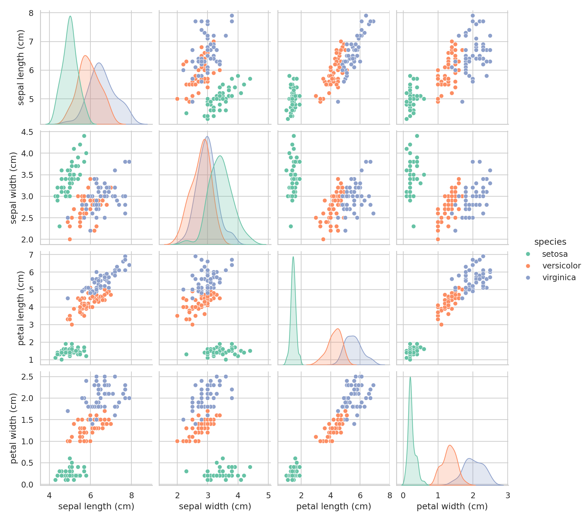

[Statistics](../README.md) › [敘述統計](README.md) › 雙變數分析

# 雙變數分析 (Bivariate Analysis)

探討**兩個變數**之間的關係，方法取決於兩者的型態：

| 變數 A | 變數 B | 描述方法 | 對應檢定 |
| --- | --- | --- | --- |
| 數值 | 數值 | 散布圖、Pearson / Spearman / Kendall 相關 | [相關檢定](../inferential-statistics/statistical-tests.md)、[等級相關](../nonparametric-methods/rank-correlation.md) |
| 類別 | 類別 | 交叉表 (cross-tabulation)、分組長條圖 | [卡方檢定](../nonparametric-methods/chi-square.md) |
| 數值 | 類別 | 分組摘要、分組 boxplot / violin | [t 檢定 / ANOVA](../inferential-statistics/statistical-tests.md)、[Mann-Whitney / Kruskal-Wallis](../nonparametric-methods/README.md) |
| 多個數值 | 多個數值 | 相關矩陣、heatmap、pairplot | [多變量分析](../multivariate-analysis/README.md) |

> **相關 ≠ 因果 (correlation ≠ causation)**。強相關只代表兩者一起變動，不代表一個造成另一個。

## 類別 × 類別：交叉表

交叉表 (contingency table) 呈現兩個類別變數的聯合次數。重點是選對**標準化方向**：

| `normalize=` | 意義 | 回答的問題 |
| --- | --- | --- |
| `False`（預設） | 原始次數 | 各格有幾筆？ |
| `"index"` | 每列加總為 1 | 在某性別中，存活比例多少？ |
| `"columns"` | 每欄加總為 1 | 在存活者中，男女各佔多少？ |
| `"all"` | 全表加總為 1 | 各組合佔全體多少？ |

```python
import pandas as pd

data = pd.DataFrame({
    "Gender":   ["Male", "Female", "Male", "Female", "Male", "Female"],
    "Survived": ["No",   "Yes",    "Yes",  "Yes",    "No",   "No"],
})

pd.crosstab(data["Gender"], data["Survived"], margins=True)          # 次數 + 總計
pd.crosstab(data["Gender"], data["Survived"], normalize="index")     # 列比例
# Survived     No    Yes
# Female    0.333  0.667
# Male      0.667  0.333
```

## 數值 × 數值：相關係數 (Correlation)

| 方法 | 衡量 | 資料 | 離群值 | 適用 |
| --- | --- | --- | --- | --- |
| **Pearson r** | **線性**關係 | 連續、近似常態 | 敏感 | 乾淨的數值資料 |
| **Spearman ρ** | **單調 (monotonic)** 關係（用排名算 Pearson） | Ordinal、偏態 | 穩健 | 非常態、有離群值 |
| **Kendall τ** | 單調關係（一致 / 不一致配對） | Ordinal、小樣本 | 穩健 | 小樣本、很多同分 (ties) |

$$
r = \frac{\sum (x_i-\bar{x})(y_i-\bar{y})}{\sqrt{\sum (x_i-\bar{x})^2 \sum (y_i-\bar{y})^2}}, \quad -1 \le r \le 1
$$

**強度參考（只是經驗值，依領域而定）**

| \|r\| | 強度 |
| --- | --- |
| < 0.3 | 弱 |
| 0.3 – 0.5 | 中 |
| ≥ 0.5 | 強 |

```python
from scipy import stats
from sklearn.datasets import load_iris

df = load_iris(as_frame=True).frame
a, b = df["sepal length (cm)"], df["petal length (cm)"]

r, p = stats.pearsonr(a, b)        # Pearson r 與 p 值
rho, p = stats.spearmanr(a, b)     # Spearman ρ
tau, p = stats.kendalltau(a, b)    # Kendall τ
a.corr(b)                          # pandas 快速版（只有係數）
```

**Pearson 的前提**：兩者皆為連續變數、關係為線性（看散布圖）、大致常態、無嚴重離群值。不符合時改用 Spearman。

> **重點**
>
> - r 只抓**線性**關係；r ≈ 0 不代表沒關係（例如 U 形）。
> - r² = 一個變數的變異能被另一個線性解釋的比例，與 [簡單線性迴歸](../regression-analysis/simple-linear-regression.md) 的 R² 相同。
> - 同時算上千對相關（例如基因共表現 co-expression）時，記得做 [多重檢定校正](../inferential-statistics/multiple-testing.md)。
> - 比例 / 組成資料 (compositional data，如微生物相對豐度) 加總固定為 1，會產生假相關。

### 先畫圖：散布圖

**Anscombe's Quartet**：四組資料相關係數幾乎相同，圖形卻完全不同。先畫圖，再算數字。

```python
import matplotlib.pyplot as plt
import seaborn as sns

sns.regplot(x=a, y=b, scatter_kws={"alpha": 0.6}, line_kws={"color": "#c44e52"})
plt.title(f"Sepal vs Petal Length (r = {r:.3f})")
plt.show()
```

| 散布圖 + 迴歸線 | Anscombe's Quartet |
| --- | --- |
|  |  |

<sub>Anscombe 圖片來源：[ResearchGate](https://www.researchgate.net/figure/Anscombes-quartet-highlights-the-importance-of-plotting-data-to-confirm-the-validity-of_fig2_280302159)</sub>

## 數值 × 類別：分組比較

```python
iris = load_iris(as_frame=True)
df = iris.frame
df["species"] = iris.target_names[iris.target]
col = "sepal length (cm)"

# 分組摘要
df.groupby("species")[col].agg(
    n="count", mean="mean", median="median", sd="std",
    iqr=lambda s: s.quantile(0.75) - s.quantile(0.25),
).round(3)
#             n   mean  median     sd    iqr
# setosa     50  5.006     5.0  0.352  0.400
# versicolor 50  5.936     5.9  0.516  0.700
# virginica  50  6.588     6.5  0.636  0.675

# 三種圖
sns.boxplot(x="species", y=col, data=df)                  # 中位數、IQR、離群值
sns.violinplot(x="species", y=col, data=df)               # 分布形狀
sns.barplot(x="species", y=col, data=df, errorbar="sd")   # 平均數 ± SD
```

| 圖 | 適合 |
| --- | --- |
| 分組 boxplot | 比較中位數與分散、找離群值 |
| violin plot | 看各組分布形狀（例如雙峰） |
| 長條圖 + error bar | 比較平均數；**務必註明 error bar 是 SD / SE / CI** |

| Boxplot | Violin | Bar + error bar |
| --- | --- | --- |
|  |  |  |

> 樣本少時（例如每組 n = 3 的生物重複），長條圖會隱藏資料點，建議疊加原始點（`sns.stripplot`）。

## 多個數值變數：相關矩陣

```python
num_cols = df.select_dtypes("number").columns
corr = df[num_cols].corr(method="pearson")   # 或 "spearman"

# Heatmap
sns.heatmap(corr, annot=True, fmt=".2f", cmap="coolwarm", vmin=-1, vmax=1, center=0, square=True)
plt.show()

# Pairplot：所有變數兩兩散布圖，對角線為分布
sns.pairplot(df, hue="species", diag_kind="kde")
plt.show()
```

| Heatmap | Pairplot |
| --- | --- |
|  |  |

> 特徵之間高度相關 → 迴歸會有 [多重共線性](../multivariate-analysis/assumptions-diagnostics.md)；也可考慮 [PCA](../multivariate-analysis/pca.md) 降維。

## 解讀關係前的三個問題

1. 真的是線性關係嗎？
2. 這個關聯是不是被離群值或子群體 (subgroup) 驅動？→ 見 Simpson's paradox，[干擾與偏誤](../experimental-design/confounding-bias.md)
3. 是否有第三個變數（干擾因子 confounder）能解釋？

雙變數分析是**篩選階段**，不是下因果結論的階段。
