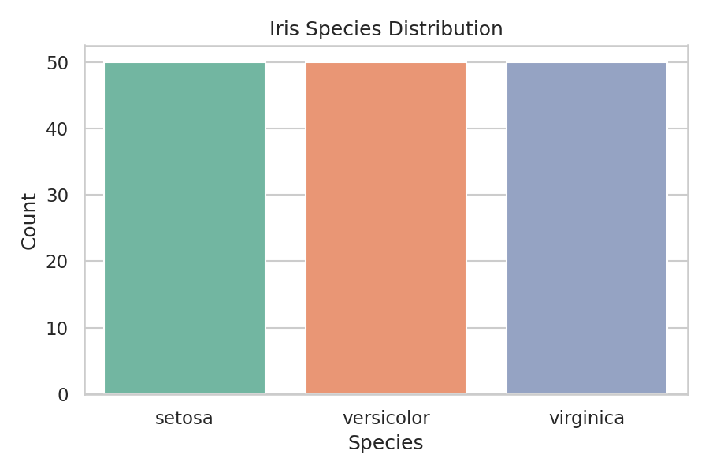
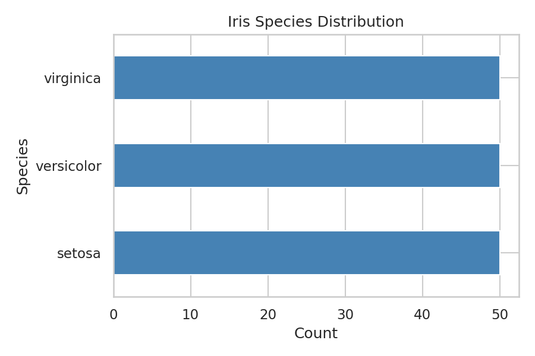
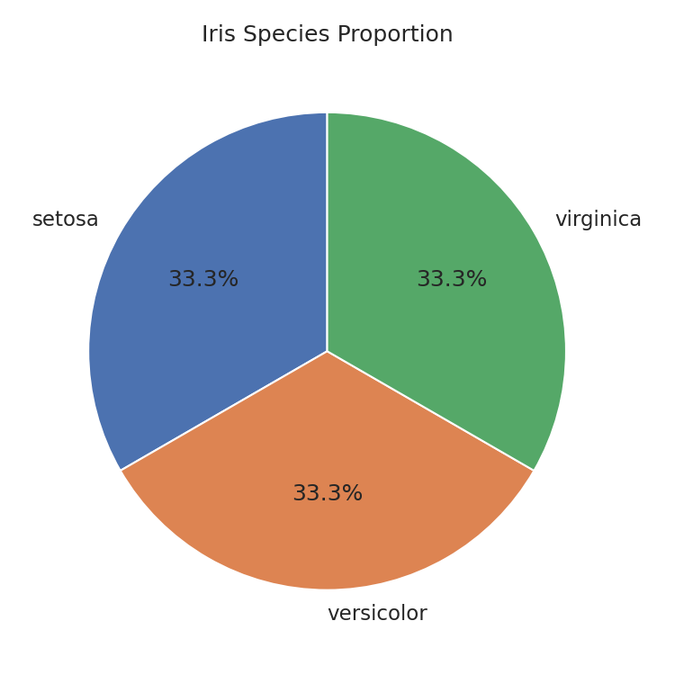
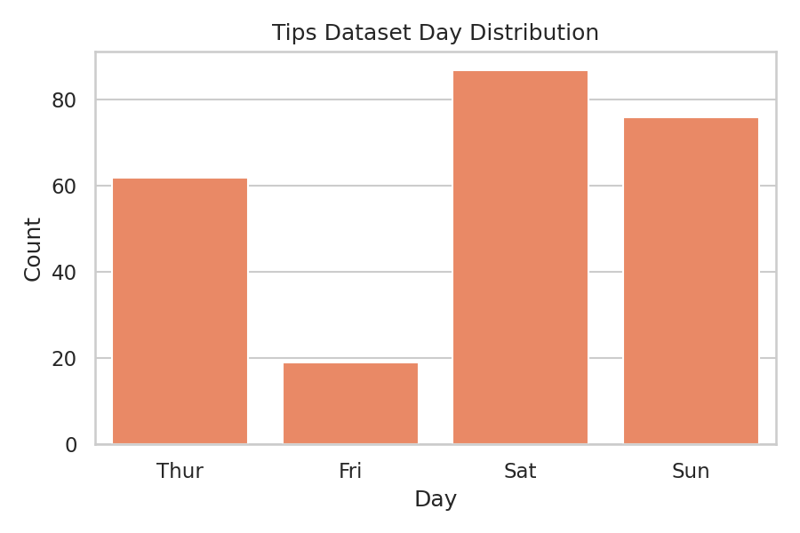

[Statistics](../README.md) › [敘述統計](README.md) › 單變數：類別型

# 單變數分析：類別型 (Univariate – Categorical)

描述單一類別變數（Nominal / Ordinal）。類別沒有有意義的平均數或標準差，所以重點是**次數、比例與分布圖**。

## 次數表 (Frequency Table)

| 指標 | 說明 |
| --- | --- |
| 次數 (frequency, n) | 每類出現幾次 |
| 相對次數 (relative frequency) | 次數 ÷ 總數 |
| 百分比 (%) | 相對次數 × 100 |
| 累積百分比 (cumulative %) | 逐類累加，**主要用於 Ordinal** |

```python
import pandas as pd
import seaborn as sns

df = sns.load_dataset("iris")

summary = pd.DataFrame({
    "Count": df["species"].value_counts(),
    "Proportion": df["species"].value_counts(normalize=True).round(3),
})
#             Count  Proportion
# setosa         50       0.333
# versicolor     50       0.333
# virginica      50       0.333

# 問卷資料建議加 dropna=False：「沒填」本身可能有意義
df["species"].value_counts(dropna=False)
```

> **何時用比例而不是次數？** 比較大小不同的群組時。100 人中 30 人抱怨，與 1,000 人中 30 人抱怨完全不同。

## 順序型資料：保留順序

不指定順序時，pandas 會依**字母**排序（Bad → Excellent → Good），破壞邏輯順序。

```python
levels = ["Strongly disagree", "Disagree", "Neutral", "Agree", "Strongly agree"]
likert = pd.Series(pd.Categorical(df_survey["satisfaction"], categories=levels, ordered=True))

prop = likert.value_counts(normalize=True).sort_index()
likert_summary = pd.DataFrame({
    "Count": likert.value_counts().sort_index(),
    "Proportion": prop.round(3),
    "Cumulative %": (prop.cumsum() * 100).round(1),
})
```

> Ordinal 問卷用**累積百分比**（例如「Agree 以上佔 65%」）通常比平均分數更好解讀，因為它不假設各級之間等距。

## 視覺化

| 圖 | 適用 | 避免 |
| --- | --- | --- |
| 直立長條圖 (vertical bar) | 預設選擇，比較各類次數 | 標籤太長或類別太多 |
| 水平長條圖 (horizontal bar) | 標籤長、類別多 | — |
| 有序長條圖 (ordered bar) | Ordinal，順序有意義 | 未先指定順序 |
| 圓餅圖 (pie) | 強調「部分佔整體」且類別 ≤ 5 | 需要精確比較時 |

```python
import matplotlib.pyplot as plt

counts = df["species"].value_counts()

# 直立長條圖
sns.countplot(x="species", data=df, hue="species", palette="Set2", legend=False)
plt.show()

# 水平長條圖（排序後更好讀）
counts.sort_values().plot(kind="barh", color="steelblue")
plt.show()

# 圓餅圖
counts.plot(kind="pie", autopct="%1.1f%%", startangle=90)
plt.ylabel("")
plt.show()

# 有序長條圖：先指定 order
tips = sns.load_dataset("tips")
sns.countplot(x="day", data=tips, order=["Thur", "Fri", "Sat", "Sun"], color="coral")
plt.show()
```

| 直立長條圖 | 水平長條圖 |
| --- | --- |
|  |  |
| **圓餅圖** | **有序長條圖** |
|  |  |

更多圖表語法見 [Seaborn: Categorical](../../data-manipulation-and-eda/visualization/seaborn/categorical.md)。

## 稀有類別 (Rare Categories)

真實資料常有很多低頻類別。繪圖或建模前，考慮把它們合併為 `Other`：

```python
counts = df["category"].value_counts(normalize=True)
rare = counts[counts < 0.01].index
df["category_grouped"] = df["category"].where(~df["category"].isin(rare), "Other")
```

稀有類別在 ML 中會造成 one-hot 維度暴增與過擬合，見 [Categorical Encoding](../../machine-learning/preprocessing/categorical-encoding.md)。
