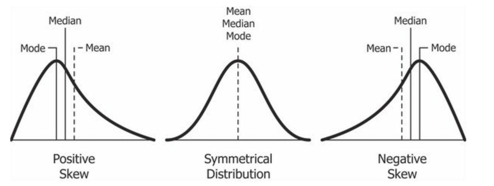
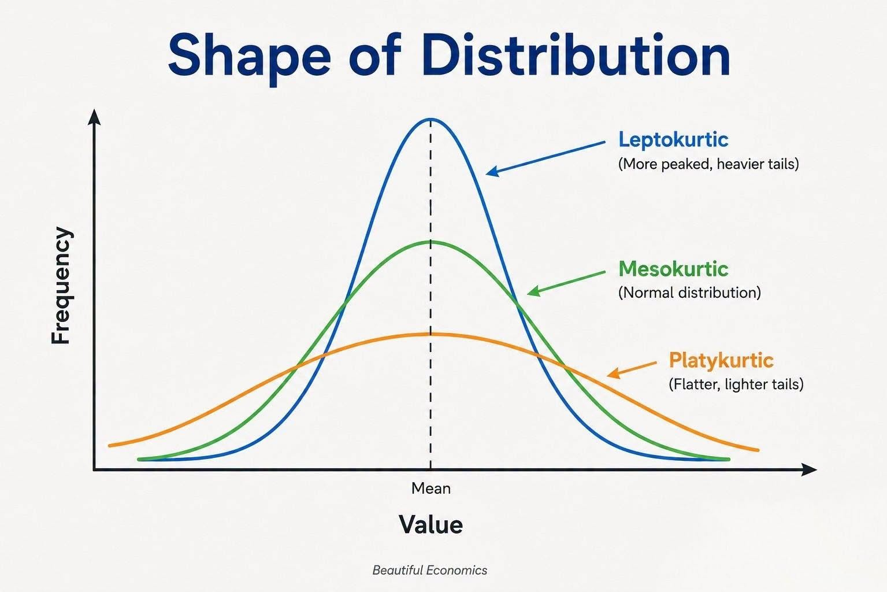
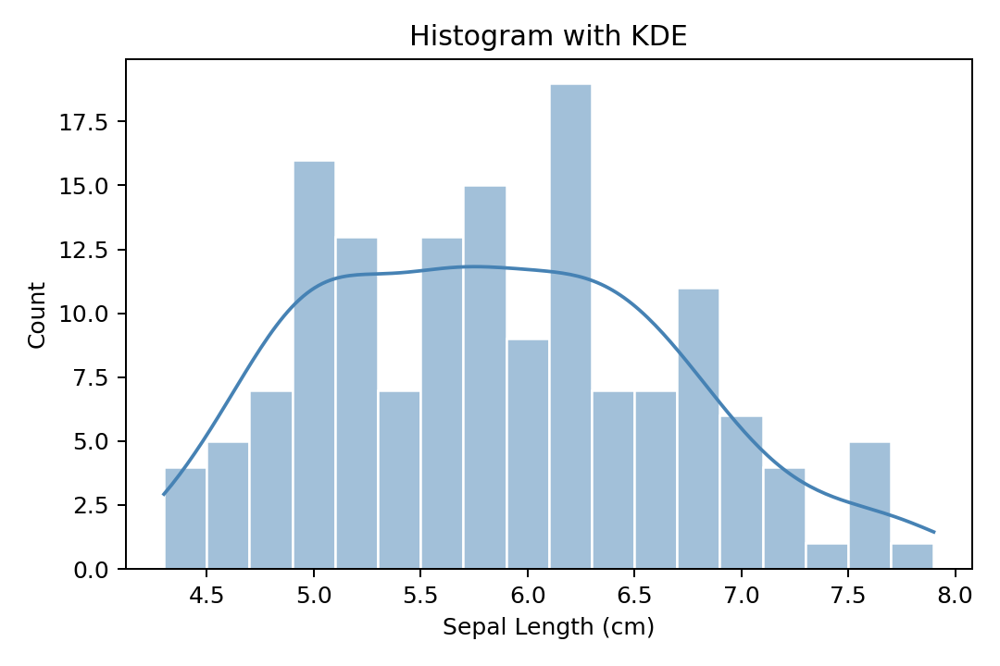
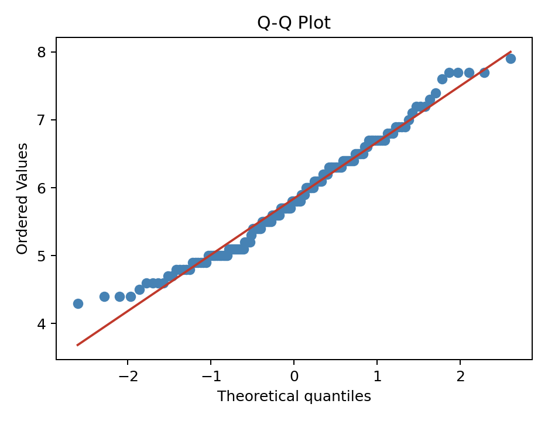
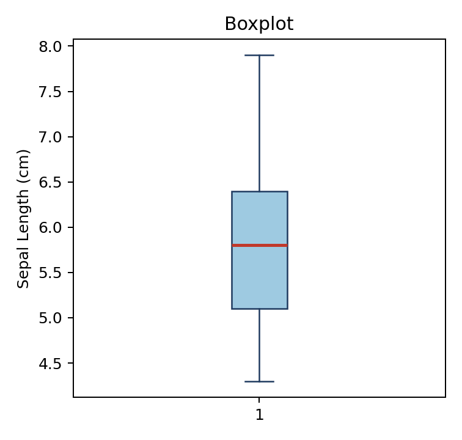

[Statistics](../README.md) › [敘述統計](README.md) › 單變數：數值型

# 單變數分析：數值型 (Univariate – Numerical)

完整描述一個數值變數（Interval / Ratio）需要三個面向，缺一不可：

| 面向 | 問題 | 主要指標 |
| --- | --- | --- |
| 集中趨勢 (central tendency) | 中心在哪？ | 平均數、中位數、眾數 |
| 離散程度 (variability / spread) | 多分散？ | SD、IQR、MAD、CV |
| 分布形狀 (shape) | 長什麼樣？ | 偏態、峰度 |

> 只報平均數不報離散與形狀是不完整的：兩組資料可以平均數相同、分布完全不同。

## 集中趨勢 (Central Tendency)

| 指標 | 定義 | 特性 | 適用 |
| --- | --- | --- | --- |
| 算術平均數 (mean) | $\bar{x} = \frac{1}{n}\sum x_i$ | 用到每個值，**對離群值敏感** | 對稱、無極端值 |
| 中位數 (median) | 排序後的中間值（第 50 百分位數，Q₂） | **穩健 (robust)** | 偏態、有離群值 |
| 眾數 (mode) | 出現最多次的值 | 可用於類別 | 離散 / 類別資料 |
| 幾何平均數 (geometric mean) | $(\prod x_i)^{1/n}$ | = log 尺度上的平均再取 exp | 成長率、倍數變化 (fold change)、log-normal 資料 |
| 調和平均數 (harmonic mean) | $n / \sum (1/x_i)$ | — | 速率的平均（等距離的平均速度）、F1 score |
| 加權平均數 (weighted mean) | $\sum w_i x_i / \sum w_i$ | — | 各觀測重要性不同（GPA、加權問卷） |

```python
import numpy as np
import pandas as pd
from scipy.stats import gmean, hmean
from sklearn.datasets import load_iris

df = load_iris(as_frame=True).frame
x = df["sepal length (cm)"]

x.mean(), x.median(), x.mode()[0]

values, weights = [2, 4, 8], [0.2, 0.3, 0.5]
np.mean(values)                     # 4.667  算術
gmean(values)                       # 4.000  幾何
hmean(values)                       # 3.429  調和
np.average(values, weights=weights) # 5.600  加權
```

> **雙峰 (bimodal)** 常暗示兩個子族群混在一起（例如兩種細胞類型），但先確認不是 bin 寬度、KDE 平滑參數或小樣本雜訊造成的。

## 離散程度 (Variability)

| 指標 | 公式 | 穩健？ | 單位 | 用途 |
| --- | --- | --- | --- | --- |
| 全距 (range) | max − min | 否 | 同原資料 | 快速 sanity check |
| 變異數 (variance) | $s^2 = \frac{\sum (x_i-\bar{x})^2}{n-1}$ | 否 | 平方單位 | 計算基礎 |
| 標準差 (SD) | $s = \sqrt{s^2}$ | 否 | 同原資料 | 搭配平均數 |
| 四分位距 (IQR) | Q₃ − Q₁ | **是** | 同原資料 | 搭配中位數，偏態資料 |
| 中位數絕對離差 (MAD) | median(\|xᵢ − median\|) | **是** | 同原資料 | 穩健版 SD，常用於離群偵測 |
| 變異係數 (CV) | $s / \bar{x} \times 100\%$ | 否 | 無單位 | 比較不同單位 / 量級的變數 |

- **為什麼除以 n−1？** Bessel's correction。用樣本平均估計母體變異時，除以 n 會系統性低估；n−1 修正這個偏誤。母體 (population) 資料才除以 N。
- **CV** 只在平均數為正、且有真零點（Ratio）時有意義；不要用在攝氏溫度。生物實驗常用 CV 評估技術重複 (technical replicate) 的穩定度。

```python
from scipy.stats import median_abs_deviation

x.max() - x.min()                 # range
x.var(ddof=1), x.std(ddof=1)      # 樣本變異數 / 標準差（pandas 預設 ddof=1）
np.std(x, ddof=0)                 # 母體標準差（numpy 預設 ddof=0，注意！）
x.quantile(0.75) - x.quantile(0.25)          # IQR
median_abs_deviation(x, scale="normal")      # MAD，scale 後在常態下 ≈ SD
x.std() / x.mean() * 100                     # CV (%)
```

### 經驗法則 (Empirical Rule, 68–95–99.7)

僅適用於**近似常態**的資料：±1 SD ≈ 68%、±2 SD ≈ 95%、±3 SD ≈ 99.7%。超出 ±3 SD 常被標記為離群值。

### 標準差 vs 標準誤 (SD vs SE)

| | 描述什麼 | 會隨 n 變小嗎？ | 何時報告 |
| --- | --- | --- | --- |
| **SD** | **個別資料點**的分散 | 否 | 描述資料有多變異 |
| **SE** = $s/\sqrt{n}$ | **樣本平均數**作為估計值的精確度 | 是 | 描述平均數估得多準 |

SE 是 [抽樣分配 (sampling distribution)](../probability-and-distributions/sampling-distributions.md) 的標準差，也是 [信賴區間](../inferential-statistics/confidence-intervals.md)（$\bar{x} \pm t^* \cdot SE$）與 [t 檢定](../inferential-statistics/statistical-tests.md)（$t = (\bar{x}-\mu_0)/SE$）的核心。

> 論文圖表的 error bar 要寫清楚是 SD、SE 還是 95% CI，三者差很多。

## 四分位距與離群值 (IQR & Outliers)

Tukey fence：落在 $[Q_1 - 1.5 \cdot IQR,\ Q_3 + 1.5 \cdot IQR]$ 之外者視為**可能的**離群值（就是 boxplot whisker 的定義）。

```python
q1, q3 = x.quantile([0.25, 0.75])
iqr = q3 - q1
outliers = x[(x < q1 - 1.5 * iqr) | (x > q3 + 1.5 * iqr)]

# 穩健 z-score（以 median / MAD 取代 mean / SD），|z| > 3.5 常作為門檻
robust_z = (x - x.median()) / median_abs_deviation(x, scale="normal")
```

離群值的處理原則見 [資料品質](data-quality.md#離群值-outliers)；ML 的處理方式見 [Outlier Handling](../../machine-learning/preprocessing/outlier-handling.md)。

## 分布形狀 (Shape)

### 偏態 (Skewness)

| 形狀 | 關係 | 意義 |
| --- | --- | --- |
| 右偏 / 正偏 (right-skewed) | 眾數 < 中位數 < **平均數** | 平均數被大值拉高（收入、基因表現量） |
| 對稱 (symmetric) | 平均數 ≈ 中位數 ≈ 眾數 | 任一指標都具代表性 |
| 左偏 / 負偏 (left-skewed) | **平均數** < 中位數 < 眾數 | 平均數被小值拉低 |

\|skewness\| > 1 通常視為明顯偏態 → 考慮 [資料轉換](#資料轉換-transformation)、穩健方法或 [無母數方法](../nonparametric-methods/README.md)。



<sub>圖片來源：[Medium](https://mdsohel-mahmood.medium.com/mean-and-median-for-skewed-distribution-d5dea13674ca)</sub>

### 峰度 (Kurtosis)

衡量**尾部厚度 (tailedness)**，與常態分配比較。

| 類型 | 超額峰度 (excess kurtosis) | 形狀 | 意義 |
| --- | --- | --- | --- |
| 常態峰 (mesokurtic) | ≈ 0 | 常態尾部 | 類似常態 |
| 高狹峰 (leptokurtic) | > 0 | 厚尾、尖峰 | 極端值比預期多 |
| 低闊峰 (platykurtic) | < 0 | 薄尾、平峰 | 極端值較少 |

- Raw (Pearson) kurtosis：常態 = 3；Excess (Fisher) kurtosis = Raw − 3，常態 = 0。
- `pandas.Series.kurt()` 與 `scipy.stats.kurtosis()` 預設都回傳 **excess** kurtosis。



<sub>圖片來源：[Beautiful Economics](https://www.facebook.com/beautifulecos/photos/-shape-of-distribution-kurtosis-by-beautiful-economics-what-is-kurtosiskurtosis-/1445152480962231/)</sub>

```python
x.skew()   # 偏態
x.kurt()   # 超額峰度
```

## 資料轉換 (Transformation)

| 轉換 | 用途 | 注意 |
| --- | --- | --- |
| $\log(x)$ / $\log_2(x)$ | 右偏、倍數關係的資料（表現量、濃度、收入）；log₂ 差 1 = 2 倍 | x 必須 > 0 |
| $\log(x+1)$（`np.log1p`） | 含 0 的計數資料（read count） | pseudo-count 的大小會影響結果 |
| $\sqrt{x}$ | 計數資料的輕度右偏 | — |
| Box-Cox / Yeo-Johnson | 自動找最佳冪次轉換 | Box-Cox 需 x > 0 |
| z-score 標準化 $(x-\bar{x})/s$ | 讓不同單位的變數可比較；PCA、距離型模型的前處理 | **不會改變分布形狀** |

```python
from scipy import stats

np.log2(x)                          # log2 轉換
np.log1p(counts)                    # log(x + 1)
x_bc, lam = stats.boxcox(x)         # Box-Cox，回傳轉換後資料與 λ
z = (x - x.mean()) / x.std()        # z-score
```

> 標準化 (standardization) 只是平移縮放，偏態資料標準化後還是偏態。要改變形狀得用 log 等非線性轉換。ML 前處理見 [Feature Scaling](../../machine-learning/preprocessing/feature-scaling.md)。

## 視覺診斷

| 圖 | 看什麼 |
| --- | --- |
| 直方圖 + KDE (histogram + kernel density estimate) | 對稱 / 偏態 / 多峰；KDE 曲線下面積 = 1 |
| Q–Q 圖 (quantile–quantile plot) | 與理論常態分配比較；點貼近對角線 ≈ 常態 |
| 箱形圖 (boxplot) | 中位數、IQR、離群值的精簡摘要 |

```python
import matplotlib.pyplot as plt
import seaborn as sns
import scipy.stats as stats

fig, axes = plt.subplots(1, 3, figsize=(14, 4))
sns.histplot(x, kde=True, bins=18, ax=axes[0])     # 直方圖 + KDE
stats.probplot(x, dist="norm", plot=axes[1])        # Q–Q 圖
axes[2].boxplot(x)                                  # 箱形圖
plt.tight_layout()
plt.show()
```

| 直方圖 + KDE | Q–Q 圖 | 箱形圖 |
| --- | --- | --- |
|  |  |  |

**Q–Q 圖判讀**

| 圖形 | 意義 |
| --- | --- |
| 點大致沿對角線 | 近似常態 |
| 左端在線下、右端在線上（S 形） | 比常態**厚尾** |
| 左端在線上、右端在線下 | 比常態**薄尾** |
| 整體向一側彎曲 | 偏態 |
| 只有一端明顯偏離 | 單側尾部問題或離群值 |

> 這裡是「描述」形狀。檢定前的正式假設檢查（Shapiro-Wilk 等）見 [假設檢查](../inferential-statistics/assumption-checks.md)。

## 重點整理

| 原則 | 說明 |
| --- | --- |
| 三個面向都要報 | 只報中心不夠 |
| 平均數 ≠ 中位數 → 有偏態 | 兩個都報 |
| SD vs SE | SD 描述資料；SE 描述估計精確度 |
| 偏態 / 離群 → 用 IQR、MAD | 比 SD 更有代表性 |
| 先畫圖 | 再解讀數字 |
