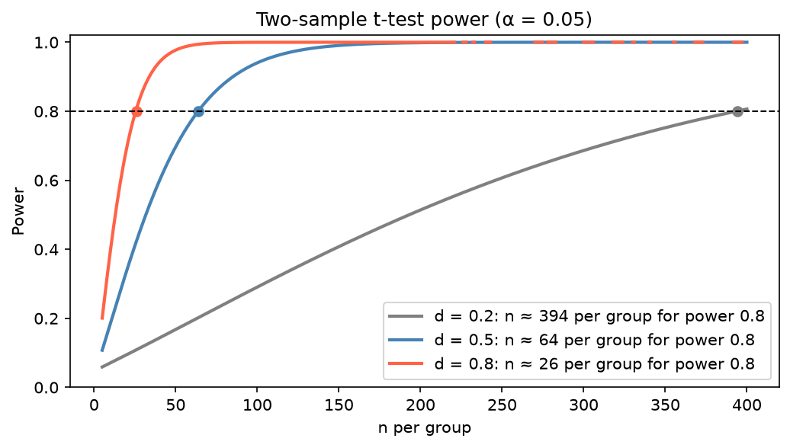

[Statistics](../README.md) › [實驗設計](README.md) › 樣本數與檢定力

# 樣本數與檢定力 (Sample Size & Statistical Power)

樣本太少會錯過真實效果；太多會浪費資源。樣本數必須在**蒐集資料前**計算：事後發現不足只能重做，而「不顯著就再多收一點」的 optional stopping 會膨脹型一錯誤。

α、β、power 的定義與型一 / 型二錯誤表見 [假設檢定](../inferential-statistics/hypothesis-testing.md#型一與型二錯誤-type-i--type-ii-errors)。慣例 α = 0.05、power = 0.80；高風險情境用 α = 0.01，探索性研究可放寬到 0.10。

## 樣本數的四個輸入

給定其中三個就能解出第四個：

| 輸入 | 對所需 n 的影響 |
| --- | --- |
| **效果量**（最重要） | 越小 → n 越大（∝ 1/d²） |
| α | 越嚴格 → n 越大 |
| 目標 power | 越高 → n 越大 |
| 樣本數 n | — |

其他會增加 n 的因素：母體變異 σ 越大、雙尾檢定、各組不等大小（平衡設計最有效率）、多重比較（每個檢定的 α 更嚴）、預期流失率。

## 效果量 (Effect Size)

| 指標 | 用於 | 公式 | 小 | 中 | 大 |
| --- | --- | --- | --- | --- | --- |
| Cohen's d | 兩組平均數 | (μ₁ − μ₂) / σ_pooled | 0.2 | 0.5 | 0.8 |
| Cohen's f | ANOVA | σ_means / σ_within | 0.1 | 0.25 | 0.4 |
| Cohen's w | 卡方 | √Σ(p₁ − p₀)² / p₀ | 0.1 | 0.3 | 0.5 |
| Cohen's h | 兩比例 | 2·arcsin√p₁ − 2·arcsin√p₂ | 0.2 | 0.5 | 0.8 |
| r | 相關 | Pearson r | 0.1 | 0.3 | 0.5 |

> Cohen 的小 / 中 / 大是脫離情境的預設值。醫學上「小」效果（每千人少 1 人死亡）可能極重要。**先定義實務上有意義的最小效果**（MDE），再據此計算 n；為一個小到不重要的效果規劃檢定力是浪費。效果量的估計來源：先導研究、文獻、或領域上的最小有意義差異。

**經驗公式**（雙尾 α = 0.05、power = 0.80、兩組等大）：每組 $n \approx 16 / d^2$。d = 0.5 → 64、d = 0.2 → 約 400。

## Python：statsmodels

```python
import numpy as np
from statsmodels.stats.power import (TTestIndPower, TTestPower, FTestAnovaPower,
                                     GofChisquarePower, NormalIndPower)
from statsmodels.stats.proportion import proportion_effectsize

t_ind = TTestIndPower()
t_ind.solve_power(effect_size=0.5, alpha=0.05, power=0.8)          # 每組需要 n ≈ 64
t_ind.solve_power(effect_size=0.5, alpha=0.05, nobs1=30)           # n = 30 時 power ≈ 0.48
t_ind.solve_power(alpha=0.05, power=0.8, nobs1=50)                 # n = 50 可偵測的 d ≈ 0.57

TTestPower().solve_power(effect_size=0.5, alpha=0.05, power=0.8)   # 配對 t（d 以差值的 SD 計）
FTestAnovaPower().solve_power(effect_size=0.25, alpha=0.05, power=0.8, k_groups=3)   # 回傳「總」樣本數
GofChisquarePower().solve_power(effect_size=0.3, alpha=0.05, power=0.8, n_bins=4)

# 兩比例：轉換率 10% → 15%
h = proportion_effectsize(0.15, 0.10)                              # ≈ 0.15
NormalIndPower().solve_power(effect_size=h, alpha=0.05, power=0.8) # 每組約 340

# 檢定力曲線
t_ind.plot_power(dep_var="nobs", nobs=np.arange(10, 200), effect_size=[0.2, 0.5, 0.8])
```

| 檢定 | statsmodels 類別 | 效果量 |
| --- | --- | --- |
| 獨立 t | `TTestIndPower` | Cohen's d |
| 配對 t / 單一樣本 t | `TTestPower` | Cohen's d |
| 單因子 ANOVA | `FTestAnovaPower` | Cohen's f |
| 卡方適合度 | `GofChisquarePower` | Cohen's w |
| 兩比例 | `NormalIndPower` + `proportion_effectsize` | Cohen's h |



> **讀檢定力曲線**：找到你在意的效果量，往右找 power ≥ 0.8 的 n。曲線在大 n 處趨平代表邊際效益遞減：n 從 200 → 400 換來的 power 遠少於 20 → 40。
>
> 固定平均差為 5：SD 從 5 → 10 → 20，d 從 1 → 0.5 → 0.25，每組所需 n 約 17 → 64 → 253。**降低變異**（更精準的量測、配對 / 區集設計、共變數調整）與增加樣本一樣有效。

## 複雜設計：用模擬

分析方法複雜（混合模型、GLM、存活分析、群集隨機化）時，公式常不存在。用 [蒙地卡羅模擬](../probability-and-distributions/monte-carlo-simulation.md)：假設真實效果與變異 → 模擬資料 → 跑預定的分析 → 重複上千次 → 拒絕 H₀ 的比例就是 power。

```python
from scipy import stats

def sim_power(n, d, n_sim=2000, rng=np.random.default_rng(0)):
    hits = 0
    for _ in range(n_sim):
        a, b = rng.normal(0, 1, n), rng.normal(d, 1, n)
        hits += stats.mannwhitneyu(a, b).pvalue < 0.05     # 任何預定分析都可以換進來
    return hits / n_sim

sim_power(n=64, d=0.5)          # 約 0.78（Mann-Whitney 效率略低於 t 檢定）
```

| 特殊情境 | 調整 |
| --- | --- |
| 群集隨機化 | 乘上設計效應 (design effect) $1 + (m-1)\rho$，m = 群大小、ρ = ICC |
| 預期流失 20% | n ÷ 0.8 |
| 多重檢定 | 用校正後的 α 計算 |
| RNA-seq | 檢定力依定序深度、生物變異（dispersion）、效果大小而定；專用工具如 `RNASeqPower`、`PROPER`；通常增加生物重複比增加定序深度更有效 |

## 不要做事後檢定力分析 (Post-hoc Power)

用**觀察到的**效果量去算「事後 power」是循環論證：不顯著的結果幾乎必然得到「power 低」，沒有提供新資訊。改為**報告信賴區間**：寬的 CI 直接說明研究的精確度不足，以及哪些效果大小仍無法排除。

```python
from scipy import stats

rng = np.random.default_rng(2)
g1, g2 = rng.normal(100, 15, 10), rng.normal(106, 15, 10)
res = stats.ttest_ind(g2, g1)
res.pvalue, res.confidence_interval()        # 不顯著，但 CI 很寬 → 無法排除有意義的效果
```
