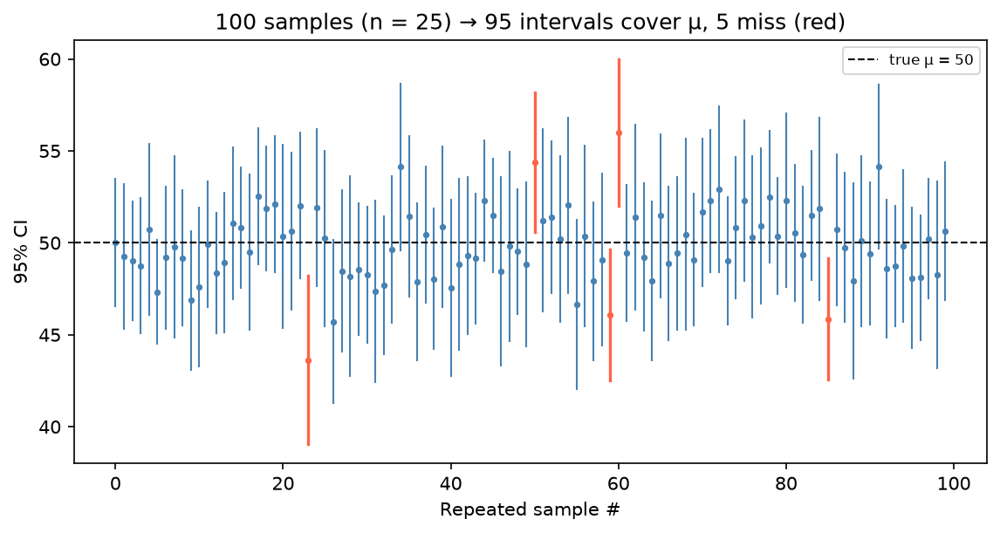

[Statistics](../README.md) › [推論統計](README.md) › 信賴區間

# 信賴區間 (Confidence Intervals, CI)

信賴區間給出母體參數的**合理範圍**，同時表達點估計與不確定性。比起只報 p 值，CI 還告訴你效果的**大小、方向與精確度**。

$$
\text{CI} = \text{點估計} \pm \underbrace{\text{臨界值} \times SE}_{\text{誤差界限 (margin of error)}}
$$

## 「95% 信賴」是什麼意思？

| | 說法 |
| --- | --- |
| ✅ 正確 | 若**重複抽樣**並每次建構區間，長期下約 95% 的區間會包含真實參數 |
| ❌ 錯誤 | 「μ 有 95% 機率落在這個區間」：μ 是固定值，這個區間要嘛包含、要嘛不包含 |
| ❌ 錯誤 | 「95% 的資料落在這個區間」：那是預測區間 / 參考範圍，不是 CI |
| ❌ 錯誤 | 「兩組 CI 有重疊 → 沒有顯著差異」：差異的顯著性要看**差值**的 CI |

機率描述的是**建構區間的程序**，不是某一個特定區間。

比喻：撒網 100 次，約 95 次網住魚；但任何一次網要嘛有魚、要嘛沒有。

> 想要「參數有 95% 機率落在區間內」這種解讀，要用貝氏的 [可信區間 (credible interval)](../bayesian-statistics/posterior-inference.md)。

## 平均數的 CI

| 情況 | 公式 | 臨界值 |
| --- | --- | --- |
| σ 已知（少見） | $\bar{x} \pm z_{\alpha/2}\,\sigma/\sqrt{n}$ | z |
| σ 未知（**標準情況**） | $\bar{x} \pm t_{\alpha/2,\,n-1}\,s/\sqrt{n}$ | t，df = n − 1 |

| 信賴水準 | α | $z_{\alpha/2}$ |
| --- | --- | --- |
| 90% | 0.10 | 1.645 |
| 95% | 0.05 | 1.960 |
| 99% | 0.01 | 2.576 |

> **z vs t**：結構相同，差別只在分母用 σ（已知）或 s（估計）。σ 幾乎永遠未知，**預設用 t**；n 大時 t 自動趨近 z。

```python
import numpy as np
import scipy.stats as stats
from sklearn.datasets import load_iris

x = load_iris(as_frame=True).frame["sepal length (cm)"]
n, x_bar, se = len(x), x.mean(), x.std(ddof=1) / np.sqrt(len(x))

# 手算
t_crit = stats.t.ppf(0.975, df=n - 1)
(x_bar - t_crit * se, x_bar + t_crit * se)

# 一行版
stats.t.interval(0.95, df=n - 1, loc=x_bar, scale=se)

# 臨界值速查
stats.norm.ppf(0.975)          # 雙尾 z = 1.96
stats.norm.ppf(0.95)           # 單尾 z = 1.645（用於單尾檢定）
```

## 比例的 CI

Wald 公式：$\hat p \pm z_{\alpha/2}\sqrt{\hat p(1-\hat p)/n}$，需 $n\hat p \ge 10$ 且 $n(1-\hat p) \ge 10$。

| 方法 | 何時用 |
| --- | --- |
| Wald（常態近似） | n 大、p̂ 不接近 0 或 1 |
| **Wilson** | **建議預設**，各種 n 與 p̂ 都表現好 |
| Clopper-Pearson（exact） | n 很小；較保守 |

```python
from statsmodels.stats.proportion import proportion_confint

proportion_confint(count=82, nobs=150, alpha=0.05, method="wilson")
```

## 影響區間寬度的因素

| 因素 | 變化 | CI 寬度 | 直覺 |
| --- | --- | --- | --- |
| 樣本數 n | ↑ | ↓ 變窄（∝ 1/√n） | 資料越多越精確 |
| 信賴水準 | ↑（95 → 99%） | ↑ 變寬 | 要更有把握就得撒更大的網 |
| 資料變異 s | ↑ | ↑ 變寬 | 越分散越難定位平均 |

## CI 與 p 值的關係

| | p 值 | 信賴區間 |
| --- | --- | --- |
| 回答 | 效果是否統計顯著？ | 效果的合理範圍是多少？ |
| 資訊 | 二元：顯著 / 不顯著 | 大小 + 方向 + 精確度 |
| 關係 | p < 0.05 ⇔ 95% CI 不包含 H₀ 的值 | 數學上等價 |

> CI 為 [0.001, 0.003] 的結果可能「顯著」但毫無實務意義。兩者都報。

## 視覺化：分組平均數 ± 95% CI

```python
import matplotlib.pyplot as plt
import seaborn as sns

iris = load_iris(as_frame=True)
df = iris.frame.assign(species=iris.target_names[iris.target])

sns.pointplot(data=df, x="species", y="sepal length (cm)", errorbar=("ci", 95),
              linestyle="none", capsize=0.2)
plt.title("Mean Sepal Length with 95% CI")
plt.show()
```

> 要判斷兩組是否不同，請直接算**差值的 CI**（例如 [兩樣本 t 檢定](statistical-tests.md) 的輸出），不要用目測重疊判斷。
