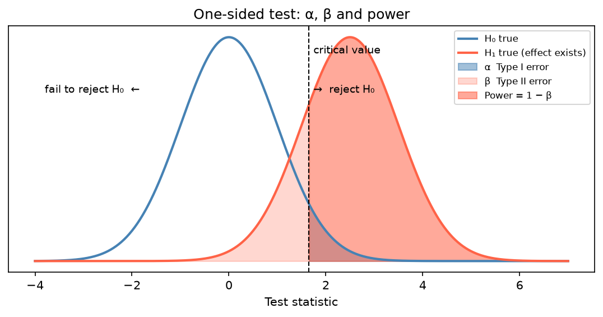

[Statistics](../README.md) › [推論統計](README.md) › 假設檢定

# 假設檢定 (Hypothesis Testing)

用樣本資料評估一個關於母體的主張。它不「證明」任何事，只判斷證據是否強到足以拒絕某個假設。

> 邏輯類似**無罪推定**：先假設「沒有效果」(H₀)，再問「若 H₀ 為真，看到這種資料的機率有多低？」機率太低就拒絕 H₀。

## 流程

| 步驟 | 例子 |
| --- | --- |
| 1. 寫下 H₀ 與 H₁ | H₀: μ = 5.0；H₁: μ ≠ 5.0 |
| 2. **事先**設定 α | α = 0.05 |
| 3. 檢查假設 | 常態、獨立、變異數，見 [假設檢查](assumption-checks.md) |
| 4. 計算檢定統計量 | $t = (\bar{x} - \mu_0)/SE$ |
| 5. 算 p 值並決策 | p = 0.023 < α → 拒絕 H₀ |
| 6. 報告效果量與 CI | d = 0.72，95% CI [5.71, 5.97] |
| 7. 多重檢定時校正 | 見 [多重檢定校正](multiple-testing.md) |
| 8. 回到脈絡解讀 | 「不同物種的花萼長度有顯著差異」 |

> **「未拒絕 H₀」≠「證明 H₀ 為真」**。沒有證據不等於有「沒有」的證據 (absence of evidence ≠ evidence of absence)。

## 虛無假設與對立假設

| 假設 | 符號 | 說明 |
| --- | --- | --- |
| 虛無假設 (null hypothesis) | H₀ | 預設主張：沒有效果、沒有差異 |
| 對立假設 (alternative hypothesis) | H₁ / Hₐ | 想偵測的效果 |

| 檢定 | H₁ | 何時用 |
| --- | --- | --- |
| 雙尾 (two-tailed) | μ ≠ μ₀ | **預設**，任一方向的差異都在意 |
| 右尾 (one-tailed, right) | μ > μ₀ | 只在意增加，且有**事先**的科學理由 |
| 左尾 (one-tailed, left) | μ < μ₀ | 只在意減少 |

看到結果後才改用單尾以得到較小 p 值，是 p-hacking。

## 檢定統計量、拒絕域、p 值

| 概念 | 是什麼 | 角色 |
| --- | --- | --- |
| 檢定統計量 (test statistic) | 把樣本標準化後的摘要（t、z、χ²、F） | 讓不同資料可以比較 |
| 拒絕域 (critical region) | 在 α 下極端到足以拒絕 H₀ 的範圍 | 看資料前就定好的決策規則 |
| p 值 (p-value) | H₀ 為真時，得到「至少這麼極端」結果的機率 | 資料的極端程度 |

$$
p = P(\text{資料至少這麼極端} \mid H_0 \text{ 為真})
$$

### p 值的常見誤解

| ❌ 錯誤 | ✅ 正確 |
| --- | --- |
| p = 0.03 → H₀ 有 3% 機率為真 | 若 H₀ 為真，只有 3% 機率看到這麼極端的資料 |
| p = 0.03 → H₁ 有 97% 機率為真 | p 值不提供 H₁ 的機率（那需要 [貝氏方法](../bayesian-statistics/README.md)） |
| p > 0.05 → 沒有效果 | 只是證據不足以拒絕 H₀ |
| p 越小 → 效果越大 | p 受 n 影響；n 很大時微小效果也會很顯著 |

## 顯著水準 α

| α | 常見情境 |
| --- | --- |
| 0.10 | 探索性研究，偽陰性代價高 |
| 0.05 | 多數領域的標準 |
| 0.01 | 醫藥研究 |
| 5 × 10⁻⁸ | GWAS 全基因體顯著水準（≈ 0.05 / 一百萬次獨立檢定） |

α 要在**蒐集資料前**決定，看完資料再調整是 p-hacking。

## 型一與型二錯誤 (Type I & Type II Errors)

| | H₀ 實際為**真** | H₀ 實際為**假** |
| --- | --- | --- |
| **拒絕 H₀** | ❌ 型一錯誤 = 偽陽性 (false positive)，機率 α | ✅ 真陽性，機率 = **檢定力 (power) 1 − β** |
| **未拒絕 H₀** | ✅ 真陰性 | ❌ 型二錯誤 = 偽陰性 (false negative)，機率 β |

- 比喻：型一錯誤 = 冤枉好人；型二錯誤 = 放走壞人。
- 慣例：α = 0.05、β = 0.20 → power = 0.80。
- **降低 α 會提高 β**。同時降低兩者的方法是增加樣本數。
- 這張表就是 ML 的 [混淆矩陣 (confusion matrix)](../../machine-learning/evaluation/confusion-metrics.md)：α ↔ FPR、power ↔ recall / sensitivity。



臨界值右移（降低 α）→ 藍色區縮小、淺紅 β 區變大；兩分配距離拉開（效果量大或 n 大使 SE 變小）→ power 增加。

## 檢定力與效果量

### 檢定力 (Statistical Power)

Power = P(拒絕 H₀ | H₀ 為假)，即真的有效果時能偵測到的機率。< 0.5 嚴重不足；0.8 為慣用最低標準；> 0.9 用於高風險研究。

| 提高 power 的方法 | 代價 |
| --- | --- |
| 增加樣本數 n | 成本 |
| 效果量較大 | 無法控制（是真實世界決定的） |
| 放寬 α | 更多偽陽性 |
| 降低變異（更精準的量測、配對設計、[區集化](../experimental-design/principles.md)） | 設計成本 |

```python
from statsmodels.stats.power import TTestIndPower

analysis = TTestIndPower()
analysis.solve_power(effect_size=0.5, nobs1=30, alpha=0.05)   # n=30 時的 power ≈ 0.48
analysis.solve_power(effect_size=0.5, alpha=0.05, power=0.8)  # 每組需要 n ≈ 64
```

完整的樣本數規劃見 [樣本數與檢定力](../experimental-design/sample-size-power.md)。

### 效果量 (Effect Size)

效果的**大小**，與樣本數無關。顯著性回答「有沒有」，效果量回答「多大」。

| 指標 | 公式 | 用於 | 小 / 中 / 大 |
| --- | --- | --- | --- |
| Cohen's d | $(\bar{x}_1 - \bar{x}_2)/s_{pooled}$ | 兩組平均數 | 0.2 / 0.5 / 0.8 |
| r | Pearson 相關 | 線性關係 | 0.1 / 0.3 / 0.5 |
| η² | SS_between / SS_total | ANOVA | 0.01 / 0.06 / 0.14 |
| Odds ratio | (a/b) / (c/d) | 類別、[邏輯斯迴歸](../regression-analysis/logistic-regression.md) | 依情境 |
| log₂ fold change | log₂(處理組 / 對照組) | 基因表現差異 | 常用 \|LFC\| > 1（2 倍） |

```python
import numpy as np
from scipy import stats

def cohens_d(a, b):
    na, nb = len(a), len(b)
    s_pooled = np.sqrt(((na - 1) * a.var(ddof=1) + (nb - 1) * b.var(ddof=1)) / (na + nb - 2))
    return (a.mean() - b.mean()) / s_pooled

t_stat, p = stats.ttest_ind(setosa, versicolor)
d = cohens_d(setosa, versicolor)
```

更多效果量（η²、ω²、partial η²）見 [事後檢定與效果量](post-hoc-effect-size.md)。

### 統計顯著 vs 實務顯著

| p 值 | 效果量 | 解讀 |
| --- | --- | --- |
| 小 | 小 | 真的存在但可能不重要（常見於 n 很大） |
| 小 | 大 | 證據強且可能有實務意義 |
| 大 | 中 / 大 | 可能重要，但證據不足（常見於 n 太小） |
| 大 | 小 | 沒有證據，也可能不重要 |

> **火山圖 (volcano plot)** 就是把兩者畫在一起：x 軸 log₂FC（效果量）、y 軸 −log₁₀(p)（顯著性），只挑兩者都夠大的基因。

## 「不顯著」不代表「沒有差異」

不顯著可能只是：樣本太少、雜訊太大、效果比預期小、檢定選錯或假設不成立。

若研究問題本身是要證明「兩者夠接近」（例如學名藥與原廠藥），應使用**等價性檢定 (equivalence test, TOST)** 或**不劣性檢定 (non-inferiority test)**。

## p-hacking 與提早停止

| 不良行為 | 後果 |
| --- | --- |
| 試很多個結果變數，只報顯著的 | 實際型一錯誤率遠高於 α |
| p < 0.05 時就停止收資料 (optional stopping) | 同上 |
| 看到結果才改成單尾 | 同上 |
| 嘗試各種共變數組合直到「有效」 | 同上 |

**好習慣**：事先指定主要結果 (primary outcome)、α、單雙尾；事先做檢定力分析；報告所有主要分析。必要時做 [事前註冊 (pre-registration)](../experimental-design/principles.md)。

## 報告範本

```text
處理組平均分數高於對照組（平均差 = 4.8，95% CI [1.9, 7.6]），
t(58) = 3.31，p = .002，Cohen's d = 0.85。
```

包含：方向、大小、不確定性、統計證據。
