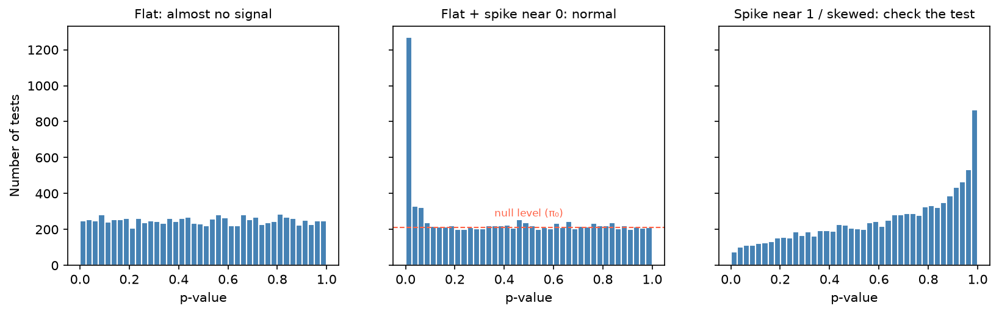

[Statistics](../README.md) › [推論統計](README.md) › 多重檢定校正

# 多重檢定校正 (Multiple Testing Correction)

一次做很多個檢定時，就算每個都用 α = 0.05，「至少一個偽陽性」的機率也會迅速升高。生資分析（差異表現、GWAS、富集分析）動輒上萬次檢定，這是必修課。

## 為什麼需要校正

m 個獨立檢定、H₀ 全為真時：

$$
P(\text{至少一個偽陽性}) = 1 - (1-\alpha)^m
$$

| 檢定數 m | P(至少一個偽陽性) | 預期偽陽性數 (m × α) |
| --- | --- | --- |
| 1 | 5% | 0.05 |
| 20 | 64% | 1 |
| 100 | 99.4% | 5 |
| 20,000（全基因） | ≈ 100% | **1,000** |

20,000 個基因都沒有差異，仍會有約 1,000 個「顯著」基因。

## 兩種錯誤率

| 錯誤率 | 定義 | 控制的是 | 適合 |
| --- | --- | --- | --- |
| **FWER** 族系錯誤率 (family-wise error rate) | P(至少一個偽陽性) | 一個都不能錯 | 少量、確認性的比較（臨床試驗主要終點） |
| **FDR** 偽發現率 (false discovery rate) | E[偽陽性數 / 宣稱顯著數] | 顯著清單中錯的**比例** | 大量、探索性的篩選（基因、特徵） |

FDR = 0.05 的意思：你宣稱顯著的 200 個基因中，預期約 10 個是偽陽性。

## 校正方法

| 方法 | 控制 | 做法 | 特性 |
| --- | --- | --- | --- |
| **Bonferroni** | FWER | $p_{adj} = \min(m \cdot p, 1)$，或門檻改為 α/m | 最簡單、最保守 |
| **Holm** (step-down) | FWER | p 由小到大排序，第 k 個與 α/(m−k+1) 比較 | **一定不比 Bonferroni 差**，FWER 的好預設 |
| **Benjamini-Hochberg (BH)** | FDR | p 排序後找最大 k 使 $p_{(k)} \le \frac{k}{m}\alpha$ | **生資最常用**；假設檢定獨立或正相關 |
| **Benjamini-Yekutieli (BY)** | FDR | BH 再除以 $\sum_{i=1}^m 1/i$ | 任意相依結構皆成立，較保守 |
| **Storey q-value** | FDR | 先估計真 H₀ 的比例 π₀，再調整 | 比 BH 更有檢定力（`qvalue` R 套件） |
| Tukey HSD / Games-Howell | FWER | ANOVA 後的兩兩比較專用 | 見 [事後檢定](post-hoc-effect-size.md) |

```python
import numpy as np
from statsmodels.stats.multitest import multipletests

pvals = np.array([0.001, 0.008, 0.012, 0.035, 0.041, 0.20, 0.55])

for method in ["bonferroni", "holm", "fdr_bh", "fdr_by"]:
    reject, p_adj, _, _ = multipletests(pvals, alpha=0.05, method=method)
    print(f"{method:10s}", reject.sum(), np.round(p_adj, 3))
# bonferroni 1   門檻 0.05/7 ≈ 0.0071
# holm       2
# fdr_bh     3   ← FDR 控制下可宣稱更多發現
# fdr_by     1

# scipy ≥ 1.11 也有：scipy.stats.false_discovery_control(pvals, method="bh")
```

> DESeq2 / edgeR / limma 輸出的 `padj` / `FDR` / `adj.P.Val` 欄位就是 BH 校正後的值。篩選基因時用的是**校正後**的值。

## 診斷：p 值直方圖

H₀ 為真時 p 值服從 [Uniform(0, 1)](../probability-and-distributions/continuous-distributions.md#均勻分配-uniform)。把所有 p 值畫直方圖：

| 形狀 | 意義 |
| --- | --- |
| 平坦 + 靠近 0 有尖峰 | 正常：大部分是 H₀，少數有真實訊號 |
| 完全平坦 | 幾乎沒有訊號 |
| 靠近 1 有尖峰 / U 形 / 中間凸起 | 檢定有問題：分配假設錯、離散資料、過濾不當、批次效應 |

```python
import matplotlib.pyplot as plt
plt.hist(pvals_all, bins=50, edgecolor="white")
plt.xlabel("p-value")
plt.show()
```



中間圖右側平坦的高度就是 H₀ 的比例 π₀；Storey 的 q-value 就是用這個高度估計 π₀，比 BH 稍有檢定力。

## 實務重點

| 情境 | 建議 |
| --- | --- |
| 少數幾個事先計畫好的比較 | Holm 或 Bonferroni |
| ANOVA 後兩兩比較 | Tukey HSD（變異數不等用 Games-Howell） |
| 上千個基因 / 特徵 / pathway | BH（FDR 0.05 或 0.1） |
| GWAS | 慣用全基因體門檻 p < 5 × 10⁻⁸ |
| 先過濾再檢定（如去除低表現基因） | 過濾條件必須**與檢定統計量獨立**（例如用平均表現量過濾，而不是用組間差異） |
| A/B 測試同時看很多指標 | 指定一個主要指標；其他指標當作探索性結果並校正 |

> **隱藏的多重比較**：嘗試很多子群體、很多切點、很多模型設定，只報最好的那個，即使沒有正式做多個檢定，也等於做了多重比較（研究者自由度 researcher degrees of freedom）。見 [p-hacking](hypothesis-testing.md#p-hacking-與提早停止)。
