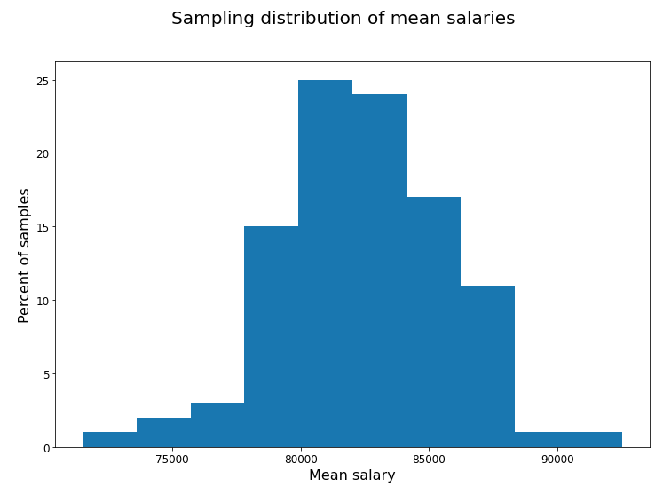

[Statistics](../README.md) › [推論統計](README.md) › 抽樣與估計

# 抽樣與估計 (Sampling & Estimation)

推論的前提是：**樣本能合理代表目標母體**。這篇談資料從哪來、怎麼用樣本統計量估計母體參數。

母體 / 樣本 / 參數 / 統計量的定義與 CLT 見 [抽樣分配與 CLT](../probability-and-distributions/sampling-distributions.md)。慣例：希臘字母（μ, σ, π）表示母體參數，英文字母（x̄, s, p̂）表示樣本統計量。

## 抽樣方法 (Sampling Methods)

| 方法 | 做法 | 優點 | 缺點 |
| --- | --- | --- | --- |
| 簡單隨機抽樣 (simple random) | 每個個體被抽中機率相同 | 無偏 | 母體大或分散時成本高 |
| 分層抽樣 (stratified) | 先分層 (strata)，**每層都抽** | 確保子群體都有代表 | 需要分層資訊 |
| 群集抽樣 (cluster) | **隨機抽幾個群**（如學校、醫院），群內全查或再抽 | 便宜 | 變異較大（群內相似） |
| 系統抽樣 (systematic) | 每隔 k 筆抽一筆 | 容易執行 | 資料順序有週期時會偏，先 shuffle |
| 便利抽樣 (convenience) | 抽容易取得的 | 快、便宜 | **選擇偏誤 (selection bias)**，不宜推論 |
| 加權抽樣 (weighted) | 各觀測被抽中的機率不同 | 可加抽稀有子群 | 分析時需再加權才能還原母體估計 |

| | 分層抽樣 | 群集抽樣 |
| --- | --- | --- |
| 目標 | 保留子群代表性 | 降低蒐集成本 |
| 抽的是 | 每一層裡的個體 | 部分的群 |

> 分層抽樣的 ML 版本是 stratified train/test split 與 stratified K-fold，見 [Train-Test Split](../../machine-learning/preprocessing/train-test-split.md)、[Sampling and Representativeness](../../machine-learning/foundations/sampling-and-representativeness.md)。

## 點估計 (Point Estimation)

| 母體參數 | 點估計量 (estimator) |
| --- | --- |
| μ | x̄ |
| σ² | s²（除以 n−1） |
| π（比例） | p̂ |
| β（迴歸係數） | $\hat\beta$（OLS / MLE） |

點估計幾乎不可能剛好等於真值，所以要搭配 [信賴區間](confidence-intervals.md)。

```python
x = df["sepal length (cm)"]
x.count(), x.mean(), x.std(ddof=1), x.var(ddof=1)   # n, x̄, s, s²
x.std(ddof=1) / np.sqrt(x.count())                  # SE
```

## 估計量的好壞：偏誤與變異

| 性質 | 定義 | 例子 |
| --- | --- | --- |
| 偏誤 (bias) | $E(\hat\theta) - \theta$，系統性偏離 | s² 除以 n 會低估 σ² |
| 變異 (variance) | $\hat\theta$ 在不同樣本間的波動 | 小樣本的 x̄ 波動大 |
| 均方誤差 (MSE) | $E[(\hat\theta-\theta)^2] = \text{Bias}^2 + \text{Variance}$ | 綜合指標 |
| 一致性 (consistency) | n → ∞ 時 $\hat\theta \to \theta$ | — |

> 這就是 ML 的 **bias-variance tradeoff**：正則化（Ridge、Lasso）刻意引入一點偏誤，換取變異大幅下降，讓 MSE 更小。見 [Bias-Variance Tradeoff](../../machine-learning/foundations/bias-variance-tradeoff.md)。

| 抽樣層面 | 偏誤 | 變異 |
| --- | --- | --- |
| 來源 | 抽樣方式系統性地偏離母體（便利抽樣、存活者偏誤） | 恰好抽到哪些人 |
| 解法 | 改善抽樣設計，**樣本變大也沒用** | 增加樣本數 |

## 理論重複抽樣 vs Bootstrap

| | 樣本來自 | 用途 |
| --- | --- | --- |
| 重複抽樣（理論） | 從母體重新抽很多組 | 定義真正的抽樣分配，推出 $SE = s/\sqrt{n}$ 等公式 |
| [Bootstrap](../probability-and-distributions/monte-carlo-simulation.md#拔靴法-bootstrap)（實務） | 從手上這一份樣本放回抽樣 | 公式難推時近似抽樣分配（中位數、比值、AUC） |



重複抽樣後，「平均薪資」不再是一個數字，而是一個分配，這正是推論統計處理的對象。

> **Bootstrap 修不了的**：選擇偏誤、量測偏誤、不具代表性的原始樣本。原始樣本有偏，bootstrap 只會把偏誤複製很多次。

抽樣設計（分層、集群、加權）與複雜樣本的估計見 [調查抽樣](survey-sampling.md)。
