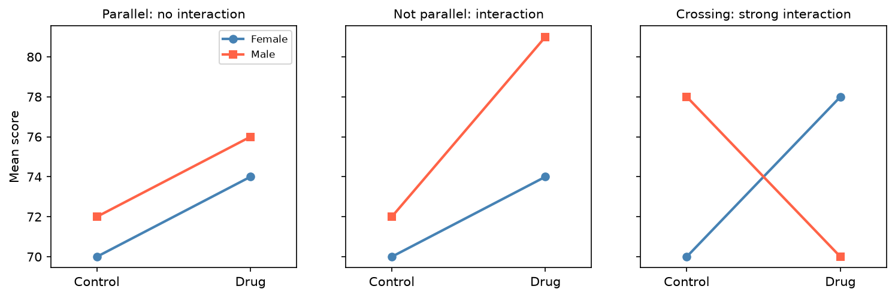

[Statistics](../README.md) › [推論統計](README.md) › [ANOVA](anova-overview.md) › 二因子

# 二因子變異數分析 (Two-Way ANOVA)

把單因子 ANOVA 擴展到**兩個類別因子**，同時回答三個問題：

| 效果 | 問題 |
| --- | --- |
| 主效果 A (main effect) | 平均而言，A 影響結果嗎？ |
| 主效果 B | 平均而言，B 影響結果嗎？ |
| **交互作用 A × B** (interaction) | A 的效果是否**取決於** B 的水準？ |

例：藥物 × 性別、基因型 × 處理、飲食 × 運動。

$$
Y_{ijk} = \mu + \alpha_i + \beta_j + (\alpha\beta)_{ij} + \varepsilon_{ijk}
$$

## 先看交互作用

交互作用顯著時，主效果可能誤導：「平均效果」可能掩蓋了不同子群體相反的反應。例如藥物對男性很有效、對女性幾乎無效，平均下來看似「中等有效」，但真正重要的是子群體差異。

| 情況 | 怎麼做 |
| --- | --- |
| 交互作用顯著 | 做**單純效果 (simple effects)**：在每個 B 水準內比較 A |
| 交互作用不顯著 | 直接解讀主效果 |
| 兩個主效果都顯著、無交互作用 | 兩因子各自獨立地影響結果 |

## Python 範例

```python
import numpy as np
import pandas as pd
import statsmodels.api as sm
import statsmodels.formula.api as smf
import matplotlib.pyplot as plt

# 模擬資料：藥物只對男性額外有效（交互作用）
rng = np.random.default_rng(42)
rows = [
    {"treatment": t, "gender": g,
     "score": 70 + 4*(t == "Drug") + 2*(g == "Male") + 5*(t == "Drug")*(g == "Male") + rng.normal(0, 4)}
    for t in ["Control", "Drug"] for g in ["Female", "Male"] for _ in range(12)
]
df = pd.DataFrame(rows)

# A * B = A + B + A:B
model = smf.ols("score ~ C(treatment) * C(gender)", data=df).fit()
anova = sm.stats.anova_lm(model, typ=2)

# 每個效果的 partial η²
ss_err = anova.loc["Residual", "sum_sq"]
anova["eta_p2"] = anova["sum_sq"] / (anova["sum_sq"] + ss_err)

# 交互作用圖
df.groupby(["gender", "treatment"])["score"].mean().unstack().plot(marker="o")
plt.ylabel("Mean score"); plt.show()
```

| ANOVA 表列 | 意義 |
| --- | --- |
| `C(treatment)` | 處理的主效果 |
| `C(gender)` | 性別的主效果 |
| `C(treatment):C(gender)` | 交互作用 |
| `Residual` | 各格 (cell) 內的變異 |

**交互作用圖判讀**

| 圖形 | 意義 |
| --- | --- |
| 線大致平行 | 幾乎沒有交互作用 |
| 明顯不平行 | 可能有交互作用 |
| 交叉 | 強交互作用，只看主效果會嚴重誤導 |



## 假設與效果量

- 假設同單因子 ANOVA，但針對**每一格**的殘差：獨立、近似常態、各格變異數相近。
- 效果量用 **partial η²** = SS_effect / (SS_effect + SS_error)。

> **不平衡設計**（各格 n 不同）時，Type I / II / III 平方和結果會不同。有交互作用時常用 Type III（需搭配 sum-to-zero 編碼：`C(x, Sum)`）；無交互作用時 Type II 較合適。

## 常見錯誤

| 錯誤 | 更好的做法 |
| --- | --- |
| 忽略交互作用 | 先看 A × B |
| 交互作用顯著仍只報主效果 | 報告單純效果與各格平均 ± CI |
| 其中一個預測變數是連續的 | 改用 ANCOVA / [迴歸](../regression-analysis/multiple-linear-regression.md) |
| 沒有結構地做很多子群 t 檢定 | 事先計畫比較並做 [多重檢定校正](multiple-testing.md) |

## 報告範本

```text
二因子 ANOVA 檢驗處理與性別對分數的影響。處理 × 性別交互作用顯著，
F(1, 44) = 6.82，p = .012，partial η² = .134，表示處理效果因性別而異；
後續比較顯示藥物對男性的改善幅度大於女性。
```
