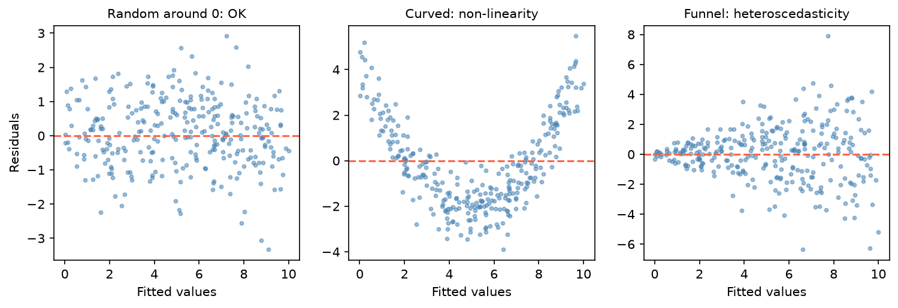

[Statistics](../README.md) › [多變量分析](README.md) › 模型假設與診斷

# 模型假設與診斷 (Model Assumptions & Diagnostics)

違反假設不一定讓模型「錯」，但可能讓估計不可靠、SE 錯誤、預測有偏。違反核心假設的模型表面上可能看起來很好（高 R²、顯著 p 值）。診斷是統計嚴謹度的最後一道防線。

## 線性迴歸：LINE + 兩項

| 假設 | 意義 | 檢查 | 違反時 |
| --- | --- | --- | --- |
| **L**inearity | X 與 y 線性 | 殘差 vs 配適值 | 多項式項、轉換、樣條 (spline) |
| **I**ndependence | 觀測獨立 | 研究設計、Durbin-Watson | [混合模型](../regression-analysis/mixed-effects-models.md)、時間序列模型 |
| **N**ormality | 殘差近似常態 | 殘差 Q–Q 圖 | 大樣本影響小；小樣本考慮轉換或 bootstrap |
| **E**qual variance | 殘差變異固定 | Scale-Location、Breusch-Pagan | 轉換 y、WLS、**robust SE (HC3)** |
| 無嚴重共線性 | 預測變數不高度相關 | VIF < 10 | 見 [多元線性迴歸](../regression-analysis/multiple-linear-regression.md#多重共線性-multicollinearity) |
| 無過度影響點 | 單一觀測不主導估計 | Cook's distance | 檢查資料、敏感度分析 |

> 最關鍵的是**線性與等變異**（影響估計與 SE）以及**獨立**；常態性在大樣本下因 CLT 較不重要，主要影響小樣本的 p 值與 CI。

## 四張診斷圖

```python
import numpy as np
import matplotlib.pyplot as plt
import scipy.stats as stats
import statsmodels.api as sm
from sklearn.datasets import fetch_california_housing

df = fetch_california_housing(as_frame=True).frame.sample(2000, random_state=42)
X = sm.add_constant(df[["MedInc", "HouseAge", "AveRooms", "AveOccup"]])
res = sm.OLS(df["MedHouseVal"], X).fit()

infl = res.get_influence()
fitted, resid = res.fittedvalues, res.resid
std_resid = infl.resid_studentized_internal
cooks = infl.cooks_distance[0]

fig, ax = plt.subplots(2, 2, figsize=(12, 9))
ax[0, 0].scatter(fitted, resid, s=10, alpha=0.3); ax[0, 0].axhline(0, color="red", ls="--")
ax[0, 0].set_title("1. Residuals vs Fitted")
stats.probplot(resid, dist="norm", plot=ax[0, 1]); ax[0, 1].set_title("2. Q–Q")
ax[1, 0].scatter(fitted, np.sqrt(np.abs(std_resid)), s=10, alpha=0.3); ax[1, 0].set_title("3. Scale-Location")
ax[1, 1].stem(cooks, markerfmt=","); ax[1, 1].axhline(4 / len(cooks), color="red", ls="--")
ax[1, 1].set_title("4. Cook's Distance")
plt.tight_layout(); plt.show()

# 或一行：statsmodels 內建
sm.graphics.plot_regress_exog(res, "MedInc")      # 針對單一預測變數：殘差、部分迴歸、CCPR 圖
```

| 圖 | 型態 | 診斷 | 對策 |
| --- | --- | --- | --- |
| 1. 殘差 vs 配適值 | 隨機分布在 0 附近 | ✅ | — |
| | 曲線（U 形、拱形） | 非線性 | 多項式、轉換 X |
| | 漏斗形（越來越寬） | 異質變異 | log / sqrt 轉換 y、WLS、HC3 |
| | 帶狀或分組 | 未建模的結構 | 加入遺漏變數或交互作用 |
| 2. Q–Q | 沿對角線 | ✅ | — |
| | S 形向外 / 向內 | 厚尾 / 薄尾 | 穩健迴歸、bootstrap |
| | 單向彎曲 | 偏態 | 轉換 y |
| 3. Scale-Location | 水平帶 | ✅ 等變異 | — |
| | 上升 / 下降 | 異質變異 | 同上 |
| 4. Cook's D | < 4/n | ✅ | — |
| | 4/n ~ 1 | ⚠️ 值得檢查 | — |
| | > 1 | ❌ 高影響力 | 查證資料、報告有無此點的結果 |



Cook's distance 結合槓桿與殘差大小：$D_i = \dfrac{\sum_j (\hat y_j - \hat y_{j(-i)})^2}{(p+1)\hat\sigma^2}$，即「移除第 i 點後，所有配適值改變多少」。

## 異質變異 (Heteroscedasticity)

```python
from statsmodels.stats.diagnostic import het_breuschpagan, het_white

het_breuschpagan(res.resid, res.model.exog)[1]    # p 值；H₀ = 等變異
het_white(res.resid, res.model.exog)[1]           # 也能偵測非線性的異質變異

res_robust = sm.OLS(df["MedHouseVal"], X).fit(cov_type="HC3")   # 係數不變，只修正 SE
```

| 對策 | 時機 |
| --- | --- |
| log 轉換 y | 變異隨配適值等比例增加 |
| sqrt 轉換 | 計數資料、中度異質變異（或改用 [Poisson / NB GLM](../regression-analysis/glm-count-models.md)） |
| 加權最小平方 (WLS) | 已知變異結構 |
| **Robust SE (HC3)** | 不想轉換，只要推論正確；異質變異輕微時的首選 |

## 邏輯斯迴歸

| 檢查 | 工具 | 目標 |
| --- | --- | --- |
| log-odds 線性 | Box-Tidwell、分箱後畫經驗 logit | 線性 |
| 完全分離 | 收斂警告、係數 / SE 爆大 | 無；有則用 Firth 或正則化 |
| 共線性 | VIF | < 10 |
| 區辨力 (discrimination) | [ROC / AUC](../../machine-learning/evaluation/roc-auc.md) | > 0.7（依情境） |
| **校準 (calibration)** | 校準曲線 | 貼近對角線 |

```python
from sklearn.calibration import calibration_curve
prob_true, prob_pred = calibration_curve(y_test, y_prob, n_bins=8)
plt.plot(prob_pred, prob_true, "s-"); plt.plot([0, 1], [0, 1], "k--"); plt.show()
```

曲線在對角線**上方** → 模型低估機率（太保守）；**下方** → 高估（過度自信）。AUC 衡量排序能力，校準衡量機率準不準，兩者不同；用預測機率做風險決策時校準很重要。見 [Thresholds & Calibration](../../machine-learning/evaluation/classification-thresholds-and-calibration.md)。

## PCA 與分群

```python
from sklearn.decomposition import PCA
from sklearn.cluster import KMeans
from sklearn.metrics import silhouette_samples, silhouette_score
from sklearn.preprocessing import StandardScaler
from sklearn.datasets import load_iris

Xs = StandardScaler().fit_transform(load_iris().data)

# PCA：重建誤差
pca = PCA(n_components=2).fit(Xs)
np.mean((Xs - pca.inverse_transform(pca.transform(Xs))) ** 2)

# 分群：每個點的輪廓係數 s_i = (b_i − a_i) / max(a_i, b_i)
labels = KMeans(n_clusters=3, n_init=10, random_state=42).fit_predict(Xs)
s = silhouette_samples(Xs, labels)
silhouette_score(Xs, labels), (s < 0).sum()       # 平均輪廓係數、可能分錯群的點數
```

aᵢ = 與同群其他點的平均距離；bᵢ = 與最近其他群的平均距離。sᵢ 接近 1 → 分得好；< 0 → 可能屬於別群。

## 診斷清單

| 模型 | 檢查 | 工具 | 目標 |
| --- | --- | --- | --- |
| OLS | 線性 | 殘差 vs 配適值 | 隨機分布 |
| | 等變異 | Scale-Location、Breusch-Pagan | 水平；p > 0.05 |
| | 常態 | Q–Q 圖 | 沿對角線 |
| | 影響點 | Cook's D | 無點 > 4/n（或已查證） |
| | 共線性 | VIF | < 10 |
| 邏輯斯 | 校準 | 校準曲線 | 貼近對角線 |
| | 區辨力 | ROC / AUC | 依情境 |
| PCA | 保留變異 | Scree、累積變異 | 依用途 |
| | 可解釋性 | 負荷量、biplot | 每個成分有清楚的主導變數 |
| K-Means | 群品質 | 輪廓係數 | > 0.5 好、> 0.7 強 |
| | 群數 | 手肘 + 輪廓 | 兩者一致 |

> **模型行為怪異時的檢查順序**：(1) 前處理 / 資料洩漏 → (2) 量尺與編碼 → (3) 影響點 → (4) 假設違反 → (5) 門檻或校準。很多看似進階的診斷問題，起點都是基本的資料流程錯誤。

statsmodels 的診斷 API（殘差圖、VIF、Breusch-Pagan、Cook's distance）見 [statsmodels：診斷](../../machine-learning/packages/statsmodels/diagnostics.md)。
