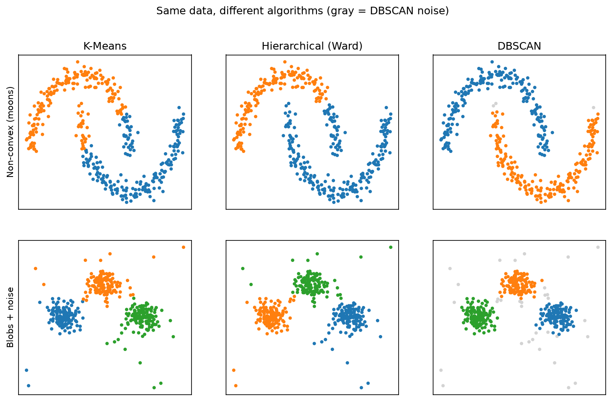
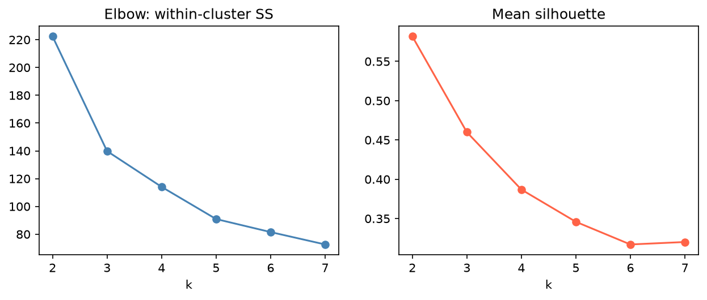

[Statistics](../README.md) › [多變量分析](README.md) › 分群

# 分群 (Clustering)

**非監督式 (unsupervised)**：不使用標籤，從資料本身找出自然群組。沒有標準答案，結果好不好要結合數學指標與領域知識判斷。各演算法的 ML 筆記：[K-Means](../../machine-learning/unsupervised-learning/clustering/kmeans.md)、[Hierarchical](../../machine-learning/unsupervised-learning/clustering/hierarchical.md)、[DBSCAN](../../machine-learning/unsupervised-learning/clustering/dbscan.md)、[Gaussian Mixture](../../machine-learning/unsupervised-learning/clustering/gaussian-mixture.md)。

## 方法比較

| 方法 | 類型 | 核心概念 | 關鍵參數 | 適合 | 弱點 |
| --- | --- | --- | --- | --- | --- |
| **K-Means** | 分割式 (partitional) | 每點分到最近的中心，重複更新中心 | k | 緊密、球狀、大小相近的群；大資料最快 | 需指定 k；對離群值與量尺敏感 |
| **階層式** (hierarchical, agglomerative) | 階層 | 由下而上合併最近的群，得樹狀圖 | 連結方法、切割高度 | 未知 k、想看巢狀結構 | 大資料慢（O(n²) 記憶體） |
| **DBSCAN** | 密度 (density-based) | 群 = 稀疏區隔開的高密度區 | ε、min_samples | 非球狀、有雜訊 / 離群 | 群密度差異大時難調 |
| **GMM** | 模型式 | 資料來自多個常態分配的混合 | 成分數、共變異型態 | 橢圓群、需要軟分配機率 | 假設常態 |
| **Leiden / Louvain** | 圖 (graph-based) | 在 kNN 圖上找社群 | resolution | **單細胞 RNA-seq 標準** | 群數依 resolution 而定 |

> 距離型方法對量尺很敏感，**分群前一定要標準化**（或先 PCA）。



K-Means 與 Ward 偏好球狀群，會把月牙形切成兩半；DBSCAN 能沿密度追出非凸形狀，並把稀疏點標為雜訊。

## Python 範例

```python
import numpy as np
import pandas as pd
import seaborn as sns
import matplotlib.pyplot as plt
from sklearn.datasets import load_iris
from sklearn.preprocessing import StandardScaler
from sklearn.cluster import KMeans, DBSCAN
from sklearn.metrics import silhouette_score, adjusted_rand_score
from sklearn.neighbors import NearestNeighbors
from scipy.cluster.hierarchy import linkage, dendrogram, fcluster

iris = load_iris(as_frame=True)
X = StandardScaler().fit_transform(iris.data)

# K-Means：用手肘法 + 輪廓係數選 k
for k in range(2, 8):
    km = KMeans(n_clusters=k, n_init=10, random_state=42).fit(X)
    print(k, round(km.inertia_, 1), round(silhouette_score(X, km.labels_), 3))
labels_km = KMeans(n_clusters=3, n_init=10, random_state=42).fit_predict(X)

# 階層式（Ward）：畫樹狀圖，再切成 k 群
Z = linkage(X, method="ward")
dendrogram(Z, no_labels=True); plt.show()
labels_hc = fcluster(Z, t=3, criterion="maxclust")

# DBSCAN：用 k-distance 圖的「膝點」選 ε
d, _ = NearestNeighbors(n_neighbors=5).fit(X).kneighbors(X)
plt.plot(np.sort(d[:, -1])); plt.show()
labels_db = DBSCAN(eps=0.8, min_samples=5).fit_predict(X)     # -1 = 雜訊點

# 有真實標籤時（僅供驗證）：ARI
adjusted_rand_score(iris.target, labels_km)
```

## 選擇群數 k

| 訊號 | 建議 |
| --- | --- |
| 手肘在 k = 3 且輪廓係數在 k = 3 最高 | 強烈支持 k = 3 |
| 手肘不明顯，輪廓係數在 k = 2 最高 | 傾向較簡單的 k |
| 兩條曲線都單調下降 | 資料可能沒有明顯群結構 |
| 兩者不一致 | 都檢查，用領域知識判斷 |



iris 是「兩者不一致」的例子：手肘不明顯，輪廓係數在 k = 2 最高（setosa vs 另外兩種），但真實有 3 個物種。versicolor 與 virginica 在量測空間中重疊，統計指標無法替你決定 k。

## 評估指標

| 指標 | 需要真實標籤？ | 範圍 | 意義 |
| --- | --- | --- | --- |
| 輪廓係數 (silhouette) | 否 | −1 ~ 1 | 群內緊密、群間分離的程度 |
| Inertia (WCSS) | 否 | ≥ 0 | 群內平方和，k 越大越小（用於手肘法） |
| Davies-Bouldin | 否 | ≥ 0，越小越好 | 群間相似度 |
| ARI (adjusted Rand index) | **是** | ≈ 0 隨機、1 完全一致 | 與已知分類的一致性（校正機率） |

## 階層式的連結方法

| 連結 (linkage) | 合併依據 | 適合 | 弱點 |
| --- | --- | --- | --- |
| **Ward** | 群內變異增加最少 | 緊密、大小相近的群；**建議起點** | 假設群大小相近 |
| Complete | 兩群間最遠距離 | 分離良好的緊密群 | 對離群值敏感 |
| Average | 兩群間平均距離 | 平衡 | — |
| Single | 兩群間最近距離 | 細長、鏈狀的群 | 「鏈結效應 (chaining)」 |

> 基因表現 heatmap 的樹狀圖常用 **1 − Pearson 相關**作為距離 + average linkage，看的是「表現型態相似」而非絕對量相近。

## DBSCAN 參數

| 參數 | 調大 | 調小 |
| --- | --- | --- |
| ε (eps) | 群更少、更大 | 群更多、雜訊點更多 |
| min_samples | 群更少、雜訊更多 | 能找到較小的群 |

## 描述各群 (Cluster Profiling)

找出群只完成一半，還要描述每群的特徵，把「Cluster 2」變成「花瓣長的大花」或「高表現免疫基因的 T 細胞」。

```python
df = iris.data.assign(cluster=labels_km)
profile = df.groupby("cluster").mean()                       # 偏態變數用 median
sns.heatmap((profile - profile.mean()) / profile.std(), annot=True, cmap="RdBu_r", center=0)
```

單細胞資料中，這一步就是找各群的 **marker genes**（常用 [Wilcoxon rank-sum](../nonparametric-methods/two-independent-samples.md)）。

## 分群是假設，不是結論

分群演算法**一定會**分出群，即使資料沒有真正的群結構。驗證方式：

| 檢查 | 做法 |
| --- | --- |
| 穩定性 | Bootstrap / 子抽樣後重新分群，看群是否一致（consensus clustering） |
| 前處理敏感度 | 換標準化方式、特徵子集、PCA 成分數，結果是否改變 |
| 領域可解釋性 | 各群在領域語言中是否有意義 |
| 外部驗證 | 在獨立資料上是否重現 |

> 用分群結果再去檢定「群間差異」是**循環論證 (double dipping)**：群本來就是依差異分出來的，p 值必然很小。
