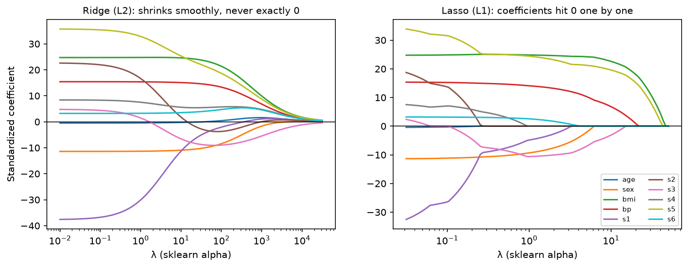

[Statistics](../README.md) › [多變量分析](README.md) › 多元迴歸：預測與正則化

# 多元迴歸：預測與正則化 (Multiple Regression for Prediction)

多元迴歸的基礎（偏迴歸係數、調整 R²、VIF、虛擬編碼、交互作用、遺漏變數偏誤）見 [迴歸分析：多元線性迴歸](../regression-analysis/multiple-linear-regression.md)。這篇著重多變量情境：**以預測為目的的工作流程**，以及**預測變數很多**時怎麼辦。

| 目的 | 工具 | 重視 |
| --- | --- | --- |
| 解釋 / 推論 | `statsmodels` | 係數、SE、p 值、CI |
| 預測 | `sklearn` | 測試集誤差、交叉驗證、pipeline |

## 以預測為目的的流程

```python
import numpy as np
import pandas as pd
import statsmodels.api as sm
from sklearn.datasets import fetch_california_housing
from sklearn.model_selection import train_test_split
from sklearn.metrics import mean_absolute_error, mean_squared_error, r2_score

df = fetch_california_housing(as_frame=True).frame
X, y = df.drop(columns="MedHouseVal"), df["MedHouseVal"]
X_train, X_test, y_train, y_test = train_test_split(X, y, test_size=0.2, random_state=42)

res = sm.OLS(y_train, sm.add_constant(X_train)).fit()
res.summary()                                   # 推論：只看訓練資料

y_pred = res.predict(sm.add_constant(X_test))   # 預測：一定要在測試集評估
mean_absolute_error(y_test, y_pred), np.sqrt(mean_squared_error(y_test, y_pred)), r2_score(y_test, y_pred)
```

| summary 欄位 | 看什麼 |
| --- | --- |
| R² / Adj. R² | 樣本內解釋力 |
| F-statistic / Prob(F) | 是否至少有一個預測變數有用 |
| coef、P>\|t\|、[0.025, 0.975] | 偏效果、顯著性、95% CI |
| AIC / BIC | 模型比較 |

> 訓練 R² 永遠偏樂觀（模型越複雜越高）；測試 R² 才代表泛化能力。見 [ML: Generalization](../../machine-learning/foundations/generalization.md)。

## 正則化：Ridge、Lasso、Elastic Net

在 OLS 損失上加懲罰項，把係數往 0 收縮，以少量偏誤換取變異大幅下降（[bias-variance tradeoff](../inferential-statistics/sampling-estimation.md#估計量的好壞偏誤與變異)）。

$$
\min_\beta \ \sum (y_i - x_i^\top\beta)^2 + \lambda \cdot \text{penalty}(\beta)
$$

| 方法 | 懲罰 | 效果 | 適合 | 貝氏解釋 |
| --- | --- | --- | --- | --- |
| **Ridge** (L2) | $\sum \beta_j^2$ | 所有係數等比例收縮，不會變 0 | 共線性、很多小效果 | 常態先驗 |
| **Lasso** (L1) | $\sum \lvert\beta_j\rvert$ | 部分係數**剛好變 0** → 自動選變數 | 稀疏訊號、想要精簡模型 | Laplace 先驗 |
| **Elastic Net** | 兩者混合 | 介於之間；相關變數會一起被選 | 高維且變數相關（基因資料） | — |

```python
from sklearn.pipeline import make_pipeline
from sklearn.preprocessing import StandardScaler
from sklearn.linear_model import RidgeCV, LassoCV, ElasticNetCV

# 懲罰對量尺敏感 → 一定要先標準化；λ（sklearn 叫 alpha）用交叉驗證選，不要在測試集上調
lasso = make_pipeline(StandardScaler(), LassoCV(cv=5, random_state=42)).fit(X_train, y_train)
coef = pd.Series(lasso[-1].coef_, index=X.columns)
(coef != 0).sum()                                 # 被保留的變數數

ridge = make_pipeline(StandardScaler(), RidgeCV(alphas=np.logspace(-3, 3, 50))).fit(X_train, y_train)
enet = make_pipeline(StandardScaler(), ElasticNetCV(l1_ratio=[0.1, 0.5, 0.9], cv=5)).fit(X_train, y_train)
```



<sub>sklearn diabetes 資料（10 個標準化預測變數）。λ 由右往左減小，係數逐漸回到 OLS 值。</sub>

> 正則化後的係數是**有偏的**，一般的 SE 與 p 值不再適用。若需要推論，要用專門方法（如 post-selection inference），或把 Lasso 當作篩選、再於獨立資料上檢定。ML 筆記：[Ridge](../../machine-learning/supervised-learning/regression/ridge.md)、[Lasso](../../machine-learning/supervised-learning/regression/lasso.md)、[Elastic Net](../../machine-learning/supervised-learning/regression/elastic-net.md)。

## 高維資料：p > n

基因體、蛋白質體資料常見「特徵數遠多於樣本數」（20,000 個基因、50 個樣本）。

| 問題 | 原因 | 對策 |
| --- | --- | --- |
| OLS 無唯一解 | $X^\top X$ 不可逆（rank < p） | Ridge / Lasso / Elastic Net |
| 完美配適訓練資料 | 參數比資料多 | 交叉驗證、獨立測試集 |
| 偽相關 | 隨機也能找到「有關」的特徵 | 正則化、[多重檢定校正](../inferential-statistics/multiple-testing.md) |
| 特徵選擇洩漏 | 用全部資料選特徵再做 CV | **特徵選擇要放在 CV 迴圈內**，見 [Data Leakage](../../machine-learning/foundations/data-leakage.md) |
| 難以解釋 | 特徵太多 | 先降維（[PCA](pca.md)）或用 pathway 層級的特徵 |

## 變數選擇方法比較

| 方法 | 評價 |
| --- | --- |
| 領域知識 | 首選，尤其以解釋為目的 |
| Lasso / Elastic Net + CV | 以預測為目的、變數多 |
| AIC / BIC 比較少數候選模型 | 可以 |
| 逐步選擇 (stepwise) | 不建議：不穩定、p 值與 CI 失真、易過擬合 |

> 「其他條件不變」在數學上很精確，但在變數高度相關的真實資料中，那種組合可能很少見甚至不存在。
