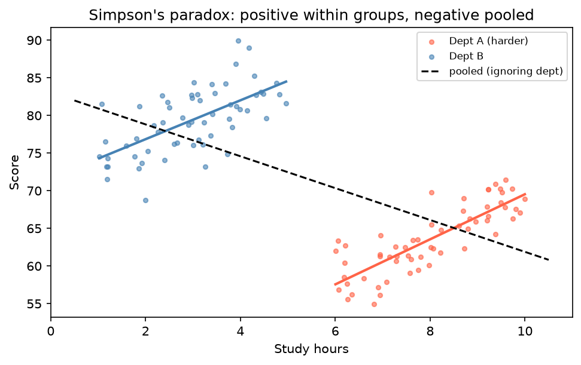

[Statistics](../README.md) › [多變量分析](README.md) › 多變量 EDA

# 多變量探索性分析 (Multivariate EDA)

變數超過兩個時，直覺開始失靈：控制第三個變數後，兩變數的關係可能消失甚至反轉（Simpson's paradox）。建模前先了解所有變數的**聯合結構**。

相關矩陣、heatmap、pairplot 的基本用法見 [雙變數分析](../descriptive-statistics/bivariate.md#多個數值變數相關矩陣)；這裡著重多變量的延伸。

## 工具總覽

| 工具 | 看什麼 |
| --- | --- |
| 相關矩陣 heatmap | 所有變數兩兩的**線性**關係（r = 0 不代表無關） |
| Pairplot（依組上色） | 實際散布形狀、各組是否分得開、非線性 |
| 分組摘要 + 標準化 heatmap | 各組在哪些變數上不同 |
| 平行座標圖 (parallel coordinates) | 多變量「輪廓」與組間差異 |
| 叢集 heatmap (clustermap) | 樣本與變數同時分群，**基因表現資料的標準圖** |
| PCA 散布圖 | 樣本在高維空間中的整體結構、批次效應、離群樣本 |

| Pairplot 型態 | 意義 |
| --- | --- |
| 不同顏色明顯分開 | 這組變數有判別力 |
| 沿直線緊密分布 | 強線性相關（冗餘） |
| 各組重疊 | 單靠這組變數分不開 |
| 對角線 KDE 雙峰 | 該變數在各組分布不同 |
| 彎曲形狀 | 非線性，相關係數會誤導 |

```python
import numpy as np
import pandas as pd
import seaborn as sns
import matplotlib.pyplot as plt
from pandas.plotting import parallel_coordinates
from sklearn.datasets import load_iris

iris = load_iris(as_frame=True)
df = iris.frame.assign(species=pd.Categorical.from_codes(iris.target, iris.target_names))
num = df.select_dtypes("number").columns.drop("target")

# 1. 相關矩陣
sns.heatmap(df[num].corr(), annot=True, fmt=".2f", cmap="coolwarm", vmin=-1, vmax=1, center=0)

# 2. Pairplot（變數 > 8 個時用 vars= 挑選，或直接做 PCA）
sns.pairplot(df, vars=num, hue="species", diag_kind="kde")

# 3. 分組平均（先標準化才能跨變數比較）
gm = df.groupby("species", observed=True)[num].mean()
sns.heatmap((gm - gm.mean()) / gm.std(), annot=True, cmap="RdBu_r", center=0)

# 4. 平行座標（先縮放到 0–1）
norm = (df[num] - df[num].min()) / (df[num].max() - df[num].min())
parallel_coordinates(norm.assign(species=df["species"]), "species", alpha=0.4)

# 5. 叢集 heatmap：列與欄同時做階層式分群；z_score=1 對每欄標準化
sns.clustermap(df[num], z_score=1, cmap="vlag", row_colors=df["species"].map({"setosa": "C0", "versicolor": "C1", "virginica": "C2"}))
plt.show()
```

## 共線性篩檢

建模前先找出高度相關的預測變數（|r| > 0.8 是警訊），再用 VIF 確認。VIF 的定義與對策見 [多元線性迴歸](../regression-analysis/multiple-linear-regression.md#多重共線性-multicollinearity)。

```python
corr = df[num].corr().abs()
upper = corr.where(np.triu(np.ones(corr.shape), k=1).astype(bool))
upper.stack().loc[lambda s: s > 0.8]          # 列出 |r| > 0.8 的變數對
```

## Simpson's Paradox

**整體**資料呈現的關係，在**分組**後反轉或消失。

例：A 系課程較難，學生讀書時數多、但分數普遍較低；B 系相反。兩系內部「讀書時數 ↔ 分數」都是正相關，忽略科系合併來看卻變成負相關。科系同時影響讀書時數與分數，就是**干擾因子 (confounder)**。



```python
import statsmodels.formula.api as smf
smf.ols("score ~ hours", data=d).fit().params          # 忽略分組
smf.ols("score ~ hours + C(dept)", data=d).fit().params  # 控制分組後
```

> 下因果結論前先問：「有沒有第三個變數同時影響兩者？」生資常見的干擾因子：**批次、定序深度、細胞組成、年齡、性別**。見 [干擾與偏誤](../experimental-design/confounding-bias.md)。

## 建模前要回答的問題

| 問題 | 為什麼 |
| --- | --- |
| 哪些變數冗餘？ | 共線性、可降維 |
| 哪些變數量尺不相容？ | PCA、距離型方法需要標準化 |
| 哪些觀測只在**組合**下才異常？ | 每個變數單看都正常的點，仍可能是**多變量離群值**（用 Mahalanobis 距離或 PCA 找） |
| 樣本是否依批次 / 時間聚集？ | PCA 上若依批次分開而非依生物條件，先處理批次效應 |
