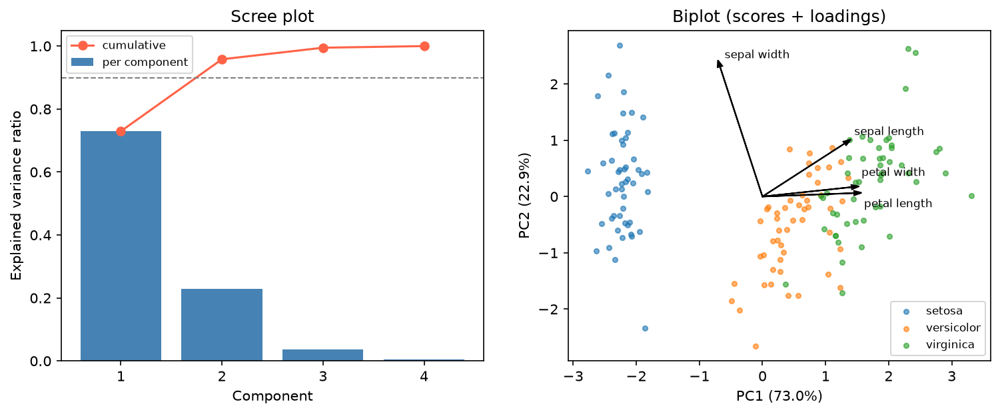

[Statistics](../README.md) › [多變量分析](README.md) › PCA

# 主成分分析 (Principal Component Analysis, PCA)

把一組相關的變數轉成少數**互不相關**的成分，每個成分盡可能保留最多變異。可單獨用來理解結構，也常是分群或迴歸前的前處理。ML 前處理角度見 [ML: PCA](../../machine-learning/unsupervised-learning/dimensionality-reduction/pca.md)。

> 高維資料通常不是均勻散開的：沿某些方向變化很大，其他方向幾乎不變。PCA 找出這些「最大變異方向」。它是**座標軸的旋轉**，不是丟資料；只是選擇保留前 k 個最重要的方向。

## 原理

| 性質 | 說明 |
| --- | --- |
| PC1 | 資料變異最大的方向 |
| PC2 | 與 PC1 **正交**、剩餘變異最大的方向 |
| PC3 … | 依此類推，解釋的變異遞減 |
| 成分彼此 | 不相關 (uncorrelated) |

數學上是（標準化後）共變異矩陣的特徵分解 $\Sigma = V\Lambda V^\top$，或中心化資料的 SVD，見 [線性代數基礎](linear-algebra-foundations.md)。

| 輸出 | 意義 | sklearn |
| --- | --- | --- |
| 特徵值 (eigenvalue) | 每個成分捕捉的變異 | `explained_variance_` |
| 解釋變異比例 | 特徵值 / 總和 | `explained_variance_ratio_` |
| 負荷量 (loadings) | 每個成分是原始變數的哪種線性組合 | `components_`（列 = 成分） |
| 分數 (scores) | 每筆觀測在新座標的位置 | `fit_transform()` 的輸出 |

> **PCA 對量尺敏感**：單位大的變數會主導前幾個成分。除非所有變數單位相同，**一定要先標準化**（等同對相關矩陣做 PCA）。

## Python 範例

```python
import numpy as np
import pandas as pd
import matplotlib.pyplot as plt
from sklearn.datasets import load_iris
from sklearn.preprocessing import StandardScaler
from sklearn.decomposition import PCA

iris = load_iris(as_frame=True)
X = iris.data
X_scaled = StandardScaler().fit_transform(X)

pca = PCA().fit(X_scaled)                       # 先保留全部成分來診斷
pca.explained_variance_ratio_.round(3)          # [0.730, 0.229, 0.037, 0.005]
np.cumsum(pca.explained_variance_ratio_)        # 前 2 個成分已解釋 95.8%

# Scree plot + 累積變異
k = np.arange(1, X.shape[1] + 1)
plt.bar(k, pca.explained_variance_ratio_)
plt.plot(k, np.cumsum(pca.explained_variance_ratio_), "o-", color="tomato")
plt.axhline(0.9, ls="--"); plt.show()

# 分數圖：軸標籤要寫解釋變異百分比
scores = PCA(n_components=2).fit(X_scaled)
Z = scores.transform(X_scaled)
plt.scatter(Z[:, 0], Z[:, 1], c=iris.target, cmap="Set1", alpha=0.7)
plt.xlabel(f"PC1 ({scores.explained_variance_ratio_[0]:.1%})")
plt.ylabel(f"PC2 ({scores.explained_variance_ratio_[1]:.1%})")

# 負荷量 + biplot 箭頭
loadings = pd.DataFrame(scores.components_.T, index=X.columns, columns=["PC1", "PC2"])
for var, (x, y) in loadings.iterrows():
    plt.arrow(0, 0, 3 * x, 3 * y, color="k", head_width=0.05)
    plt.text(3.3 * x, 3.3 * y, var, fontsize=8)
plt.show()
```



## 選擇成分數 k

| 規則 | 說明 | 注意 |
| --- | --- | --- |
| 手肘法 (elbow) | scree plot 的轉折點 | 轉折不明顯時很主觀 |
| 累積變異 ≥ 90–95% | 保留到解釋足夠變異 | 雜訊多時可能保留太多 |
| Kaiser 準則 | 標準化資料中保留特徵值 > 1 | 常保留過多 |
| 用途導向 | 視覺化取 2–3；下游模型用 CV 選 | 最可靠 |

## 解讀負荷量與 biplot

| 負荷量 | 意義 |
| --- | --- |
| 接近 ±1 | 該變數與此成分高度一致 |
| 接近 0 | 對此成分幾乎沒貢獻 |
| 同號 | 沿此成分一起變動 |
| 異號 | 沿此成分反向變動 |

為成分命名讓結果好溝通：iris 的 PC1 負荷量為花萼長 0.52、花萼寬 −0.27、花瓣長 0.58、花瓣寬 0.56 →「花朵大小（主要是花瓣）」；PC2 幾乎只由花萼寬主導（0.92，其餘 ≤ 0.38）→「花萼寬度」。負荷量的正負號是任意的，整個成分翻號意義不變。

| Biplot | 意義 |
| --- | --- |
| 箭頭方向相同 | 變數高度正相關 |
| 箭頭方向相反 | 負相關 |
| 箭頭長 | 在此 2D 平面中表現良好 |
| 箭頭短 | 前兩個成分無法代表此變數 |

## 生資應用：基因表現 PCA

| 步驟 | 原因 |
| --- | --- |
| 先 log 轉換（如 log₂(count + 1)、DESeq2 的 VST） | 計數資料右偏，變異隨平均增加 |
| 選最具變異的基因（如前 500–2,000 個） | 去除雜訊基因 |
| 中心化（是否縮放依目的） | 縮放會放大低表現基因的雜訊 |
| 依**生物條件**與**批次**分別上色 | PC1 若對應批次而非處理，先處理 [批次效應](../experimental-design/confounding-bias.md) |
| 檢查離群樣本 | 遠離其他樣本的點可能是品質問題或標籤錯誤 |

DESeq2 的 `vst()` + `plotPCA()` 見 [DESeq2 workflow](../../../biology/genomics/sequencing-and-analysis/workflows/rnaseq-differential-expression-with-deseq2.md#pca-for-sample-structure)；GWAS / QTL 則用 genotype PCs 當共變數校正族群結構（[QTL mapping](../../../biology/genomics/sequencing-and-analysis/genome-wide-analysis/qtl-analysis-and-mapping.md#相關統計方法)）。

> 單細胞分析中，PCA（約 30–50 個成分）是 t-SNE / UMAP 與分群之前的標準步驟。非線性結構 PCA 抓不到，見 [ML: t-SNE](../../machine-learning/unsupervised-learning/dimensionality-reduction/tsne.md)。

## 注意事項

| 項目 | 說明 |
| --- | --- |
| 只在訓練集 fit | 有 train / test 時，scaler 與 PCA 都只 `fit` 訓練集，測試集用 `transform()`，否則 [資料洩漏](../../machine-learning/foundations/data-leakage.md) |
| 只抓線性結構 | 非線性用 kernel PCA、UMAP、t-SNE |
| **不是特徵重要性** | PCA 找變異方向，不是預測目標的方向；某變數在 PC1 負荷大，對監督式預測仍可能很弱（需要的話用 PLS 或 LDA） |
| 對離群值敏感 | 極端點會拉走主成分方向；考慮 robust PCA |
| 符號任意 | 不同軟體 PC 的正負號可能相反，解讀時看相對方向 |
