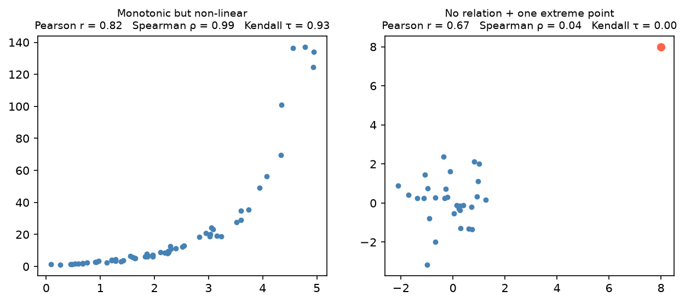

[Statistics](../README.md) › [無母數方法](README.md) › 等級相關

# 等級相關：Spearman ρ 與 Kendall τ (Rank Correlation)

Pearson r 衡量**線性**關係；等級相關衡量**單調 (monotonic)** 關係：一個變數增加時，另一個是否一致地增加（或減少），不管速率。基本介紹與 Pearson 見 [雙變數分析](../descriptive-statistics/bivariate.md#數值--數值相關係數-correlation)。

## Spearman ρ

把兩個變數各自**排名**，再對排名算 Pearson r。無同分時：

$$
\rho = 1 - \frac{6\sum d_i^2}{n(n^2-1)}, \quad d_i = \text{第 } i \text{ 對的排名差}
$$

## Kendall τ

看所有配對 (i, j)：

- **一致 (concordant)**：xᵢ > xⱼ 且 yᵢ > yⱼ（或都較小）
- **不一致 (discordant)**：方向相反

$$
\tau = \frac{\#\text{concordant} - \#\text{discordant}}{\binom{n}{2}}
$$

τ 可直接解讀為機率：P(一致) − P(不一致)。同一份資料 τ 通常小於 ρ（τ = 0.6 約相當於 ρ = 0.75 以上），**尺度不同，不代表較弱**。

## Python 範例

```python
from scipy import stats
from sklearn.datasets import load_iris

df = load_iris(as_frame=True).frame
x, y = df["sepal length (cm)"], df["petal length (cm)"]

stats.pearsonr(x, y)      # (r, p)
stats.spearmanr(x, y)     # (ρ, p)
stats.kendalltau(x, y)    # (τ, p)

df.select_dtypes("number").corr(method="spearman")   # Spearman 相關矩陣
```

## 選哪一個

| | Pearson r | Spearman ρ | Kendall τ |
| --- | --- | --- | --- |
| 關係類型 | 線性 | 單調 | 單調 |
| 假設常態 | 是 | 否 | 否 |
| 資料 | 連續 | Ordinal / 連續 | Ordinal / 連續 |
| 對離群值 | 敏感 | 穩健 | 穩健 |
| 小樣本 / 很多同分 | 不理想 | 可 | **最佳** |
| 何時用 | 散布圖確認線性、資料乾淨 | **一般預設** | 小樣本、大量同分 |

> **Pearson 與 Spearman 差很多 → 關係可能是非線性或被離群值影響**。例如指數成長：Pearson 低估、Spearman 能抓到。但兩者都抓不到 U 形等**非單調**關係，一定要先畫散布圖。



> **生資應用**：基因共表現 (co-expression) 網路常用 Spearman，因為表現量偏態且有離群樣本。上千個基因兩兩相關時，記得 [多重檢定校正](../inferential-statistics/multiple-testing.md)。
