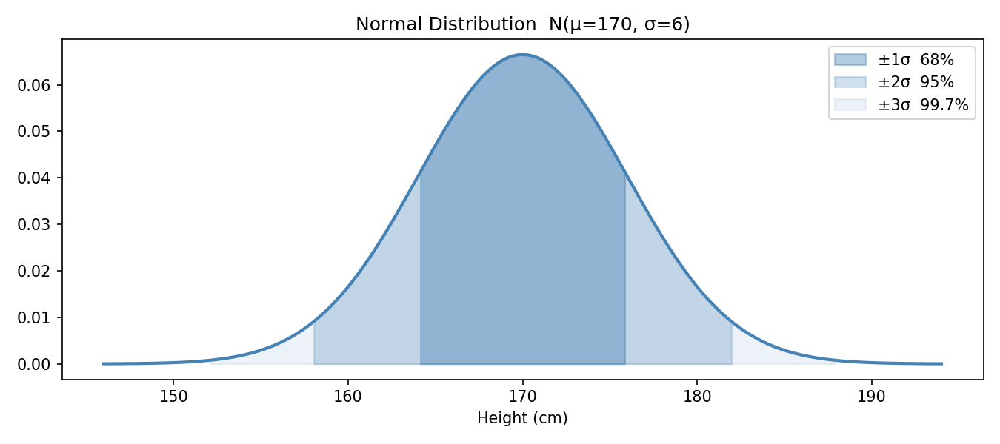
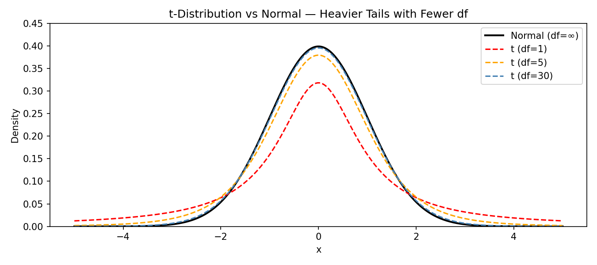
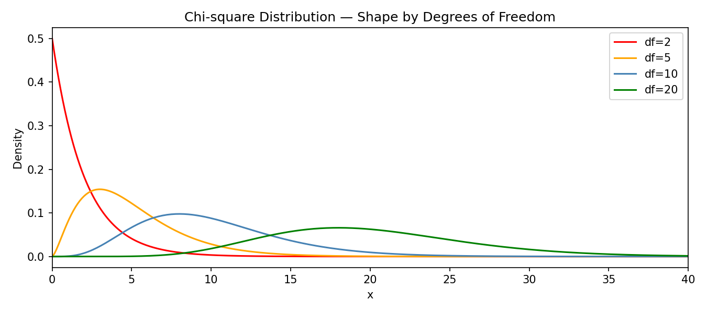
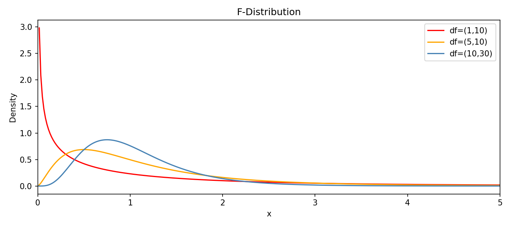
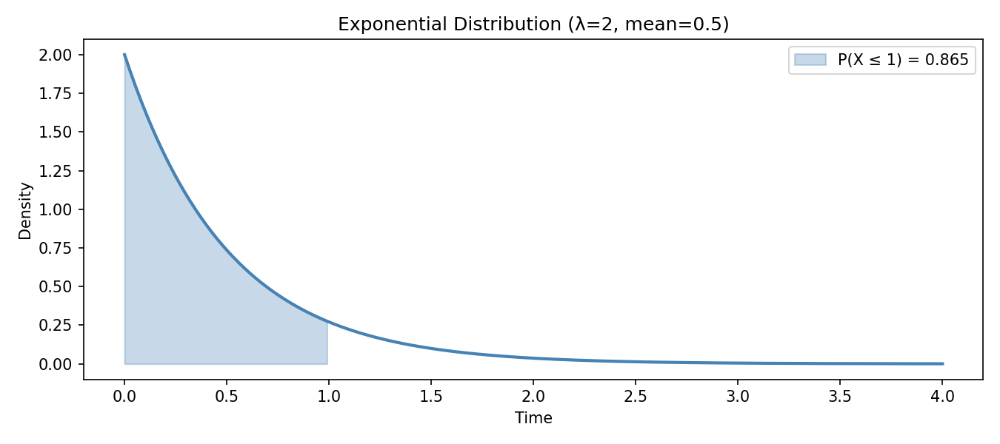
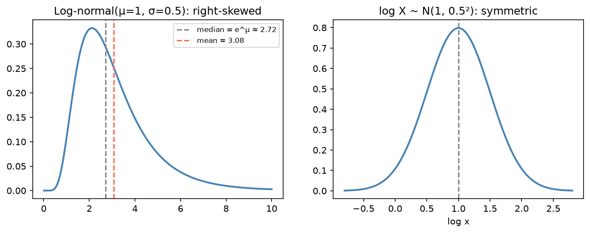
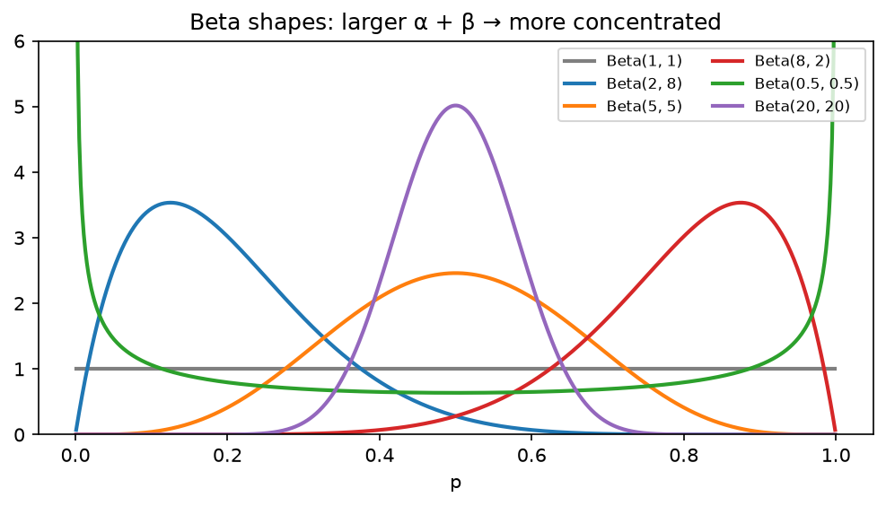
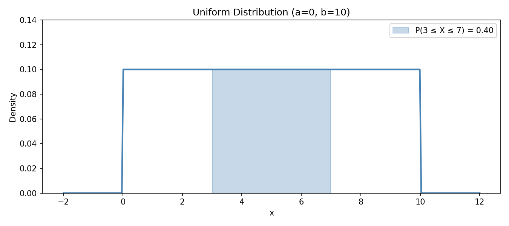

[Statistics](../README.md) › [機率與分配](README.md) › 連續分配

# 連續分配 (Continuous Distributions)

連續隨機變數的機率是 **PDF 曲線下的面積**。常態分配是核心，t、χ²、F 都由它衍生，也是 t 檢定、卡方檢定、ANOVA 的基礎。

## 選擇指南

| 分配 | 形狀 | 範圍 | 參數 | 主要用途 |
| --- | --- | --- | --- | --- |
| **Normal** 常態 | 對稱鐘形 | (−∞, ∞) | μ, σ | 量測誤差、多數檢定的基礎 |
| **t** | 對稱、厚尾 | (−∞, ∞) | df | σ 未知時的平均數推論 |
| **χ²** 卡方 | 右偏 | [0, ∞) | df | 變異數檢定、適合度、獨立性檢定 |
| **F** | 右偏 | [0, ∞) | df₁, df₂ | 變異數比較、ANOVA、迴歸 F 檢定 |
| **Exponential** 指數 | 右偏、遞減 | [0, ∞) | λ | 事件間等待時間、壽命 |
| **Log-normal** 對數常態 | 右偏 | (0, ∞) | μ, σ（log 尺度） | 濃度、表現量、收入 |
| **Beta** | 彈性 | [0, 1] | α, β | 比例 / 機率本身的分配、貝氏先驗 |
| **Uniform** 均勻 | 平坦 | [a, b] | a, b | 亂數產生、無資訊先驗 |

### 分配之間的關係

```
N(0,1) ──平方──▶ χ²(1) ──k 個相加──▶ χ²(k) ──兩個 χ² 相除──▶ F(df₁, df₂)
N(0,1) ÷ √(χ²(k)/k) ──▶ t(k)          t(k)² = F(1, k)
Poisson 的事件間隔 ──▶ Exponential     log(X) ~ Normal ⇔ X ~ Log-normal
```

## 常態分配 (Normal)

$$
X \sim N(\mu, \sigma^2), \qquad f(x) = \frac{1}{\sigma\sqrt{2\pi}} e^{-\frac{(x-\mu)^2}{2\sigma^2}}
$$

- 對稱：平均 = 中位數 = 眾數；完全由 μ、σ 決定
- 經驗法則：±1σ ≈ 68%、±2σ ≈ 95%、±3σ ≈ 99.7%
- **z-score** $Z = (X-\mu)/\sigma$ 把任何常態轉為標準常態 N(0, 1)，表示「離平均幾個標準差」

```python
from scipy.stats import norm

mu, sigma = 170, 6                      # 身高：平均 170 cm、SD 6 cm
norm.cdf(175, mu, sigma)                # P(X < 175)
norm.cdf(180, mu, sigma) - norm.cdf(160, mu, sigma)   # P(160 < X < 180)
norm.sf(180, mu, sigma)                 # P(X > 180)
norm.ppf(0.95, mu, sigma)               # 第 95 百分位數
```



## t 分配 (t-Distribution)

形狀像常態，但**尾巴較厚**，反映「用樣本 s 估計 σ」所多出的不確定性。

- 用途：σ 未知時對平均數做推論（[t 檢定](../inferential-statistics/statistical-tests.md)、[信賴區間](../inferential-statistics/confidence-intervals.md)）
- 自由度 (degrees of freedom) 單一樣本為 df = n − 1；df → ∞ 時趨近標準常態

```python
from scipy.stats import t

for df in [5, 10, 30, 100]:
    print(df, round(t.ppf(0.975, df), 3))   # 2.571, 2.228, 2.042, 1.984 → 趨近 1.96
```



## 卡方分配 (Chi-square, χ²)

$k$ 個獨立標準常態的平方和：$\chi^2_k = Z_1^2 + \cdots + Z_k^2$。平均 = df，變異數 = 2·df，永遠 ≥ 0。

| 應用 | 說明 |
| --- | --- |
| 變異數檢定 | 母體變異數是否等於某值？ |
| 適合度檢定 (goodness-of-fit) | 觀察次數是否符合期望分配？ |
| 獨立性檢定 | 兩個類別變數是否獨立？見 [卡方檢定](../nonparametric-methods/chi-square.md) |
| 概似比檢定 (likelihood ratio test) | 巢狀模型比較，見 [最大概似估計](maximum-likelihood.md) |

```python
from scipy.stats import chi2
chi2.ppf(0.95, df=10)   # 右尾 α = 0.05 臨界值
```



## F 分配 (F-Distribution)

兩個獨立 χ² 各除以自由度後的比值：$F = \dfrac{\chi^2_{df_1}/df_1}{\chi^2_{df_2}/df_2}$。

| 應用 | 說明 |
| --- | --- |
| 兩變異數比較 | σ₁² = σ₂²？ |
| [ANOVA](../inferential-statistics/anova-overview.md) | F = 組間變異 / 組內變異 |
| 迴歸整體 F 檢定 | 模型整體是否顯著？見 [多元線性迴歸](../regression-analysis/multiple-linear-regression.md) |

```python
from scipy.stats import f
f.ppf(0.95, dfn=5, dfd=20)
```



## 指數分配 (Exponential)

**Poisson 事件之間的等待時間**。Poisson 數「單位時間幾次」；Exponential 量「下一次要等多久」。

$$
f(x) = \lambda e^{-\lambda x},\ x \ge 0, \qquad E(X) = 1/\lambda, \quad \text{Var}(X) = 1/\lambda^2
$$

- **無記憶性**：$P(X > s+t \mid X > s) = P(X > t)$。用了 1,000 小時的燈泡，再撐 500 小時的機率和新燈泡一樣。
- 等同於「風險率 (hazard) 固定」，是 [存活分析參數模型](../survival-analysis/parametric-models.md) 最簡單的情況。

```python
from scipy.stats import expon

lam = 2
expon.cdf(0.5, scale=1/lam)    # scipy 用 scale = 1/λ，注意！
```



## 對數常態分配 (Log-normal)

若 $\log X \sim N(\mu, \sigma^2)$，則 X 服從 log-normal。由**許多正值因子相乘**產生的量（細胞大小、濃度、表現量、收入）常呈此分配。

- 實務上：右偏的正值資料先取 log，常會變得近似常態 → 再用常態方法分析，見 [資料轉換](../descriptive-statistics/univariate-numerical.md#資料轉換-transformation)
- log 尺度上的平均取 exp = 原尺度的**幾何平均數**

```python
from scipy.stats import lognorm
import numpy as np

mu, sigma = 1.0, 0.5
dist = lognorm(s=sigma, scale=np.exp(mu))   # scipy 參數化：s = σ、scale = e^μ
dist.mean(), dist.median()                  # 平均 > 中位數（右偏）
```



## Beta 分配

定義在 [0, 1]，適合描述「比例或機率本身」的不確定性。

- Beta(1, 1) = Uniform(0, 1)
- 平均 = α / (α + β)；α、β 越大越集中
- 是 Binomial 的**共軛先驗 (conjugate prior)**：先驗 Beta(α, β) + 觀察 k 成功 / n 次 → 後驗 Beta(α+k, β+n−k)，見 [概似與共軛](../bayesian-statistics/likelihood-conjugate.md)

```python
from scipy.stats import beta
beta(2, 8).mean()           # 0.2
beta(2, 8).interval(0.95)   # 95% 區間
```



## 均勻分配 (Uniform)

[a, b] 內每個值等可能：$f(x) = 1/(b-a)$，$E(X) = (a+b)/2$，$\text{Var}(X) = (b-a)^2/12$。

用途：亂數產生、[蒙地卡羅模擬](monte-carlo-simulation.md)、無資訊先驗。另外，**虛無假設為真時，p 值服從 Uniform(0, 1)**，這是 [多重檢定](../inferential-statistics/multiple-testing.md) 中檢查 p 值直方圖的依據。

```python
from scipy.stats import uniform
uniform.cdf(7, loc=0, scale=10) - uniform.cdf(3, loc=0, scale=10)   # P(3 ≤ X ≤ 7) = 0.4
```


