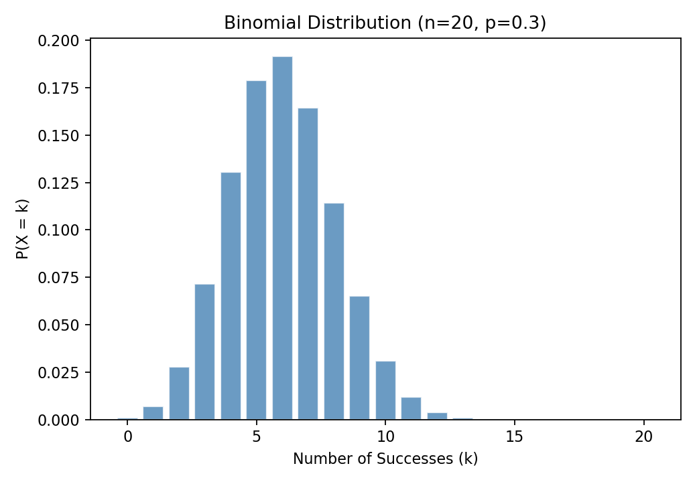
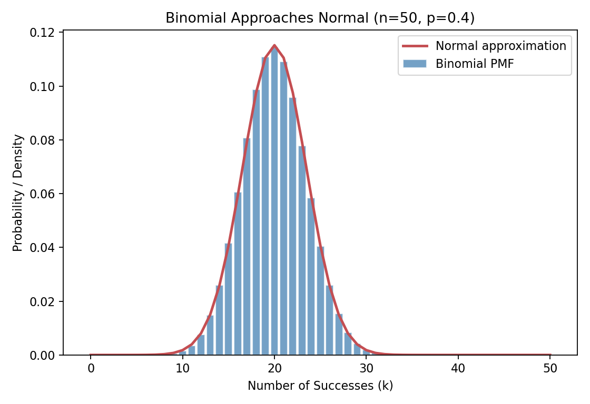
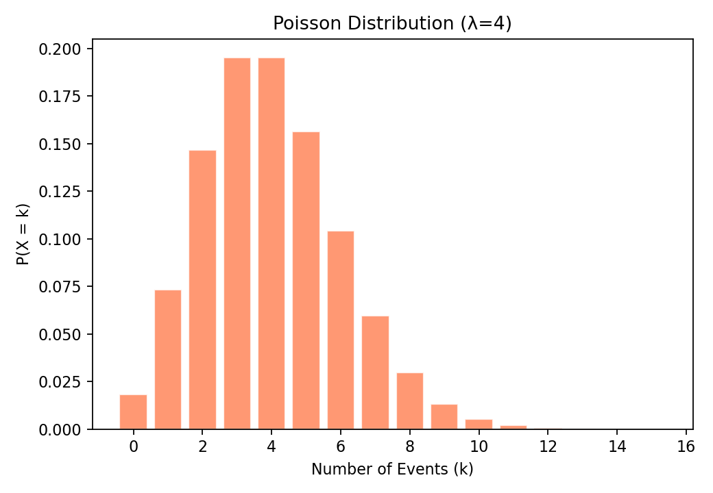
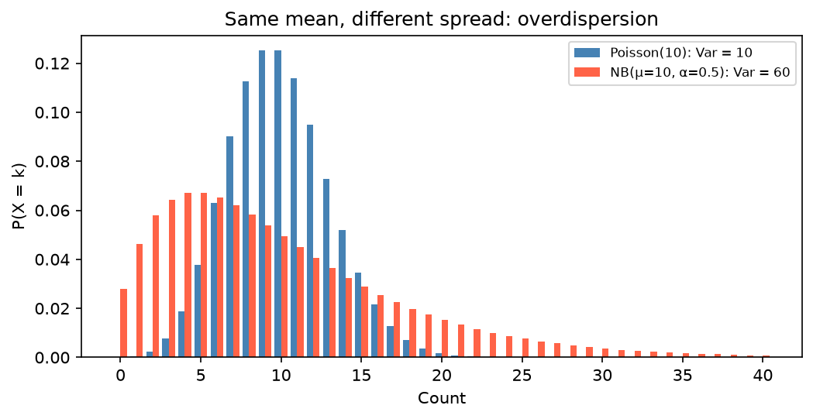
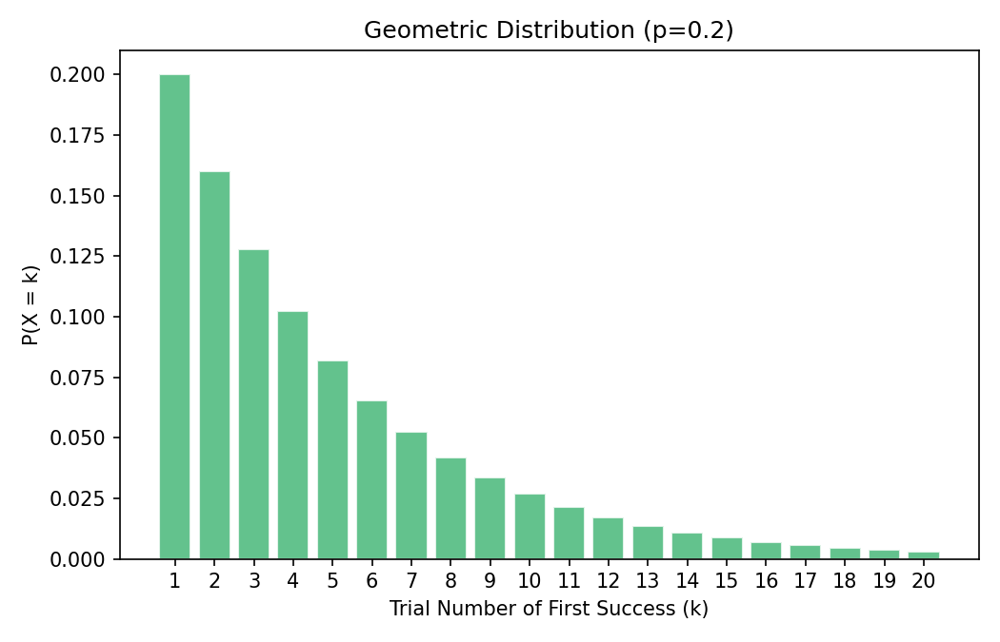

[Statistics](../README.md) › [機率與分配](README.md) › 離散分配

# 離散分配 (Discrete Distributions)

描述只能取可數值（通常是非負整數）的隨機變數。選哪一個取決於資料的產生過程。

## 選擇指南

| 分配 | 問題 | 參數 | 平均 | 變異數 | 典型情境 |
| --- | --- | --- | --- | --- | --- |
| **Bernoulli** | 單次試驗成功與否 | p | p | p(1−p) | 一位病人是否有反應 |
| **Binomial** 二項 | n 次試驗中幾次成功？ | n, p | np | np(1−p) | 100 人中幾人點擊廣告 |
| **Poisson** 卜瓦松 | 固定區間內發生幾次？ | λ | λ | **λ**（= 平均） | 每小時到站人數、每 kb 突變數 |
| **Negative Binomial** 負二項 | 計數資料，但變異 > 平均 | μ, α（或 r, p） | μ | μ + αμ² | **RNA-seq read count** |
| **Geometric** 幾何 | 第幾次才第一次成功？ | p | 1/p | (1−p)/p² | 等第一筆成交 |
| **Hypergeometric** 超幾何 | **不放回**抽樣中幾個成功？ | N, K, n | nK/N | 見下 | 品管抽檢、**基因集富集分析** |

## 二項分配 (Binomial)

**條件**：試驗次數 n 固定、每次只有兩種結果、成功機率 p 不變、各次獨立。Binomial 就是 n 個 Bernoulli 的和。

$$
P(X = k) = \binom{n}{k} p^k (1-p)^{n-k}
$$

推導見 [Binomial 平均與變異數推導](src/discrete-distributions-binomial-derivation.md)。

```python
from scipy.stats import binom

n, p = 20, 0.3
binom.mean(n, p), binom.var(n, p)   # 6.0, 4.2
binom.pmf(6, n, p)                  # P(X = 6)
binom.cdf(6, n, p)                  # P(X ≤ 6)
binom.sf(8, n, p)                   # P(X > 8)
```

| Binomial(20, 0.3) | 常態近似 (n=50, p=0.4) |
| --- | --- |
|  |  |

**近似規則**

| 條件 | 近似為 |
| --- | --- |
| n 大、p 不極端（np ≥ 5 且 n(1−p) ≥ 5） | 常態 $N(np,\ np(1-p))$，即 [CLT](sampling-distributions.md) 的預告 |
| n 很大、p 很小（罕見事件） | Poisson(λ = np) |

## 卜瓦松分配 (Poisson)

**條件**：事件在固定時間 / 空間區間內隨機發生、彼此獨立、平均發生率 λ 固定。

$$
P(X = k) = \frac{e^{-\lambda}\lambda^k}{k!}, \quad k = 0, 1, 2, \ldots
$$

推導見 [Poisson 平均與變異數推導](src/discrete-distributions-poisson-derivation.md)。

```python
from scipy.stats import poisson
import numpy as np

lam = 4
poisson.pmf(4, lam), poisson.cdf(6, lam), poisson.sf(6, lam)

# 診斷：實際資料的變異數 ≈ 平均嗎？
counts = np.array([2, 4, 3, 5, 7, 4, 2, 6, 5, 3, 4, 4])
counts.mean(), counts.var(ddof=1)   # 變異數 >> 平均 → 過度離散
```



> **過度離散 (overdispersion)**：變異數遠大於平均。真實計數資料（尤其生物重複間的基因表現量）幾乎都如此，原因是隱藏的異質性 (heterogeneity) 或事件間相依。此時改用 Negative Binomial。

## 負二項分配 (Negative Binomial)

兩種常見的理解方式：

| 觀點 | 說明 |
| --- | --- |
| 等待時間 | 第 r 次成功前失敗了幾次（Geometric 是 r = 1 的特例） |
| **Poisson–Gamma 混合** | 每個樣本的 λ 本身也是隨機的（來自 Gamma 分配）→ 計數比 Poisson 更分散 |

第二種觀點是生物資料使用它的原因：$\text{Var} = \mu + \alpha\mu^2$，α 為離散參數 (dispersion)，α → 0 時退化為 Poisson。DESeq2、edgeR 等 RNA-seq 差異表現 (differential expression) 工具都以 NB 為核心。迴歸用法見 [GLM 與計數模型](../regression-analysis/glm-count-models.md)。

```python
from scipy.stats import nbinom

# scipy 使用 (n, p) 參數化；由平均 μ 與離散 α 轉換
mu, alpha = 10, 0.5
n = 1 / alpha
p = n / (n + mu)
nbinom.mean(n, p), nbinom.var(n, p)   # 10, 10 + 0.5*100 = 60
```



## 幾何分配 (Geometric)

第一次成功出現在第 k 次試驗的機率：

$$
P(X = k) = (1-p)^{k-1} p, \quad k = 1, 2, \ldots
$$

推導見 [Geometric 平均與變異數推導](src/discrete-distributions-geometric-derivation.md)。

```python
from scipy.stats import geom

geom.mean(0.2)        # 平均需要 5 次
geom.cdf(5, 0.2)      # 5 次內成功的機率
```



**無記憶性 (memoryless)**：$P(X > m + n \mid X > m) = P(X > n)$。過去失敗多少次，不影響未來成功的機率。連續版本是 [Exponential](continuous-distributions.md#指數分配-exponential)。

## 超幾何分配 (Hypergeometric)

從大小 N（含 K 個成功）的有限母體中**不放回**抽 n 個，抽到 k 個成功的機率：

$$
P(X = k) = \frac{\binom{K}{k}\binom{N-K}{n-k}}{\binom{N}{n}}, \qquad
\text{Var}(X) = n\frac{K}{N}\frac{N-K}{N}\underbrace{\frac{N-n}{N-1}}_{\text{有限母體校正}}
$$

| | Binomial | Hypergeometric |
| --- | --- | --- |
| 抽樣 | 放回（或母體無限大） | 不放回、有限母體 |
| 各次獨立 | 是 | 否 |
| 成功機率 | 固定 | 每抽一次就改變 |

```python
from scipy.stats import hypergeom

# 100 件中有 15 件不良，抽 10 件
N, K, n = 100, 15, 10
hypergeom.mean(N, K, n)        # 1.5
hypergeom.sf(2, N, K, n)       # P(X ≥ 3)
```

> **生資應用：基因集富集分析 (over-representation analysis)**
> 基因體共 N = 20,000 個基因，某 pathway 有 K = 200 個；你的差異表現基因清單有 n = 500 個，其中 k = 15 個落在此 pathway。超幾何右尾機率 `hypergeom.sf(k-1, N, K, n)` 就是 GO / KEGG enrichment 的 p 值（等同單尾 [Fisher's exact test](../nonparametric-methods/chi-square.md)）。對上千個 pathway 檢定後要做 [多重檢定校正](../inferential-statistics/multiple-testing.md)。
