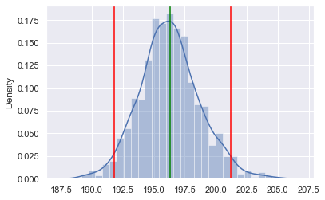

[Statistics](../README.md) › [機率與分配](README.md) › 蒙地卡羅與重抽樣

# 蒙地卡羅與重抽樣 (Monte Carlo & Resampling)

用**重複隨機抽樣**近似難以精確求解的量。公式太複雜、假設不確定、或想看整個分配而非單一數字時特別好用。

## 三種方法比較

| 方法 | 抽什麼？ | 目的 | 典型問題 |
| --- | --- | --- | --- |
| **蒙地卡羅模擬** (Monte Carlo) | 從**假設的機率模型**產生資料 | 估計機率、風險 | 「4 次擲骰至少一個 6 的機率？」 |
| **拔靴法** (Bootstrap) | 從**觀察到的樣本**放回抽樣 | 估計統計量的不確定性（SE、CI） | 「中位數的 95% CI？」 |
| **置換檢定** (Permutation test) | **打亂組別標籤** | 建立虛無分配，算 p 值 | 「兩組差異是否只是隨機？」 |

共同流程：定義隨機過程 → 模擬很多次 → 每次算統計量 → 摘要模擬出的分配。

## 蒙地卡羅模擬

```python
import numpy as np

rng = np.random.default_rng(42)          # 固定 seed 確保可重現
rolls = rng.integers(1, 7, size=(100_000, 4))
(rolls == 6).any(axis=1).mean()          # ≈ 0.518；精確解 1 − (5/6)^4 = 0.5177

# 尾部風險：20 天累積報酬 < −10% 的機率
daily = rng.normal(0.0004, 0.012, size=(200_000, 20))
((1 + daily).prod(axis=1) - 1 < -0.10).mean()
```

> 模擬誤差約以 $1/\sqrt{n_{sim}}$ 縮小：雜訊減半需要 4 倍模擬次數。罕見事件（尾部機率）需要非常多次才穩定。

## 拔靴法 (Bootstrap)

把樣本當成母體的縮影，**放回抽樣**出同樣大小的新樣本，重複算統計量。

```python
import seaborn as sns

sample = sns.load_dataset("tips")["total_bill"].to_numpy()
boot = np.array([rng.choice(sample, len(sample), replace=True).mean() for _ in range(5000)])

np.percentile(boot, [2.5, 97.5])   # percentile bootstrap 95% CI
boot.std(ddof=1)                   # bootstrap SE

# scipy 內建（預設 BCa，比 percentile 更準）
from scipy.stats import bootstrap
bootstrap((sample,), np.median, n_resamples=5000, random_state=42).confidence_interval
```



藍色為 bootstrap 分配、綠線為觀察平均、紅線為 95% CI 上下界。單一樣本平均數變成了「可能平均數的分配」。

> **適用**：中位數、比值、相關係數、AUC 等沒有簡單 SE 公式的統計量。**不適用**：樣本極小、資料相依（需改用 block bootstrap）、估計極端值（最大值）。ML 中的 [Bagging](../../machine-learning/supervised-learning/ensemble/bagging.md) 與 [Random Forest](../../machine-learning/supervised-learning/ensemble/random-forest.md) 也是基於 bootstrap 抽樣。

## 置換檢定 (Permutation Test)

若虛無假設「兩組沒有差異」為真，組別標籤就是可交換的。反覆打亂標籤、重算統計量，得到虛無分配 (null distribution)。

```python
a = rng.normal(10, 2, 15)          # 處理組
b = rng.normal(11.5, 2, 15)        # 對照組
obs = b.mean() - a.mean()

pooled = np.concatenate([a, b])
null = []
for _ in range(10_000):
    rng.shuffle(pooled)
    null.append(pooled[15:].mean() - pooled[:15].mean())
p_value = (np.abs(null) >= abs(obs)).mean()    # 雙尾

# scipy 內建
from scipy.stats import permutation_test
permutation_test((a, b), lambda x, y: y.mean() - x.mean(), n_resamples=10_000).pvalue
```

> 不需要常態假設，只要求「H₀ 下可交換 (exchangeability)」。小樣本或分配怪異時是 t 檢定的好替代，見 [無母數方法](../nonparametric-methods/when-and-why.md)。ML 中的 permutation feature importance 也是相同概念。

## 限制

| 限制 | 說明 |
| --- | --- |
| 垃圾進、垃圾出 | 機率模型錯了，模擬結果就會誤導 |
| 罕見事件需大量次數 | 尾部機率雜訊大 |
| 結果是近似值 | 報告時不要假裝高精度 |
| 忽略相依性 | 錯誤假設獨立會嚴重低估風險 |
| 沒設 seed | 結果無法重現 |
