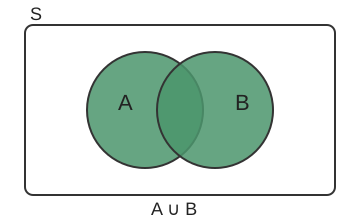
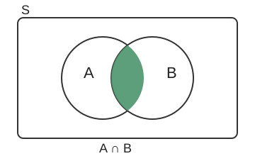
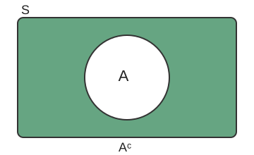
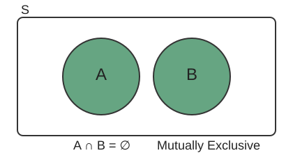

[Statistics](../README.md) › [機率與分配](README.md) › 機率基礎

# 機率基礎 (Probability Basics)

機率是 0 到 1 之間的數字，表示事件發生的可能性。

## 三種詮釋

| 詮釋 | 定義 | 例子 |
| --- | --- | --- |
| 古典 (classical) | 有利結果數 ÷ 總結果數（各結果等可能） | 骰到 3 的機率 = 1/6 |
| 頻率學派 (frequentist) | 重複無限多次後的長期相對次數 | 擲 10,000 次硬幣，正面約 50% |
| 主觀 / 貝氏 (subjective / Bayesian) | 根據現有證據的信念程度 | 「明天 70% 會下雨」 |

多數傳統統計使用頻率學派詮釋；兩者比較見 [貝氏 vs 頻率學派](../bayesian-statistics/bayesian-vs-frequentist.md)。

## 基本名詞與規則

| 名詞 | 定義 | 例子（擲骰） |
| --- | --- | --- |
| 樣本空間 (sample space, S) | 所有可能結果 | {1, 2, 3, 4, 5, 6} |
| 事件 (event, E) | 樣本空間的子集合 | 偶數 {2, 4, 6} |
| 餘事件 (complement, Eᶜ) | 不在 E 中的結果 | {1, 3, 5} |
| 聯集 (union, A ∪ B) | A **或** B 至少一個發生 | 偶數或 > 4 |
| 交集 (intersection, A ∩ B) | A **且** B 都發生 | 偶數且 > 4 |

| 聯集 | 交集 | 餘事件 | 互斥 |
| --- | --- | --- | --- |
|  |  |  |  |

| 規則 | 公式 | 特例 |
| --- | --- | --- |
| 範圍 | $0 \le P(E) \le 1$，$P(S)=1$ | — |
| 餘事件法則 (complement rule) | $P(E^c) = 1 - P(E)$ | 「至少一次」通常用 1 − P(一次都沒有) 算 |
| 加法法則 (addition rule) | $P(A \cup B) = P(A) + P(B) - P(A \cap B)$ | 互斥時 $P(A \cap B)=0$ |
| 乘法法則 (multiplication rule) | $P(A \cap B) = P(A)\,P(B \mid A)$ | 獨立時 $P(A \cap B)=P(A)P(B)$ |

## 條件機率 (Conditional Probability)

$$
P(A \mid B) = \frac{P(A \cap B)}{P(B)}
$$

直覺：已知 B 發生，就把樣本空間「縮小」到 B，再看 A 在其中佔多少。

### 獨立 vs 互斥

| 概念 | 定義 | 意義 |
| --- | --- | --- |
| 獨立 (independent) | $P(A \mid B) = P(A)$ | B 不提供 A 的任何資訊，**可以同時發生** |
| 互斥 (mutually exclusive) | $P(A \cap B) = 0$ | **不能同時發生** |

兩個機率都 > 0 的互斥事件**一定不獨立**：知道 B 發生，就知道 A 沒發生。

## 全機率定律 (Law of Total Probability)

若 B₁…Bₙ 互斥且涵蓋整個樣本空間：

$$
P(A) = \sum_i P(A \mid B_i)\,P(B_i)
$$

例：機台 1 產出 60%、不良率 2%；機台 2 產出 40%、不良率 5% → $P(\text{不良}) = 0.6(0.02) + 0.4(0.05) = 0.032$。

## 貝氏定理 (Bayes' Theorem)

$$
P(A \mid B) = \frac{P(B \mid A)\,P(A)}{P(B)}
$$

| 項 | 名稱 | 意義 |
| --- | --- | --- |
| $P(A)$ | 先驗 (prior) | 看到證據前的信念 |
| $P(B \mid A)$ | 概似 (likelihood) | 若 A 為真，看到 B 的機率 |
| $P(B)$ | 證據 (evidence) | 看到 B 的總機率（用全機率定律算） |
| $P(A \mid B)$ | 後驗 (posterior) | 看到 B 之後更新的信念 |

**經典例子：篩檢陽性**

盛行率 1%、敏感度 (sensitivity) 95%、偽陽性率 (false positive rate) 5%。驗出陽性，真的有病的機率？

```python
prior = 0.01          # 盛行率 P(D)
sens  = 0.95          # P(+ | D)
fpr   = 0.05          # P(+ | 非 D)

p_pos = sens * prior + fpr * (1 - prior)   # 全機率定律
ppv   = sens * prior / p_pos               # 貝氏定理
print(f"P(D | +) = {ppv:.3f}")             # ≈ 0.161
```

> **基礎率 (base rate) 很重要**：檢驗再準，疾病罕見時，陽性者大多仍是偽陽性。
>
> - 這裡的 $P(D \mid +)$ 就是 ML 分類中的 **precision / PPV**，敏感度就是 **recall**，見 [Confusion Metrics](../../machine-learning/evaluation/confusion-metrics.md)。
> - 同樣的邏輯解釋了為什麼在不平衡資料上 precision 會很低，見 [Class Imbalance](../../machine-learning/evaluation/class-imbalance.md)。
> - 完整的貝氏推論見 [貝氏定理（貝氏統計）](../bayesian-statistics/bayes-theorem.md)。

## 用模擬驗證公式

公式複雜時，可以用重複隨機抽樣近似機率，再跟公式比對。

```python
import numpy as np

rng = np.random.default_rng(42)
flips = rng.integers(0, 2, size=(200_000, 3))     # 擲 3 次硬幣，重複 20 萬回
(flips.sum(axis=1) >= 1).mean()                   # ≈ 0.875 = 1 − (1/2)^3
```

這就是 [蒙地卡羅模擬](monte-carlo-simulation.md) 的基本概念。
