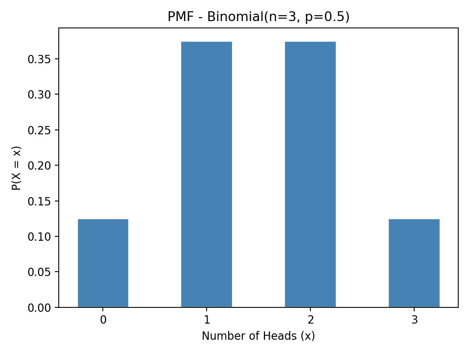
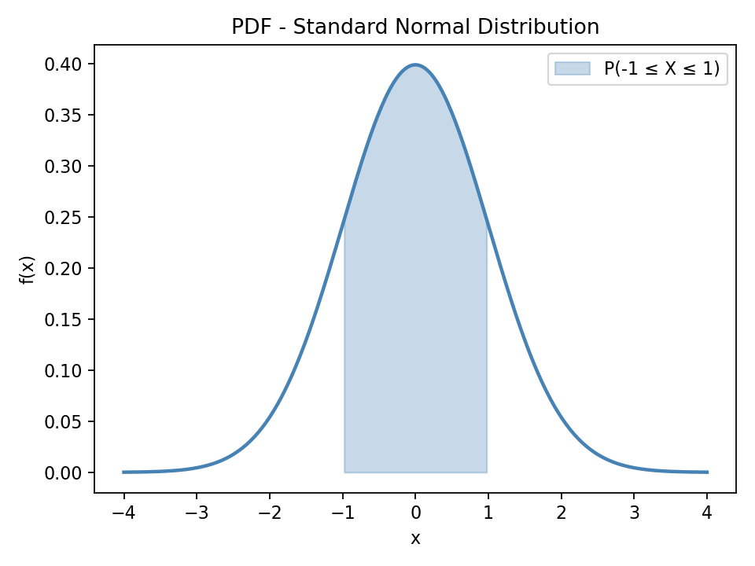

[Statistics](../README.md) › [機率與分配](README.md) › 隨機變數

# 隨機變數 (Random Variables)

隨機變數把隨機過程的「結果」對應成「數字」，讓我們能計算期望值、變異數並套用分配模型。它是機率與統計之間的橋樑。

| 類型 | 定義 | 例子 | 描述方式 |
| --- | --- | --- | --- |
| 離散 (discrete) | 可數的值（可列出，即使無限） | 10 次擲硬幣的正面數、read count | PMF |
| 連續 (continuous) | 區間內任意值 | 身高、表現量 | PDF |

## PMF、PDF、CDF

| 函數 | 適用 | 給你什麼 | 高度 = 機率？ | 用途 |
| --- | --- | --- | --- | --- |
| **PMF** 機率質量函數 (probability mass function) | 離散 | $P(X = x)$ | **是** | 特定值的機率 |
| **PDF** 機率密度函數 (probability density function) | 連續 | 密度 $f(x)$ | **否**；機率 = 曲線下面積 $\int_a^b f(x)dx$ | 看形狀、算區間機率 |
| **CDF** 累積分配函數 (cumulative distribution function) | 兩者 | $F(x) = P(X \le x)$ | 是（累積機率） | 區間機率 $F(b)-F(a)$、百分位數 |
| **Inverse CDF / PPF** 分位數函數 (quantile function) | 兩者 | 給機率 p，回傳 x 使 $P(X \le x) = p$ | — | 臨界值 (critical value)、百分位 |

- 連續變數在任一**單點**的機率都是 0，所以 PDF 高度可以 > 1。
- PMF 所有值加總 = 1；PDF 曲線下總面積 = 1。

```python
import numpy as np
from scipy.stats import binom, norm

# PMF：3 次擲硬幣的正面數 ~ Binomial(3, 0.5)
binom.pmf(np.arange(4), n=3, p=0.5)   # [0.125, 0.375, 0.375, 0.125]

# CDF
binom.cdf(2, n=3, p=0.5)              # P(X ≤ 2) = 0.875
norm.cdf(1.5)                         # P(Z ≤ 1.5) = 0.9332
norm.cdf(1) - norm.cdf(-1)            # P(-1 ≤ Z ≤ 1) ≈ 0.6827

# PPF（inverse CDF）：95% CI 的臨界值
norm.ppf(0.975)                       # 1.96
```

| PMF：Binomial(3, 0.5) | PDF：標準常態 |
| --- | --- |
|  |  |

> scipy 的分配物件都有相同介面：`.pmf` / `.pdf`、`.cdf`、`.ppf`、`.sf`（= 1 − cdf，右尾機率）、`.rvs`（抽樣）、`.mean`、`.var`。

## 期望值與變異數

| | 離散 | 連續 |
| --- | --- | --- |
| 期望值 (expected value) $E(X)$ | $\sum x\,P(X=x)$ | $\int x\,f(x)\,dx$ |
| 變異數 (variance) | $\text{Var}(X) = E[(X-\mu)^2] = E(X^2) - [E(X)]^2$ | 同左 |

期望值 = 長期平均，是分配的「重心」。

| 性質 | 公式 | 條件 |
| --- | --- | --- |
| 線性 (linearity) | $E(aX+b) = aE(X)+b$ | 永遠成立 |
| 和的期望值 | $E(X+Y) = E(X)+E(Y)$ | **永遠成立**（即使相依） |
| 積的期望值 | $E(XY) = E(X)E(Y)$ | 需獨立 |
| 縮放 | $\text{Var}(aX+b) = a^2\,\text{Var}(X)$ | 平移不影響變異 |
| 和的變異數 | $\text{Var}(X+Y) = \text{Var}(X)+\text{Var}(Y)+2\,\text{Cov}(X,Y)$ | 獨立時 Cov = 0 |

```python
x = np.array([0, 1, 2, 3])
p = np.array([0.125, 0.375, 0.375, 0.125])

E  = (x * p).sum()                 # 1.5
Var = (x**2 * p).sum() - E**2      # 0.75
```

> $\text{Var}(\bar{X}) = \sigma^2/n$ 就是由「獨立變數的和的變異數」推得，見 [抽樣分配](sampling-distributions.md)。
