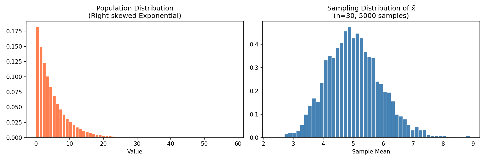
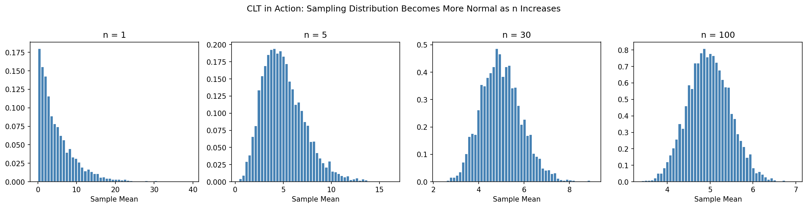

[Statistics](../README.md) › [機率與分配](README.md) › 抽樣分配與 CLT

# 抽樣分配與中央極限定理 (Sampling Distributions & CLT)

這篇是敘述統計與推論統計之間的橋樑：解釋為什麼能用樣本推論母體，以及為什麼即使原始資料不是常態，常態分配仍到處出現。

## 母體 vs 樣本

| 名詞 | 符號 | 意義 |
| --- | --- | --- |
| 母體參數 (population parameter) | μ, σ, p | 母體真值，通常未知 |
| 樣本統計量 (sample statistic) | x̄, s, p̂ | 從樣本算出，會隨抽樣而變 |
| 抽樣誤差 (sampling error) | x̄ − μ | 不是錯誤，而是「只看到一部分」的自然變異 |

## 平均數的抽樣分配

從同一母體**重複**抽很多組大小為 n 的樣本，每組算一個 x̄；這些 x̄ 形成的分配就是**抽樣分配 (sampling distribution)**。

```python
import numpy as np

rng = np.random.default_rng(42)
population = rng.exponential(scale=5, size=100_000)   # 明顯右偏的母體

for n in [1, 5, 30, 100]:
    means = [rng.choice(population, n).mean() for _ in range(5000)]
    print(n, round(np.std(means), 3))   # SD 隨 n 變小 ≈ σ/√n
```

| 右偏母體 vs x̄ 的抽樣分配 (n=30) | 不同 n 下的抽樣分配 |
| --- | --- |
|  |  |

## 中央極限定理 (Central Limit Theorem, CLT)

**不論母體分配形狀**，只要觀測值獨立同分配 (i.i.d.) 且變異數有限，樣本平均數的抽樣分配會隨 n 增加趨近常態：

$$
\bar{X} \ \dot\sim\ N\left(\mu,\ \frac{\sigma^2}{n}\right)
$$

| 性質 | 公式 | 意義 |
| --- | --- | --- |
| 中心 | $E(\bar{X}) = \mu$ | x̄ 是 μ 的**不偏估計量 (unbiased estimator)**，推導見 [E(x̄) 推導](src/sampling-distributions-mean-of-xbar-derivation.md) |
| 分散 | $SE = \sigma / \sqrt{n}$ | n 越大越精確；**SE 減半需要 4 倍樣本** |
| 形狀 | 近似常態 | n 夠大即成立 |

**n 要多大？**（經驗法則，不是定律）

| 母體形狀 | 大約需要的 n |
| --- | --- |
| 近似常態 | ≥ 10 |
| 輕度偏態 | ≥ 30 |
| 嚴重偏態 / 厚尾 | ≥ 100 以上 |

> **大數法則 (Law of Large Numbers, LLN) vs CLT**：LLN 說 x̄ 會**收斂到** μ；CLT 進一步說 x̄ 在 μ 附近的**波動形狀**是常態。

> **CLT 不適用的情況**：觀測值不獨立（重複量測、時間序列、同一病人多個細胞）、極端厚尾（變異數無限）。相依資料要用 [混合效應模型](../regression-analysis/mixed-effects-models.md) 或 [時間序列](../time-series-analysis/README.md) 方法。

## σ 未知時：t 分配

實務上 σ 幾乎都未知，改用樣本 s 估計，統計量變成 t 分配：

$$
T = \frac{\bar{X}-\mu}{s/\sqrt{n}} \sim t_{n-1}
$$

這就是 [單一樣本 t 檢定](../inferential-statistics/statistical-tests.md) 的檢定統計量。

| 條件 | 使用 |
| --- | --- |
| σ 已知 | Z（標準常態） |
| σ 未知，n 大 | Z 或 t 皆可（結果幾乎相同） |
| σ 未知，n 小 | t，df = n − 1 |

## 比例的抽樣分配

CLT 同樣適用於樣本比例 p̂（本質上是 0/1 資料的平均）：

$$
\hat{p} \ \dot\sim\ N\left(p,\ \frac{p(1-p)}{n}\right), \qquad \text{條件：} np \ge 5,\ n(1-p) \ge 5
$$

```python
from scipy.stats import norm
import numpy as np

p, n = 0.4, 100
se = np.sqrt(p * (1 - p) / n)
norm.cdf((0.35 - p) / se)        # P(p̂ < 0.35)
```

## 為什麼重要：通往推論

| 方法 | 統計量 | CLT 的角色 |
| --- | --- | --- |
| 單一樣本 t 檢定 | $(\bar{x}-\mu_0)/(s/\sqrt{n})$ | x̄ 近似常態 |
| 兩樣本 t 檢定 | $(\bar{x}_1-\bar{x}_2)/SE$ | 平均數差近似常態 |
| 比例 z 檢定 | $(\hat{p}-p_0)/SE$ | p̂ 近似常態 |
| [信賴區間](../inferential-statistics/confidence-intervals.md) | $\bar{x} \pm t^* \cdot SE$ | x̄ 圍繞 μ 呈常態 |
| 迴歸係數的檢定 | $\hat\beta / SE(\hat\beta)$ | 係數估計量近似常態 |

即使原始資料不是常態，夠大樣本的平均數仍近似常態，這是幾乎所有母數方法 (parametric methods) 的根據。SE 的實務意義見 [SD vs SE](../descriptive-statistics/univariate-numerical.md#標準差-vs-標準誤-sd-vs-se)；不想依賴 CLT 時可用 [Bootstrap](monte-carlo-simulation.md)。
