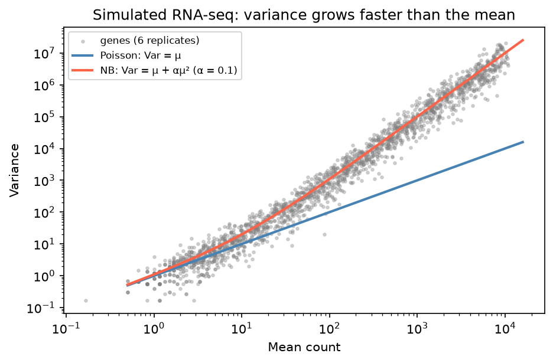

[Statistics](../README.md) › [迴歸分析](README.md) › GLM 與計數模型

# 廣義線性模型與計數模型 (GLM & Count Models)

線性迴歸假設 Y 連續且誤差常態。結果是**二元、計數、比例、正值偏態**時，用廣義線性模型 (generalized linear model, GLM) 把同一套迴歸框架延伸過去。

## GLM 的三個元件

$$
g\big(E[Y]\big) = \beta_0 + \beta_1 X_1 + \cdots + \beta_k X_k
$$

| 元件 | 意義 |
| --- | --- |
| 隨機成分 (random component) | Y 的分配（屬於指數族 exponential family） |
| 系統成分 (systematic component) | 線性預測子 Xβ |
| 連結函數 (link function) g | 把 E[Y] 的範圍對應到 (−∞, ∞) |

| 結果變數 | 分配 | 常用 link | 模型 | 係數解讀 |
| --- | --- | --- | --- | --- |
| 連續 | Gaussian | identity | 線性迴歸 | Y 的差 |
| 二元 / 比例 | Binomial | logit | [邏輯斯迴歸](logistic-regression.md) | $e^\beta$ = odds ratio |
| 計數 | Poisson | log | Poisson 迴歸 | $e^\beta$ = rate ratio |
| 計數（過度離散） | Negative Binomial | log | 負二項迴歸 | $e^\beta$ = rate ratio |
| 正值、右偏 | Gamma | log / inverse | Gamma 迴歸 | $e^\beta$ = 平均值的倍數 |

所有 GLM 都以 [最大概似估計](../probability-and-distributions/maximum-likelihood.md) 配適，用 deviance、AIC、概似比檢定比較模型。

> **GLM vs 「先 log 再 OLS」**：`log(y) ~ x` 建模的是 E[log Y]（幾何平均）；`GLM(log link)` 建模的是 log E[Y]（算術平均），而且能處理 y = 0。計數資料優先用 GLM。

## Poisson 迴歸

$$
\log E[Y] = \beta_0 + \beta_1 X \quad\Rightarrow\quad E[Y] = e^{\beta_0} \cdot e^{\beta_1 X}
$$

X 增加 1 單位，預期計數**乘上** $e^{\beta_1}$（rate ratio, RR）。

```python
import numpy as np
import statsmodels.api as sm
import statsmodels.formula.api as smf

pois = smf.glm("count ~ treatment + age", data=df, family=sm.families.Poisson()).fit()
pois.summary()
np.exp(pois.params)                         # rate ratio
np.exp(pois.conf_int())
```

### 暴露量與 offset

計數依觀察的「量」而不同（觀察時間、人口數、**定序深度 library size**）時，把 log(暴露量) 當作 offset（係數固定為 1）：

$$
\log E[Y] = \log(\text{exposure}) + \beta_0 + \beta_1 X \quad\Leftrightarrow\quad \log\frac{E[Y]}{\text{exposure}} = \beta_0 + \beta_1 X
$$

```python
smf.glm("count ~ treatment", data=df, family=sm.families.Poisson(),
        offset=np.log(df["exposure"])).fit()
```

## 過度離散與負二項迴歸

Poisson 假設 **Var(Y) = E(Y)**。真實計數資料（尤其生物重複）幾乎都是 Var > Mean，即 [過度離散 (overdispersion)](../probability-and-distributions/discrete-distributions.md#負二項分配-negative-binomial)。忽略它會讓 SE 太小、p 值太小、偽陽性大增。



低表現量時 Poisson 尚可；表現量越高，αμ² 項越主導，生物重複間的變異遠超 Poisson。

**診斷**：Pearson χ² / 殘差自由度 ≫ 1。

```python
pois.pearson_chi2 / pois.df_resid           # ≈ 1 OK；遠大於 1 → 過度離散

# 負二項迴歸：同時估計離散參數 α（Var = μ + αμ²）
nb = smf.negativebinomial("count ~ treatment + age", data=df).fit()
nb.summary()                                # 輸出中的 alpha 即離散參數

# 替代方案：quasi-Poisson 式的 SE 放大（係數相同，SE 依離散程度調整）
smf.glm("count ~ treatment + age", data=df, family=sm.families.Poisson()).fit(scale="X2")
```

| 方法 | 處理過度離散的方式 |
| --- | --- |
| Quasi-Poisson | 係數同 Poisson，SE 乘上 √(離散係數) |
| 負二項 | 明確建模 Var = μ + αμ²，可用 AIC 比較 |
| 零膨脹模型 (zero-inflated) | 0 比負二項預期還多（例如單細胞 dropout） |
| 混合效應 Poisson | 過度離散來自群集 / 個體差異 |

## 生資應用：RNA-seq 差異表現

DESeq2 / edgeR 對每個基因配適一個 NB-GLM：

$$
\log \mu_{ij} = \log s_j + \beta_0 + \beta_1 \cdot \text{condition}_j + \beta_2 \cdot \text{batch}_j
$$

| 元素 | 對應 |
| --- | --- |
| $Y_{ij}$ | 基因 i 在樣本 j 的 read count |
| $s_j$ | size factor（定序深度標準化），即 **offset** |
| $\beta_1$ | **log fold change**（DESeq2 輸出以 log₂ 表示） |
| batch | 把批次效應放進設計矩陣 (design matrix) 校正 |
| 離散參數 α | 跨基因收縮 (shrinkage) 估計，借用全部基因的資訊 |
| 上萬個基因的 p 值 | BH 校正 → `padj`，見 [多重檢定校正](../inferential-statistics/multiple-testing.md) |

> 這就是為什麼不該對 count 直接做 t 檢定：count 不是常態、變異隨平均增加、樣本間深度不同，NB-GLM 一次處理這三件事。

實際流程見 [RNA-seq：count models](../../../biology/genomics/workflows/rna-seq/06-exploratory-design-and-count-models.md#計數模型-count-models)、[edgeR / DESeq2 / limma-voom](../../../biology/genomics/workflows/rna-seq/07-differential-expression.md)、[DESeq2 workflow](../../../biology/genomics/workflows/rna-seq/07-differential-expression.md#deseq2)；ChIP-seq 差異結合（[DiffBind](../../../biology/genomics/sequencing-techniques/chip-seq.md#差異結合分析-diffbind)）也是同一套 NB-GLM。

## 模型診斷

| 檢查 | 方法 |
| --- | --- |
| 過度離散 | Pearson χ² / df |
| 模型比較 | AIC、概似比檢定 |
| 殘差 | Deviance / Pearson 殘差 vs 配適值（不應有趨勢） |
| 零過多 | 觀察的 0 比例 vs 模型預測的 0 比例 |
