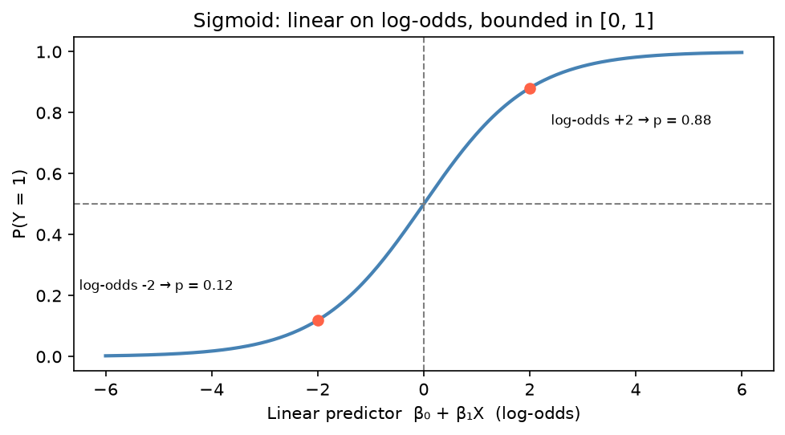

[Statistics](../README.md) › [迴歸分析](README.md) › 邏輯斯迴歸

# 邏輯斯迴歸 (Logistic Regression)

結果變數為**二元**（0/1、有病/沒病、存活/死亡）時使用。預測的是 **P(Y = 1)**，並透過轉換確保機率落在 0–1 之間。

這篇著重**統計建模與解讀**（log-odds、odds ratio、GLM）。其他角度：

- ML 分類工作流程：[ML: Logistic Regression](../../machine-learning/supervised-learning/classification/logistic-regression.md)
- statsmodels 套件輸出細節：[Statsmodels: Logistic Regression](../../machine-learning/packages/statsmodels/logistic-regression.md)

> **為什麼不用線性迴歸？** 直線會預測出 < 0 或 > 1 的「機率」。邏輯斯迴歸改為對 **log-odds** 建立線性模型，再用 sigmoid 轉回機率。

## 機率、勝算、對數勝算

| 尺度 | 公式 | 範圍 | 用途 |
| --- | --- | --- | --- |
| 機率 (probability) | p | [0, 1] | 最好溝通 |
| 勝算 (odds) | p / (1 − p) | [0, ∞) | 解讀係數（odds ratio） |
| 對數勝算 (log-odds / logit) | ln(p / (1 − p)) | (−∞, ∞) | **模型在這個尺度上是線性的** |

$$
\text{logit}(p) = \ln\frac{p}{1-p} = \beta_0 + \beta_1 X_1 + \cdots + \beta_k X_k
\qquad\Longleftrightarrow\qquad
p = \frac{1}{1 + e^{-(\beta_0 + \beta_1 X_1 + \cdots)}} \ \ \text{(sigmoid)}
$$

p = 0.5 ⇔ log-odds = 0。



曲線在 p = 0.5 附近最陡：同樣增加 1 單位 log-odds，在中段改變的機率最多，在兩端幾乎不變。所以係數的「機率效果」取決於起點，odds ratio 才是固定的。

## 作為廣義線性模型 (GLM)

| GLM 元件 | 邏輯斯迴歸的選擇 |
| --- | --- |
| 隨機成分（分配） | Bernoulli / Binomial |
| 系統成分 | 線性預測子 β₀ + β₁X₁ + … |
| 連結函數 (link) | logit |

以最大概似估計配適，負 log-likelihood 就是 ML 的 **binary cross-entropy / log loss**，見 [最大概似估計](../probability-and-distributions/maximum-likelihood.md#mle-與-ml-損失函數的對應)。其他 GLM（Poisson、負二項）見 [GLM 與計數模型](glm-count-models.md)。

## Python 範例

```python
import numpy as np
import pandas as pd
import statsmodels.formula.api as smf
from sklearn.datasets import load_breast_cancer

data = load_breast_cancer(as_frame=True)
df = data.frame.rename(columns=lambda c: c.replace(" ", "_"))
df["malignant"] = 1 - df["target"]          # 1 = 惡性

# statsmodels：統計推論（係數、SE、p、CI）
model = smf.logit("malignant ~ mean_radius + mean_texture", data=df).fit()
model.summary()

# Odds ratio 與 95% CI
or_table = np.exp(pd.concat([model.params, model.conf_int()], axis=1))
or_table.columns = ["OR", "2.5%", "97.5%"]

# 預測機率
model.predict(df.head())                     # 機率尺度
```

## 解讀係數：Odds Ratio

$$
\text{OR}_j = e^{\beta_j}
$$

| OR | 解讀 |
| --- | --- |
| = 1 | Xⱼ 與結果無關 |
| > 1 | Xⱼ 增加 → Y = 1 的**勝算**增加（危險因子） |
| < 1 | Xⱼ 增加 → 勝算降低（保護因子） |
| = 2 | Xⱼ 每增加 1 單位，勝算**變為 2 倍**（控制其他變數下） |

> - OR 是**勝算的倍數**，不是機率的倍數。結果罕見時（< 10%）OR ≈ 相對風險 (relative risk, RR)；結果常見時 OR 會誇大 RR。
> - 95% CI 包含 1 → 不顯著。
> - 想報機率的變化，用**邊際效果** `model.get_margeff().summary()` 或直接比較不同 X 下的預測機率。

### 由 2×2 表計算 OR

| | 結果 = 是 | 結果 = 否 |
| --- | --- | --- |
| 暴露 | a | b |
| 未暴露 | c | d |

$$
\text{OR} = \frac{ad}{bc}, \qquad SE_{\ln OR} = \sqrt{\tfrac1a + \tfrac1b + \tfrac1c + \tfrac1d}, \qquad 95\%\ CI = e^{\ln OR \pm 1.96\,SE}
$$

```python
a, b, c, d = 30, 10, 20, 40
or_ = a * d / (b * c)                              # 6.0
se = np.sqrt(1/a + 1/b + 1/c + 1/d)
np.exp(np.log(or_) + np.array([-1.96, 1.96]) * se)
```

流病中的病例對照研究 (case-control study) 只能估計 OR，不能估計 RR。

## 從機率到分類

預設門檻 0.5 只是慣例，應依偽陽性 / 偽陰性的**成本**決定。

| 優先 | 指標 | 例子 |
| --- | --- | --- |
| 避免偽陽性 | Precision | 垃圾郵件過濾 |
| 避免偽陰性 | Recall / Sensitivity | 癌症篩檢 |
| 兩者平衡 | F1 | 一般分類 |
| 不依賴門檻的排序能力 | AUC-ROC | 模型比較 |
| 預測機率準不準 | Calibration | 依風險做決策時 |

這部分的完整說明在 ML 筆記：[Confusion Metrics](../../machine-learning/evaluation/confusion-metrics.md)、[ROC / AUC](../../machine-learning/evaluation/roc-auc.md)、[Thresholds & Calibration](../../machine-learning/evaluation/classification-thresholds-and-calibration.md)、[Class Imbalance](../../machine-learning/evaluation/class-imbalance.md)。

> 類別不平衡時不要只看 accuracy：95% 都是 0 的資料，全猜 0 就有 95% accuracy。

## 模型配適指標

邏輯斯迴歸沒有一般的 R²：

| 指標 | 解讀 |
| --- | --- |
| Log-likelihood | 越大（越接近 0）越好 |
| AIC / BIC | 越小越好 |
| McFadden pseudo-R² = 1 − ℓ_model / ℓ_null | 0.2–0.4 已算很好（不能與 OLS 的 R² 直接比較） |
| 概似比檢定 (LRT) | 比較巢狀模型 |

```python
model.llf, model.aic, model.bic, model.prsquared   # prsquared = McFadden R²
```

## 假設

| 假設 | 檢查 |
| --- | --- |
| 二元結果 | Y ∈ {0, 1} |
| 觀測獨立 | 研究設計 |
| X 與 **log-odds** 線性 | Box-Tidwell、分箱後畫經驗 logit |
| 無嚴重共線性 | VIF |
| 樣本足夠 | 經驗法則：每個預測變數至少 10–20 個**事件**（較少那一類的數量） |
| 無極端影響點 | Cook's distance |

**不需要**：殘差常態、等變異、X 與 Y（機率）線性。

> **完全分離 (perfect separation)**：某個 X 能完美區分 0 與 1 時，係數會發散到無限大、SE 爆炸。常見於小樣本或高維資料（如基因）。解法：Firth 校正、正則化。

## 延伸模型

| 延伸 | 何時用 |
| --- | --- |
| 多項邏輯斯 (multinomial) | 3+ 個無序類別（`smf.mnlogit`） |
| 順序邏輯斯 (ordinal) | 3+ 個有序類別，如腫瘤分級（`OrderedModel`） |
| 正則化邏輯斯 (L1 / L2) | 預測變數多、防止過擬合；sklearn 預設就有 L2 |
| 類別權重 | 嚴重不平衡（`class_weight="balanced"`） |
| 混合效應邏輯斯 | 群集 / 重複量測的二元結果，見 [混合效應模型](mixed-effects-models.md) |

```python
from sklearn.linear_model import LogisticRegression

LogisticRegression(penalty="l2", C=1.0)                      # C 越小正則化越強
LogisticRegression(penalty="l1", solver="liblinear", C=1.0)  # 特徵選擇
LogisticRegression(class_weight="balanced")
```

## R 對照

| 功能 | R |
| --- | --- |
| 配適 | `glm(y ~ x, data = df, family = binomial)` |
| 預測 log-odds（預設！） | `predict(m, newdata)` |
| 預測機率 | `predict(m, newdata, type = "response")` |
| 畫邏輯斯曲線 | `geom_smooth(method = "glm", method.args = list(family = binomial))` |
| 混淆矩陣 | `yardstick::conf_mat()` |

> R 的 `predict(glm)` 預設回傳 **log-odds**，忘記加 `type = "response"` 是常見錯誤。用 `family = gaussian` 則等同線性迴歸，會預測出不可能的機率。
