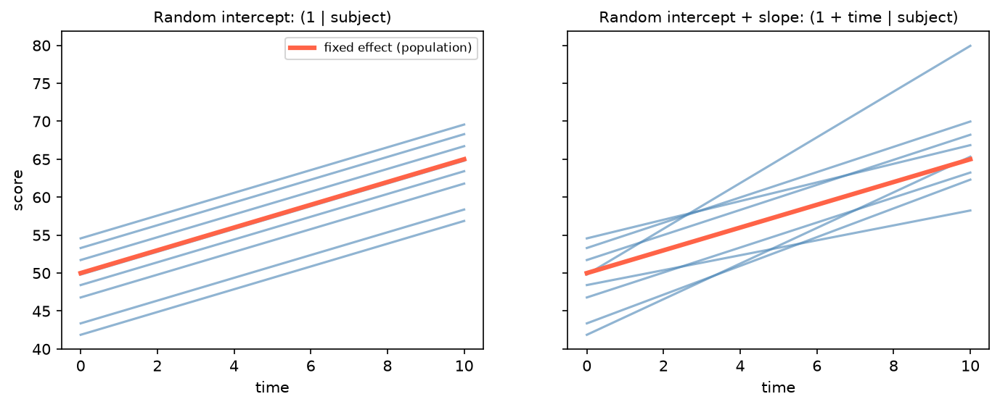

[Statistics](../README.md) › [迴歸分析](README.md) › 混合效應模型

# 混合效應模型 (Mixed-Effects Models)

資料有**群集或階層結構**時（同一病人多次量測、同一小鼠多個細胞、同一批次的樣本、同一醫院的病人），觀測值不獨立。混合效應模型 (linear mixed model, LMM；又稱多層次模型 multilevel / 階層模型 hierarchical model) 把這種相依性直接建進模型。

## 為什麼需要

| 做法 | 問題 |
| --- | --- |
| 忽略群集，當成獨立樣本 | **假重複 (pseudoreplication)**：SE 太小、p 值太小 |
| 每個群集先平均再分析 | 丟失資訊；各群集大小不同時權重不當 |
| 每個群集一個虛擬變數（固定效應） | 群集多時參數爆炸；無法推論到新群集 |
| **混合效應模型** | 估計群集間變異，並在群集間「借用資訊」 |

## 固定效應 vs 隨機效應

| | 固定效應 (fixed effect) | 隨機效應 (random effect) |
| --- | --- | --- |
| 關心的是 | 該變數**本身**的效果 | 群集間的**變異**有多大 |
| 水準 | 全部感興趣的水準都在資料中（處理 vs 對照） | 來自更大母體的隨機樣本（病人、批次、實驗室） |
| 估計 | 每個水準一個係數 | 估計一個變異數 σ²_group |
| 例子 | 藥物、劑量、時間、性別 | subject、batch、mouse、hospital |

$$
y_{ij} = \underbrace{\beta_0 + \beta_1 x_{ij}}_{\text{固定效應}} + \underbrace{u_{0j} + u_{1j} x_{ij}}_{\text{隨機效應}} + \varepsilon_{ij},
\qquad u_{0j} \sim N(0, \sigma^2_{u_0})
$$

| 結構 | 意義 | lme4 寫法 |
| --- | --- | --- |
| 隨機截距 (random intercept) | 每個群集有自己的基線 | `(1 \| subject)` |
| 隨機斜率 (random slope) | 每個群集對 x 的反應也不同 | `(1 + time \| subject)` |
| 巢套 (nested) | 細胞在小鼠內、小鼠在批次內 | `(1 \| batch/mouse)` |
| 交叉 (crossed) | 每個受試者看過每個刺激 | `(1 \| subject) + (1 \| item)` |



**收縮 (shrinkage / partial pooling)**：樣本少的群集，其估計值會被拉向整體平均，介於「完全合併」與「各自獨立」之間。這與 [貝氏階層模型](../bayesian-statistics/prior-distributions.md) 的概念相同。

## Python 範例

```python
import statsmodels.formula.api as smf

# 隨機截距：每位受試者基線不同
m1 = smf.mixedlm("score ~ time + treatment", data=df, groups=df["subject"]).fit()
m1.summary()            # Group Var = 受試者間變異 σ²_u

# 隨機截距 + 隨機斜率（每人隨時間變化的速率也不同）
m2 = smf.mixedlm("score ~ time * treatment", data=df, groups=df["subject"],
                 re_formula="~time").fit()

# 組內相關係數 ICC：總變異中有多少來自群集間差異
var_u = m1.cov_re.iloc[0, 0]
icc = var_u / (var_u + m1.scale)
```

R 的生態系更完整：

```r
library(lme4); library(lmerTest)          # lmerTest 提供 p 值
m <- lmer(score ~ time * treatment + (1 + time | subject), data = df)
glmer(y ~ treatment + (1 | batch), family = binomial, data = df)   # 廣義混合模型 GLMM
```

| ICC | 意義 |
| --- | --- |
| ≈ 0 | 群集內幾乎不相關，接近獨立 |
| 高 | 同群集的觀測非常相似 → 有效樣本數接近群集數，而非觀測數 |

## 何時用

| 情境 | 建議 |
| --- | --- |
| 重複量測，有缺失或時間不規則 | LMM 取代 [重複量數 ANOVA](../inferential-statistics/repeated-measures-anova.md) |
| 縱貫研究 (longitudinal)、成長曲線 | 隨機截距 + 隨機斜率 |
| 多中心試驗 | 中心為隨機效應 |
| 批次效應 | 批次多 → 隨機效應；批次少（2–3 個）→ 固定效應較穩 |
| 單細胞比較組別 | 細胞巢套在樣本內；或先 pseudobulk 再做 NB-GLM |
| 二元 / 計數結果 + 群集 | GLMM（`glmer`、`BinomialBayesMixedGLM`） |
| 只關心族群平均效果，不需個體預測 | GEE（`smf.gee`）也是選項 |
| RNA-seq paired / 重複量測 | subject 當 blocking factor，或 limma `duplicateCorrelation()` / `dream()`，見 [RNA-seq 實驗設計](../../../biology/genomics/workflows/rna-seq/06-exploratory-design-and-count-models.md#實驗設計-experimental-design) |
| QTL / GWAS 有親緣關係 | kinship 矩陣當隨機效應（GEMMA、BOLT-LMM），見 [QTL mapping](../../../biology/genomics/genome-wide-analysis/qtl-analysis-and-mapping.md#相關統計方法) |

## 注意事項

| 問題 | 說明 |
| --- | --- |
| 群集數太少（< 5–6） | 隨機效應變異估計不穩，改用固定效應 |
| 模型不收斂 / singular fit | 隨機效應結構太複雜，簡化（先拿掉隨機斜率的相關） |
| p 值 | 自由度不明確；R 用 `lmerTest`（Satterthwaite）或概似比檢定 |
| REML vs ML | 估計變異成分用 REML（預設）；比較**固定效應**不同的模型要用 ML |
