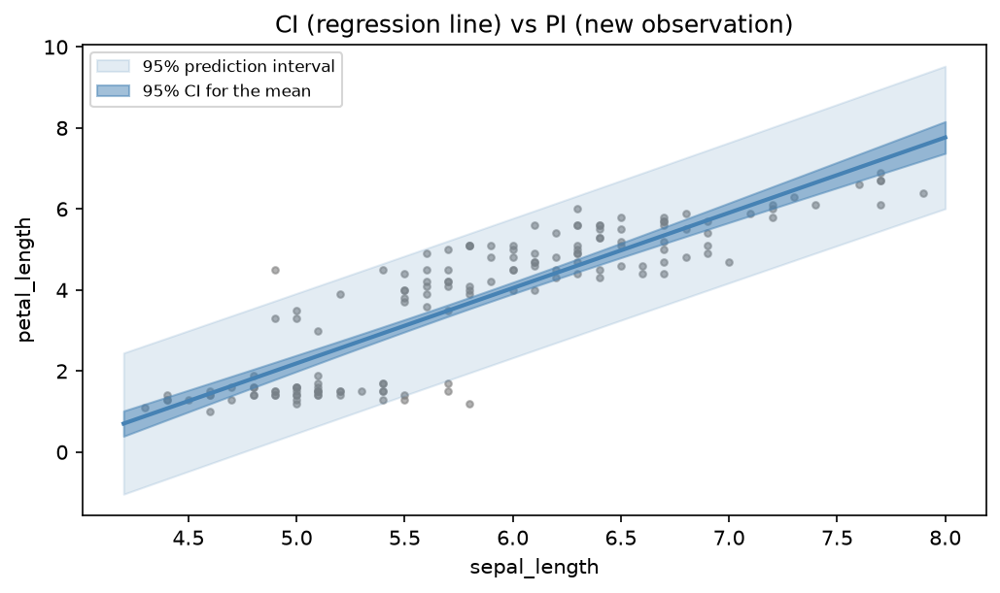
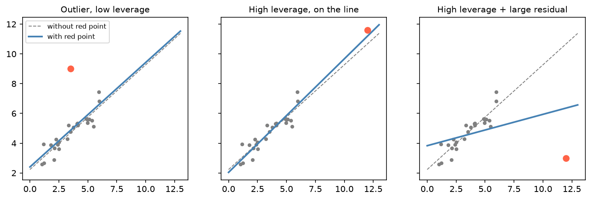

[Statistics](../README.md) › [迴歸分析](README.md) › 簡單線性迴歸

# 簡單線性迴歸 (Simple Linear Regression)

用一條直線描述**一個預測變數 X** 與**一個連續結果 Y** 的關係，是所有迴歸方法的基礎。建模前先用散布圖確認確實有線性趨勢。

$$
Y = \beta_0 + \beta_1 X + \varepsilon, \qquad \hat{Y} = \hat\beta_0 + \hat\beta_1 X
$$

| 符號 | 意義 |
| --- | --- |
| Y | 結果 / 反應變數 (response) |
| X | 預測 / 解釋變數 (predictor) |
| β₀ 截距 (intercept) | X = 0 時 Y 的預測值（常無實際意義） |
| β₁ 斜率 (slope) | X 增加 1 單位，Y **平均**改變多少 |
| ε 誤差 (error) | X 無法解釋的部分；樣本中的估計值稱為殘差 (residual) |

> **「線性」是指對參數線性**，不是 X 與 Y 一定是直線。$Y = \beta_0 + \beta_1 X + \beta_2 X^2$ 仍是線性模型；$Y = \beta_0 + e^{\beta_1 X}$ 則不是。所以多項式、log 轉換後的特徵都能用線性模型的工具。

## 最小平方法 (Ordinary Least Squares, OLS)

找出讓**殘差平方和**最小的直線：

$$
\min \sum (Y_i - \hat{Y}_i)^2
\quad\Rightarrow\quad
\hat\beta_1 = \frac{\sum (X_i-\bar{X})(Y_i-\bar{Y})}{\sum (X_i-\bar{X})^2} = r \cdot \frac{s_Y}{s_X}, \qquad
\hat\beta_0 = \bar{Y} - \hat\beta_1 \bar{X}
$$

- 斜率與 [Pearson r](../descriptive-statistics/bivariate.md) 直接相關：r = 0 → 斜率 = 0。
- 誤差為常態時，OLS = [最大概似估計](../probability-and-distributions/maximum-likelihood.md)，也就是 ML 的 **MSE loss**。

## Python 範例

```python
import pandas as pd
import statsmodels.formula.api as smf
from sklearn.datasets import load_iris
from sklearn.linear_model import LinearRegression

df = load_iris(as_frame=True).frame
df.columns = ["sepal_length", "sepal_width", "petal_length", "petal_width", "target"]

# statsmodels：完整統計推論（SE、t、p、CI）
model = smf.ols("petal_length ~ sepal_length", data=df).fit()
model.summary()
model.params, model.conf_int(), model.rsquared

# scikit-learn：ML 工作流程（只有係數，沒有 p 值）
lr = LinearRegression().fit(df[["sepal_length"]], df["petal_length"])
lr.intercept_, lr.coef_, lr.score(df[["sepal_length"]], df["petal_length"])
```

| 項目 | 值 | 解讀 |
| --- | --- | --- |
| Intercept | −7.101 | 花萼長 0 cm 時的預測值（不合理，不解讀） |
| sepal_length | 1.858 | 花萼每長 1 cm，花瓣平均長 1.858 cm |
| R² | 0.760 | 花瓣長度 76% 的變異可由花萼長度解釋 |
| p-value | < 0.001 | 斜率顯著不為 0 |

> 「與…有關 (associated with)」≠「造成 (causes)」。

## 模型配適

$$
R^2 = 1 - \frac{SS_{res}}{SS_{tot}} = 1 - \frac{\sum (Y_i-\hat{Y}_i)^2}{\sum (Y_i-\bar{Y})^2}
$$

| 指標 | 意義 |
| --- | --- |
| R² | Y 的變異中被模型解釋的比例；簡單迴歸中 R² = r² |
| 殘差標準誤 (residual standard error, σ̂) | 典型的預測誤差大小，**單位與 Y 相同**（≈ RMSE） |

R² 的參考：物理科學常 > 0.7，社會 / 生物科學 0.3–0.6 很常見。R² = 1 在真實資料中通常是 bug 或資料洩漏。

> R² 只描述解釋比例，不告訴你假設是否成立。兩個模型 R² 相近，實際誤差大小（σ̂）可能差很多。

## 假設：LINE（針對殘差）

| 假設 | 檢查 | 違反的後果 |
| --- | --- | --- |
| **L**inearity 線性 | 殘差 vs 配適值圖無曲線 | 係數有偏 |
| **I**ndependence 獨立 | 研究設計、Durbin-Watson | SE 失準、p 值太小 |
| **N**ormality 殘差常態 | 殘差 Q–Q 圖 | 小樣本時 CI / p 值失準（大樣本影響小） |
| **E**qual variance 等變異 | 殘差 vs 配適值圖無漏斗形 | SE 失準 → 用 robust SE（`cov_type="HC3"`） |

```python
import matplotlib.pyplot as plt
import scipy.stats as stats
import numpy as np

fitted, resid = model.fittedvalues, model.resid
fig, ax = plt.subplots(1, 3, figsize=(15, 4))
ax[0].scatter(fitted, resid, alpha=0.5); ax[0].axhline(0, color="red", ls="--")
ax[0].set_title("Residuals vs Fitted")                       # 曲線 → 非線性；漏斗 → 變異不等
stats.probplot(resid, dist="norm", plot=ax[1])                # 偏離對角線 → 非常態
ax[2].scatter(fitted, np.sqrt(np.abs(model.get_influence().resid_studentized_internal)), alpha=0.5)
ax[2].set_title("Scale-Location")                             # 上升趨勢 → 變異隨配適值增加
plt.tight_layout(); plt.show()
```

## 信賴區間 vs 預測區間

| 區間 | 回答 | 寬度 |
| --- | --- | --- |
| 平均數的信賴區間 (CI for the mean) | 在這個 X，**迴歸線（平均 Y）**在哪？ | 窄 |
| 預測區間 (prediction interval) | 在這個 X，**一個新個體**的 Y 會落在哪？ | 寬（多了個體雜訊） |



兩條帶子都在 X 平均處最窄、往兩端變寬；即使 n → ∞，CI 會縮到迴歸線上，PI 仍至少有 ±1.96σ 寬。

```python
new = pd.DataFrame({"sepal_length": [5.0, 6.0, 7.0]})
model.get_prediction(new).summary_frame(alpha=0.05)
# mean, mean_ci_lower/upper（CI）, obs_ci_lower/upper（PI）
```

> 預測個體結果時，預測區間才是誠實的不確定性。**不要外插 (extrapolation)**：X 超出訓練資料範圍時預測不可信。

## 影響點 (Influence)

| 概念 | 意義 |
| --- | --- |
| 槓桿 (leverage) | X 值不尋常 |
| 影響力 (influence) | 移除這點後迴歸線明顯改變（Cook's distance） |

高槓桿本身不一定是問題；高槓桿 + 大殘差才會把線拉走。



```python
infl = model.get_influence().summary_frame()
infl[["hat_diag", "cooks_d"]].sort_values("cooks_d", ascending=False).head()
```

## 趨中迴歸 (Regression to the Mean)

極端的觀測值常含較大的隨機成分，再量一次時會自然往平均靠攏，**即使沒有任何介入**。例如挑出血壓最高的病人，下次量測平均會下降。不要把這種改善誤認為處理效果，需要 [對照組](../experimental-design/principles.md)。

## R 對照

| 功能 | R |
| --- | --- |
| 配適 | `lm(y ~ x, data = df)` |
| 新資料預測 / 訓練資料配適值 / 殘差 | `predict(m, newdata)` / `fitted(m)` / `residuals(m)` |
| 整潔輸出 | `broom::tidy(m)`（係數）、`glance(m)`（R²、σ、AIC）、`augment(m)`（每列 .fitted、.resid、.cooksd） |

> 觀測值 = 配適值 + 殘差 (response = fitted + residual)。
